# Angel / Atlas 2016 metrics on GISD30 · 35 Swedish cities, 1990-2020

[På svenska](REPORT_sv.md)

Exploratory. The whole report, every number and every label included, is generated by `scripts/06_reporte.R` from `outputs/angel/resumen.csv` (step 04b). Run of 2026-11-04.

**Question:** how is each city growing, and how much does it change the picture to count the *fringe open space* (the 100 m ring of unbuilt land around urban and suburban built-up) as part of the city?

## Contents

1. [Summary](#summary)
2. [Method](#method)
3. [Sweden](#sweden)
4. [Cities](#cities): [Stockholm](#stockholm) · [Göteborg](#göteborg) · [Malmö](#malmö) · [Uppsala](#uppsala) · [Västerås](#västerås) · [Örebro](#örebro) · [Linköping](#linköping) · [Helsingborg](#helsingborg) · [Jönköping](#jönköping) · [Norrköping](#norrköping) · [Lund](#lund) · [Umeå](#umeå) · [Gävle](#gävle) · [Södertälje](#södertälje) · [Borås](#borås) · [Halmstad](#halmstad) · [Växjö](#växjö) · [Eskilstuna](#eskilstuna) · [Karlstad](#karlstad) · [Sundsvall](#sundsvall) · [Östersund](#östersund) · [Trollhättan](#trollhättan) · [Luleå](#luleå) · [Borlänge](#borlänge) · [Kalmar](#kalmar) · [Kristianstad](#kristianstad) · [Skövde](#skövde) · [Falun](#falun) · [Nyköping](#nyköping) · [Karlskrona](#karlskrona) · [Skellefteå](#skellefteå) · [Varberg](#varberg) · [Uddevalla](#uddevalla) · [Åkersberga](#åkersberga) · [Landskrona](#landskrona)

## Summary

Across the 35 cities, built-up land inside the urban extent grew from 662 km² in 1990 to 1,051 km² in 2020 (1.55 % a year); without Stockholm, from 546 to 816 km² (1.35 % a year). The fringe open space is 41.7 % of the total urban extent in 2020, and between 29.5 % and 57.1 % city by city. Counting it adds 42-133 % to the area of each city, and moves its 1990-2020 growth rate by less than 0.2 points a year in 20 of the 35.

## Method

### Data

- **GISD30** (Zhang et al. 2022, *Earth System Science Data* 14:1831-1856, CC BY 4.0): global impervious surface at 30 m from Landsat. Each pixel stores the period of its first detection: 0 never, 1 before 1985, 2-8 five-year periods 1985-2020. The record is cumulative: a pixel never stops being built.
- **Decades** (`01_gisd30_decadas.R`): built-up by 1990 = values 1-2, by 2000 = 1-4, by 2010 = 1-6, by 2020 = 1-8.
- **City boundaries** (`07_limites_aglomerados.R`): Statistics Sweden (SCB) statistical *tätorter* 2020 (open geodata). A tätort is a continuous built-up area of at least 200 inhabitants with houses no more than 200 m apart.
- **Boxes** (`cajas.md`): the tätort's bounding box plus 10 km on every side, so the 1 km² neighbourhood never runs out of data at the edge of the city.
- Each box is reprojected to its UTM zone at 30 m (nearest neighbour) so that distances are metric.

### Classes

Each 30 m pixel looks at the circle of 1 km² around it (radius 564 m) and the share of that circle that is built-up. Rural cut used here: **0.25** (Atlas 2016 edition).

| Value | Class | Rule | In the urban extent? |
|---|---|---|---|
| 0 | rural open space | not built-up, none of the below | no |
| 1 | urban built-up | built-up, circle > 50 % built | yes |
| 2 | suburban built-up | built-up, circle 25-50 % built | yes |
| 3 | rural built-up | built-up, circle < 25 % built | no |
| 4 | fringe open space | not built-up, within 100 m of urban or suburban built-up | yes |
| 5 | captured open space | open patch (4-connected) under 200 ha, fully enclosed, not touching the box edge | yes |

**Urban extent** = urban + suburban + fringe + captured.

#### How the fringe is drawn

A 100 m circle on the 30 m grid is centred on every urban and suburban pixel; every pixel that is not built-up and falls inside one of those circles is fringe. On the grid the circle reaches 3 pixels straight out (90 m) and 85-95 m on the diagonals. Rural built-up pixels do not make fringe. Captured open space is assigned after the fringe, so the two never overlap.

Because each built edge brings its own ring, the fringe grows with the *length of the city's edge*, not with its area: fragmented cities carry the most fringe, and a city that builds on its old fringe loses fringe as it grows.

### "The city"

Inside each box, the city is the set of urban-extent patches (8-connected) that touch the tätort boundary. A town inside the box that never touches the boundary is left out; a neighbouring town whose extent grows into the city's (the fringe is enough) counts with it.

When one patch touches the tätorter of two cities, each of its pixels goes to the nearer boundary. It applies here to: Stockholm, Malmö, Helsingborg, Lund, Södertälje, Borlänge, Falun, Åkersberga, Landskrona.

### Metrics

| Metric | Definition |
|---|---|
| built-up | built-up pixels inside the city's urban extent |
| saturation | built-up / urban extent |
| openness | average unbuilt share of the 1 km² circle around the city's urban and suburban pixels |
| fringe share | fringe open space / urban extent |
| growth | annual compound rate, (x1 / x0)^(1 / years) - 1 |
| 2007 footprint | the Angel, Parent & Civco 2007 definition (rural cut 0.10): built-up with ≥ 10 % of its circle built, plus unbuilt pixels with > 50 % built around them or within 100 m of that built-up; patches touching the boundary |

### Rules used to describe the cities

- **Pace** (built-up growth 1990-2020 per year): very fast ≥ 4 %, fast ≥ 2.5 %, moderate ≥ 1.5 %, slow < 1.5 %.
- **Shape** (saturation change 1990-2020): filling in ≥ +0.03, spreading out ≤ -0.03, stable in between.
- **Check**: built-up growth ≥ 4 % a year is flagged for review against GHSL or imagery.

### Caveats

- **GISD30 is the only input.** Its 1985-2000 detection is the weakest of the series (few Landsat 5 scenes), so part of the post-2000 acceleration may come from the data. At Swedish latitudes snow cover, low sun and clouds cut the number of usable scenes, and low-density housing among trees may be under-detected at 30 m.
- **Water counts as open space.** GISD30 has no water mask, so shores and coasts next to the city become fringe or captured open space. This weighs heavily in Sweden (Mälaren, the archipelagos, Göta älv). The Atlas removes water from open space; this pipeline does not yet.
- **The tätort boundary is from 2020.** It decides which patches are "the city" in all four years; it is not used to cut pixels.
- **Proximity is not reported**: measured to the centroid it says little about the city's shape.
- **Rural cut**: the Atlas 2016 edition puts suburban at 25-50 %; the 2007 definition uses 10 %, so its footprint is larger than the extent measured here.
- **No density yet**: it needs population per grid cell (the SCB population grid is the natural next step).

### Pipeline (`scripts/`)

| Step | Script | What it does |
|---|---|---|
| 00 | `00_gisd30_descarga.R` | GISD30 tiles for Sweden (Zenodo, md5 checked) |
| 01 | `01_gisd30_decadas.R` | eight five-year epochs to four cumulative decades |
| 07 | `07_limites_aglomerados.R` | SCB tätorter 2020 for the chosen cities, and their boxes in `cajas.md` |
| 04b | `04b_angel_sin_landsat.R` | Angel classes and metrics per decade, GISD30 cut with each box |
| 06 | `06_reporte.R` | this report, in English and Swedish |
| 08 | `08_sitio.R` | the same results as a GitHub Pages site |

## Sweden

### Totals

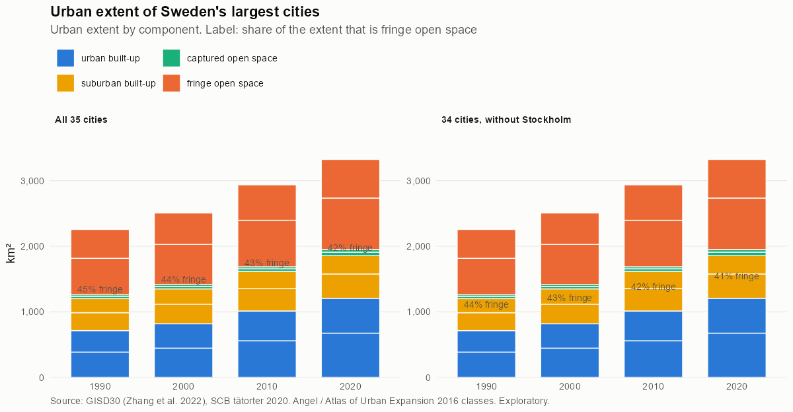

#### All 35 cities (km²)

|  | urban built-up | suburban built-up | captured open space | fringe open space | extent | % fringe | built-up |
|---|---|---|---|---|---|---|---|
| 1990 | 384.7 | 273.1 | 34.7 | 555.8 | 1,248.2 | 44.5 | 662.1 |
| 2000 | 445.1 | 299.2 | 37.8 | 613.8 | 1,395.8 | 44.0 | 749.0 |
| 2010 | 557.8 | 341.8 | 41.6 | 709.8 | 1,651.0 | 43.0 | 904.4 |
| 2020 | 674.4 | 370.6 | 53.6 | 785.2 | 1,883.8 | 41.7 | 1,050.9 |

#### 34 cities, without Stockholm (km²)

|  | urban built-up | suburban built-up | captured open space | fringe open space | extent | % fringe | built-up |
|---|---|---|---|---|---|---|---|
| 1990 | 328.7 | 214.1 | 24.5 | 440.8 | 1,008.1 | 43.7 | 546.1 |
| 2000 | 372.2 | 233.3 | 26.2 | 479.8 | 1,111.6 | 43.2 | 608.8 |
| 2010 | 454.5 | 261.1 | 30.2 | 540.6 | 1,286.3 | 42.0 | 719.2 |
| 2020 | 531.7 | 279.4 | 40.0 | 589.7 | 1,440.8 | 40.9 | 815.5 |

Annual growth 1990-2020: built-up 1.55 %, extent without fringe 1.55 %, extent with fringe 1.38 % (all 35); 1.35, 1.36 and 1.20 % without Stockholm.

### How each city is growing

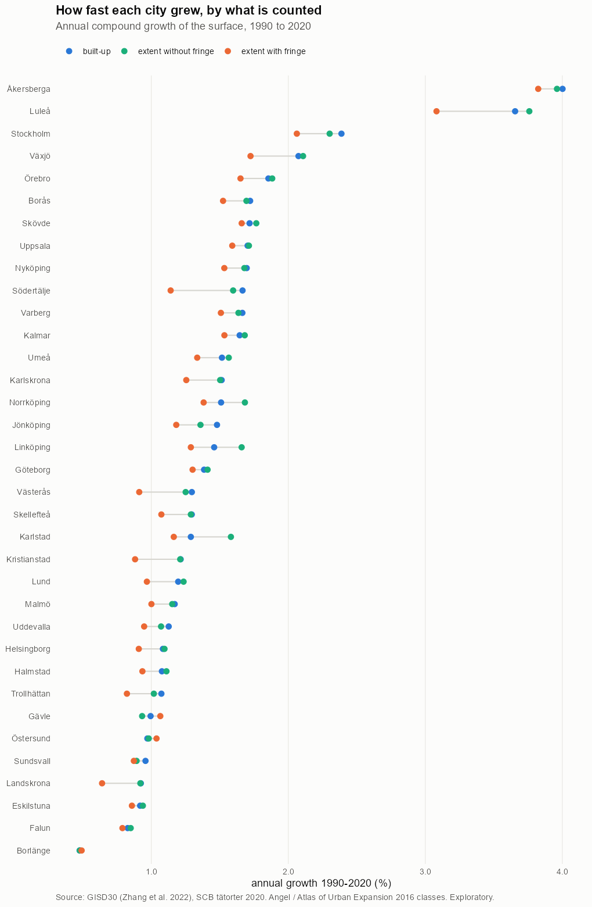

| Pace | Cities |
|---|---|
| **very fast** | [Åkersberga](#åkersberga) |
| **fast** | [Luleå](#luleå) |
| **moderate** | [Stockholm](#stockholm), [Uppsala](#uppsala), [Örebro](#örebro), [Norrköping](#norrköping), [Umeå](#umeå), [Södertälje](#södertälje), [Borås](#borås), [Växjö](#växjö), [Kalmar](#kalmar), [Skövde](#skövde), [Nyköping](#nyköping), [Karlskrona](#karlskrona), [Varberg](#varberg) |
| **slow** | [Göteborg](#göteborg), [Malmö](#malmö), [Västerås](#västerås), [Linköping](#linköping), [Helsingborg](#helsingborg), [Jönköping](#jönköping), [Lund](#lund), [Gävle](#gävle), [Halmstad](#halmstad), [Eskilstuna](#eskilstuna), [Karlstad](#karlstad), [Sundsvall](#sundsvall), [Östersund](#östersund), [Trollhättan](#trollhättan), [Borlänge](#borlänge), [Kristianstad](#kristianstad), [Falun](#falun), [Skellefteå](#skellefteå), [Uddevalla](#uddevalla), [Landskrona](#landskrona) |

| Shape | Cities |
|---|---|
| **filling in** | [Stockholm](#stockholm), [Malmö](#malmö), [Västerås](#västerås), [Örebro](#örebro), [Helsingborg](#helsingborg), [Jönköping](#jönköping), [Lund](#lund), [Södertälje](#södertälje), [Växjö](#växjö), [Trollhättan](#trollhättan), [Luleå](#luleå), [Kristianstad](#kristianstad), [Karlskrona](#karlskrona), [Skellefteå](#skellefteå), [Landskrona](#landskrona) |
| **stable** | [Göteborg](#göteborg), [Uppsala](#uppsala), [Linköping](#linköping), [Norrköping](#norrköping), [Umeå](#umeå), [Gävle](#gävle), [Borås](#borås), [Halmstad](#halmstad), [Eskilstuna](#eskilstuna), [Karlstad](#karlstad), [Sundsvall](#sundsvall), [Östersund](#östersund), [Borlänge](#borlänge), [Kalmar](#kalmar), [Skövde](#skövde), [Falun](#falun), [Nyköping](#nyköping), [Varberg](#varberg), [Uddevalla](#uddevalla), [Åkersberga](#åkersberga) |
| **spreading out** | none |

**To check** (built-up ≥ 4 % a year, see the caveats): [Åkersberga](#åkersberga).

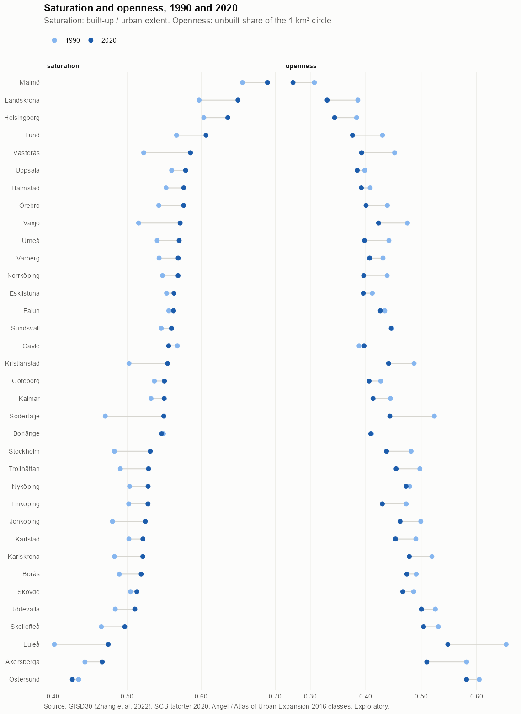

### How much the fringe open space matters

#### On the size of the city

In 2020 the fringe is between 29.5 % and 57.1 % of the urban extent; counting it adds 42-133 % to the area of everything else. Anything divided by the urban extent (population density, share of the city in a given condition) moves by that much depending on whether the fringe is in.

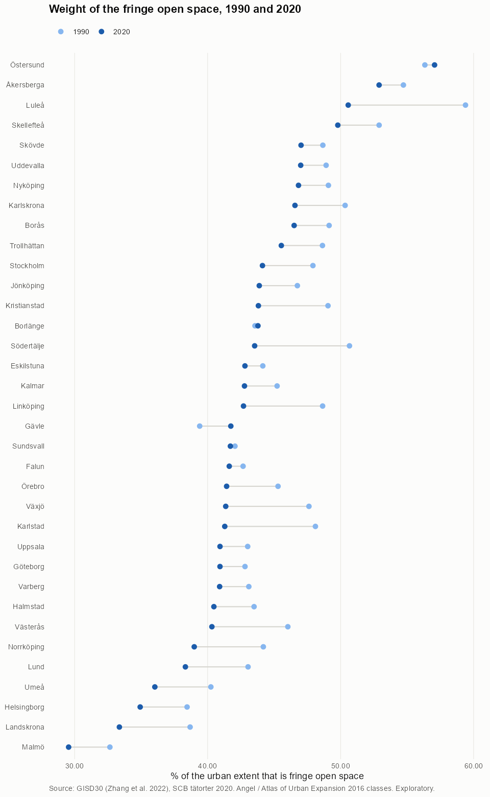

#### On growth

Counting the fringe moves the 1990-2020 growth rate by less than 0.2 points a year in 20 of the 35 cities. It lowers growth most where the city fills in its old fringe ([Luleå](#luleå), [Södertälje](#södertälje), [Karlstad](#karlstad)) and raises it most where new scattered patches add new fringe ([Gävle](#gävle), [Östersund](#östersund), [Borlänge](#borlänge)).

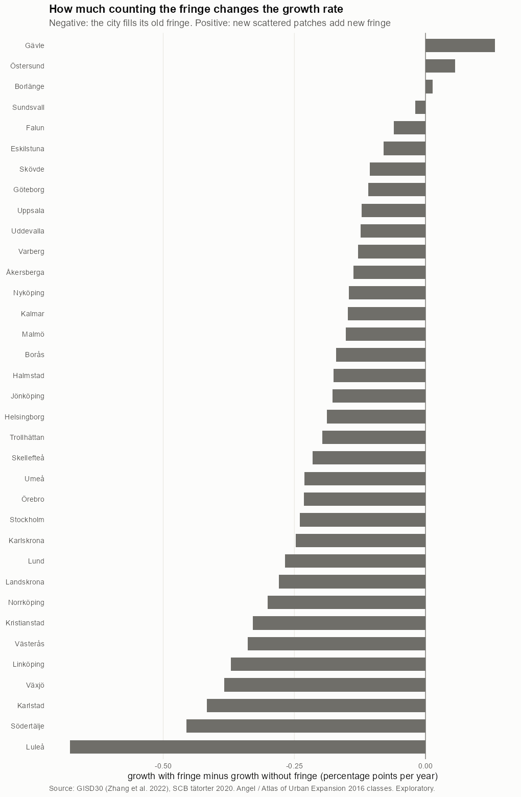

### All cities

Growth in % per year, 1990-2020. Extent in km², 2020. Population: tätort 2020 (SCB).

| City | County | population | extent 2020 | built-up | without fringe | with fringe | difference | % fringe 2020 | saturation | pace | shape |
|---|---|---|---|---|---|---|---|---|---|---|---|
| [Stockholm](#stockholm) | Stockholm | 1,617,407 | 443.0 | 2.39 | 2.30 | 2.06 | -0.24 | 44.1 | 0.48 → 0.53 | moderate | filling in |
| [Göteborg](#göteborg) | Västra Götaland | 607,882 | 228.9 | 1.39 | 1.41 | 1.30 | -0.11 | 40.9 | 0.54 → 0.55 | slow | stable |
| [Malmö](#malmö) | Skåne | 325,069 | 117.4 | 1.17 | 1.15 | 1.00 | -0.15 | 29.5 | 0.66 → 0.69 | slow | filling in |
| [Uppsala](#uppsala) | Uppsala | 166,698 | 47.6 | 1.70 | 1.71 | 1.59 | -0.12 | 40.9 | 0.56 → 0.58 | moderate | stable |
| [Västerås](#västerås) | Västmanland | 128,660 | 56.6 | 1.30 | 1.25 | 0.91 | -0.34 | 40.3 | 0.52 → 0.59 | slow | filling in |
| [Örebro](#örebro) | Örebro | 126,604 | 52.1 | 1.85 | 1.88 | 1.65 | -0.23 | 41.4 | 0.54 → 0.58 | moderate | filling in |
| [Linköping](#linköping) | Östergötland | 115,682 | 51.9 | 1.46 | 1.66 | 1.29 | -0.37 | 42.7 | 0.50 → 0.53 | slow | stable |
| [Helsingborg](#helsingborg) | Skåne | 113,828 | 55.0 | 1.08 | 1.10 | 0.91 | -0.19 | 34.9 | 0.60 → 0.64 | slow | filling in |
| [Jönköping](#jönköping) | Jönköping | 100,579 | 37.3 | 1.48 | 1.36 | 1.18 | -0.18 | 43.9 | 0.48 → 0.52 | slow | filling in |
| [Norrköping](#norrköping) | Östergötland | 98,088 | 46.7 | 1.51 | 1.68 | 1.38 | -0.30 | 39.0 | 0.55 → 0.57 | moderate | stable |
| [Lund](#lund) | Skåne | 94,393 | 32.6 | 1.20 | 1.24 | 0.97 | -0.27 | 38.3 | 0.57 → 0.61 | slow | filling in |
| [Umeå](#umeå) | Västerbotten | 91,916 | 46.8 | 1.52 | 1.57 | 1.33 | -0.23 | 36.0 | 0.54 → 0.57 | moderate | stable |
| [Gävle](#gävle) | Gävleborg | 79,004 | 61.2 | 0.99 | 0.93 | 1.07 | +0.13 | 41.7 | 0.57 → 0.56 | slow | stable |
| [Södertälje](#södertälje) | Stockholm | 76,320 | 33.9 | 1.67 | 1.60 | 1.14 | -0.46 | 43.5 | 0.47 → 0.55 | moderate | filling in |
| [Borås](#borås) | Västra Götaland | 74,042 | 30.8 | 1.72 | 1.69 | 1.52 | -0.17 | 46.5 | 0.49 → 0.52 | moderate | stable |
| [Halmstad](#halmstad) | Halland | 71,422 | 42.3 | 1.08 | 1.11 | 0.93 | -0.18 | 40.5 | 0.55 → 0.58 | slow | stable |
| [Växjö](#växjö) | Kronoberg | 71,282 | 35.2 | 2.07 | 2.11 | 1.72 | -0.38 | 41.4 | 0.52 → 0.57 | moderate | filling in |
| [Eskilstuna](#eskilstuna) | Södermanland | 69,948 | 25.9 | 0.92 | 0.94 | 0.86 | -0.08 | 42.8 | 0.55 → 0.56 | slow | stable |
| [Karlstad](#karlstad) | Värmland | 67,122 | 36.1 | 1.29 | 1.58 | 1.16 | -0.42 | 41.3 | 0.50 → 0.52 | slow | stable |
| [Sundsvall](#sundsvall) | Västernorrland | 58,813 | 60.9 | 0.96 | 0.89 | 0.87 | -0.02 | 41.7 | 0.55 → 0.56 | slow | stable |
| [Östersund](#östersund) | Jämtland | 52,980 | 8.0 | 0.97 | 0.98 | 1.04 | +0.06 | 57.1 | 0.43 → 0.43 | slow | stable |
| [Trollhättan](#trollhättan) | Västra Götaland | 50,502 | 26.5 | 1.07 | 1.02 | 0.82 | -0.20 | 45.5 | 0.49 → 0.53 | slow | filling in |
| [Luleå](#luleå) | Norrbotten | 49,123 | 26.3 | 3.66 | 3.76 | 3.08 | -0.68 | 50.6 | 0.40 → 0.47 | fast | filling in |
| [Borlänge](#borlänge) | Dalarna | 44,898 | 38.3 | 0.48 | 0.48 | 0.49 | +0.01 | 43.8 | 0.55 → 0.55 | slow | stable |
| [Kalmar](#kalmar) | Kalmar | 41,852 | 27.3 | 1.64 | 1.68 | 1.53 | -0.15 | 42.8 | 0.53 → 0.55 | moderate | stable |
| [Kristianstad](#kristianstad) | Skåne | 41,299 | 24.8 | 1.21 | 1.21 | 0.88 | -0.33 | 43.8 | 0.50 → 0.55 | slow | filling in |
| [Skövde](#skövde) | Västra Götaland | 39,580 | 22.4 | 1.72 | 1.77 | 1.66 | -0.11 | 47.0 | 0.50 → 0.51 | moderate | stable |
| [Falun](#falun) | Dalarna | 39,492 | 30.5 | 0.83 | 0.85 | 0.79 | -0.06 | 41.6 | 0.56 → 0.56 | slow | stable |
| [Nyköping](#nyköping) | Södermanland | 38,780 | 19.0 | 1.70 | 1.68 | 1.53 | -0.15 | 46.8 | 0.50 → 0.53 | moderate | stable |
| [Karlskrona](#karlskrona) | Blekinge | 36,904 | 21.0 | 1.51 | 1.50 | 1.26 | -0.25 | 46.6 | 0.48 → 0.52 | moderate | filling in |
| [Skellefteå](#skellefteå) | Västerbotten | 36,388 | 21.9 | 1.30 | 1.29 | 1.07 | -0.22 | 49.8 | 0.47 → 0.50 | slow | filling in |
| [Varberg](#varberg) | Halland | 36,327 | 23.3 | 1.66 | 1.64 | 1.51 | -0.13 | 40.9 | 0.54 → 0.57 | moderate | stable |
| [Uddevalla](#uddevalla) | Västra Götaland | 35,916 | 21.7 | 1.13 | 1.07 | 0.95 | -0.12 | 47.0 | 0.48 → 0.51 | slow | stable |
| [Åkersberga](#åkersberga) | Stockholm | 35,747 | 12.4 | 4.00 | 3.96 | 3.82 | -0.14 | 52.9 | 0.44 → 0.47 | very fast | stable |
| [Landskrona](#landskrona) | Skåne | 33,466 | 18.0 | 0.92 | 0.92 | 0.64 | -0.28 | 33.4 | 0.60 → 0.65 | slow | filling in |

## Cities

### Stockholm

County: Stockholm. Tätort population 2020 (SCB): 1,617,407.

Built-up land in the city's urban extent grew from **116.0 km²** in 1990 to **235.4 km²** in 2020, **2.39 % a year** (pace: **moderate**). The urban extent went from 240.1 to 443.0 km². Saturation moved from 0.48 to 0.53 (shape: **filling in**).

The fringe open space was 47.9 % of the urban extent in 1990 and 44.1 % in 2020; in 2020 it adds 79 % to the rest of the extent. Counting it changes the 1990-2020 growth rate from 2.30 % to 2.06 % a year (-0.24 points).

#### Growth by class

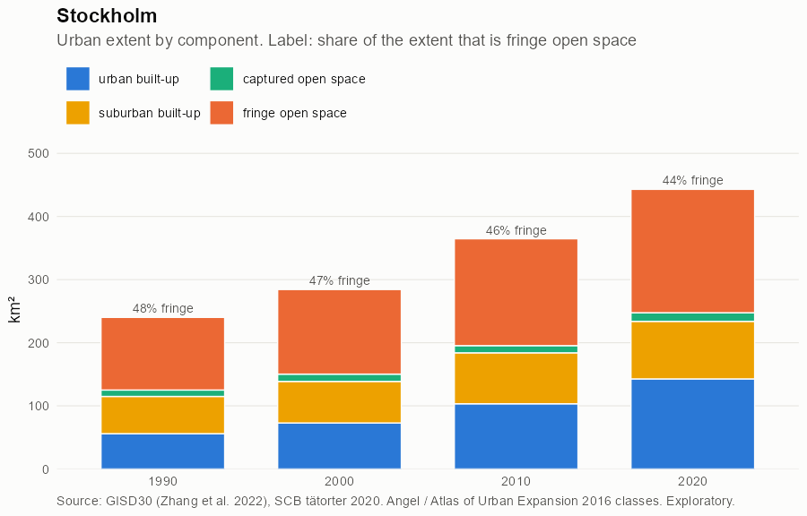

|  | urban built-up | suburban built-up | captured open space | fringe open space | extent | % fringe | built-up | saturation | openness | 2007 footprint |
|---|---|---|---|---|---|---|---|---|---|---|
| 1990 | 55.9 | 59.0 | 10.2 | 115.1 | 240.1 | 47.9 | 116.0 | 0.48 | 0.48 | 375.4 |
| 2000 | 72.9 | 65.9 | 11.5 | 134.0 | 284.3 | 47.1 | 140.2 | 0.49 | 0.47 | 435.7 |
| 2010 | 103.3 | 80.7 | 11.4 | 169.3 | 364.7 | 46.4 | 185.2 | 0.51 | 0.46 | 507.8 |
| 2020 | 142.7 | 91.2 | 13.6 | 195.5 | 443.0 | 44.1 | 235.4 | 0.53 | 0.44 | 573.4 |

km². Rural built-up and rural open space lie outside the urban extent; they appear on the maps.

#### Growth by decade

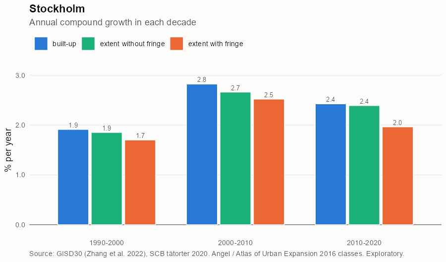

| Decade | built-up | extent without fringe | extent with fringe |
|---|---|---|---|
| 1990-2000 | 1.91 | 1.85 | 1.70 |
| 2000-2010 | 2.82 | 2.66 | 2.52 |
| 2010-2020 | 2.43 | 2.39 | 1.96 |

% per year.

#### Maps

<table>
<tr><td><a href="img/maps/stockholm_1990.png">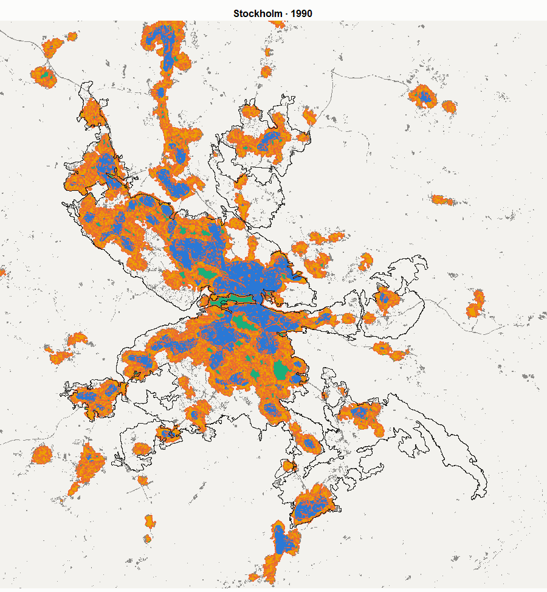</a></td><td><a href="img/maps/stockholm_2000.png">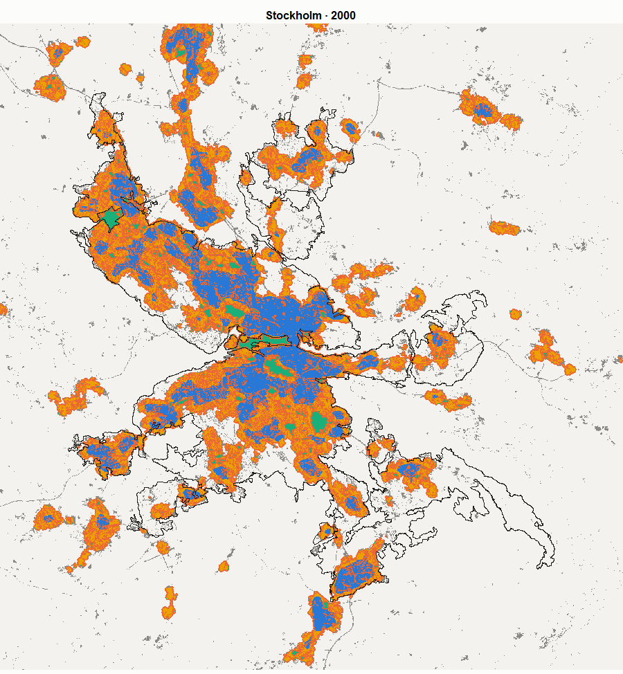</a></td></tr>
<tr><td><a href="img/maps/stockholm_2010.png">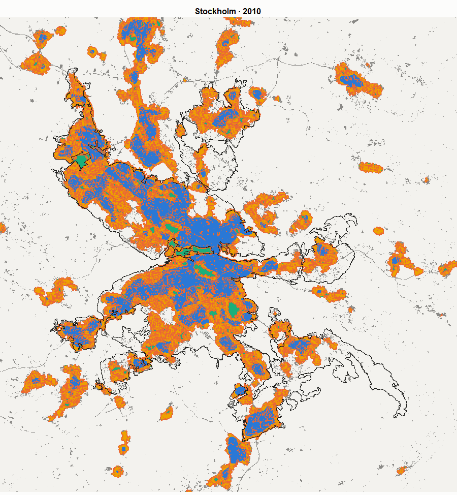</a></td><td><a href="img/maps/stockholm_2020.png">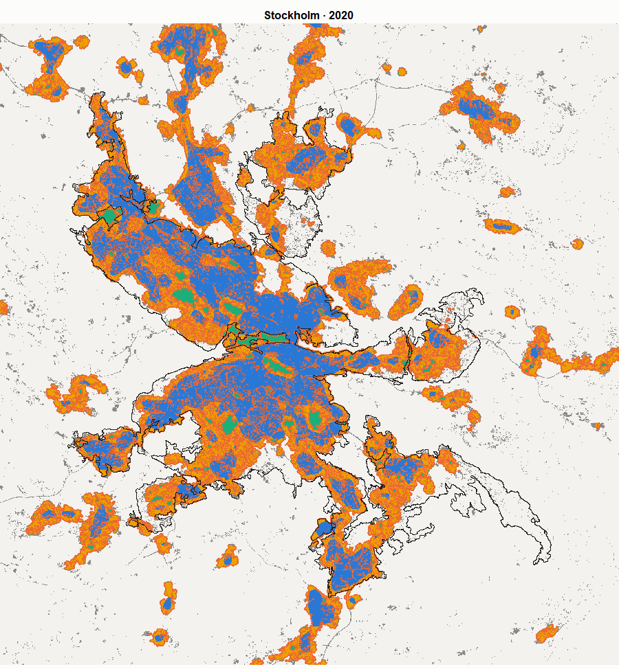</a></td></tr>
</table>

Maps are framed on the tätort plus 5 km; the metrics use the larger box of `cajas.md` (slug `stockholm`).

[Back to contents](#contents)

### Göteborg

County: Västra Götaland. Tätort population 2020 (SCB): 607,882.

Built-up land in the city's urban extent grew from **83.4 km²** in 1990 to **126.0 km²** in 2020, **1.39 % a year** (pace: **slow**). The urban extent went from 155.3 to 228.9 km². Saturation moved from 0.54 to 0.55 (shape: **stable**).

The fringe open space was 42.8 % of the urban extent in 1990 and 40.9 % in 2020; in 2020 it adds 69 % to the rest of the extent. Counting it changes the 1990-2020 growth rate from 1.41 % to 1.30 % a year (-0.11 points).

#### Growth by class

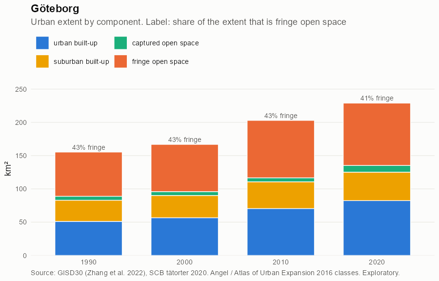

|  | urban built-up | suburban built-up | captured open space | fringe open space | extent | % fringe | built-up | saturation | openness | 2007 footprint |
|---|---|---|---|---|---|---|---|---|---|---|
| 1990 | 51.1 | 31.8 | 5.9 | 66.5 | 155.3 | 42.8 | 83.4 | 0.54 | 0.43 | 217.6 |
| 2000 | 56.6 | 33.5 | 5.8 | 71.0 | 166.8 | 42.5 | 90.6 | 0.54 | 0.42 | 234.5 |
| 2010 | 70.4 | 40.2 | 6.0 | 86.3 | 202.9 | 42.5 | 111.3 | 0.55 | 0.42 | 263.0 |
| 2020 | 82.4 | 42.8 | 10.1 | 93.7 | 228.9 | 40.9 | 126.0 | 0.55 | 0.41 | 313.8 |

km². Rural built-up and rural open space lie outside the urban extent; they appear on the maps.

#### Growth by decade

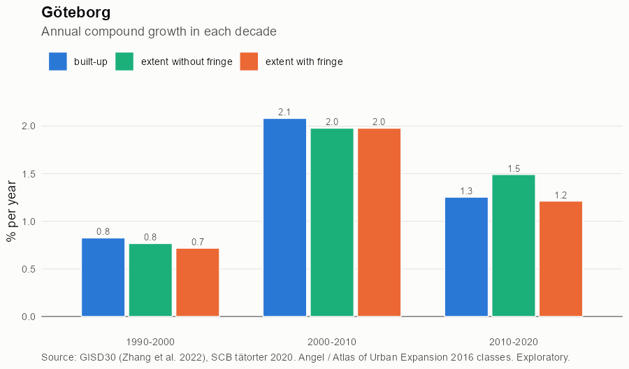

| Decade | built-up | extent without fringe | extent with fringe |
|---|---|---|---|
| 1990-2000 | 0.83 | 0.77 | 0.72 |
| 2000-2010 | 2.08 | 1.98 | 1.98 |
| 2010-2020 | 1.25 | 1.49 | 1.21 |

% per year.

#### Maps

<table>
<tr><td><a href="img/maps/goteborg_1990.png">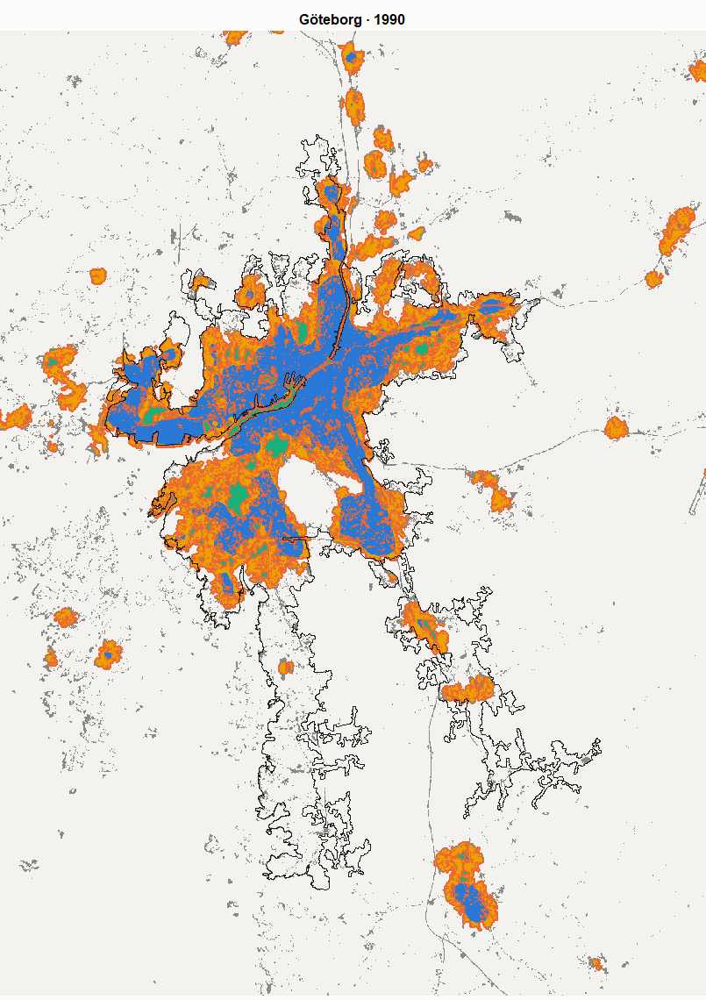</a></td><td><a href="img/maps/goteborg_2000.png">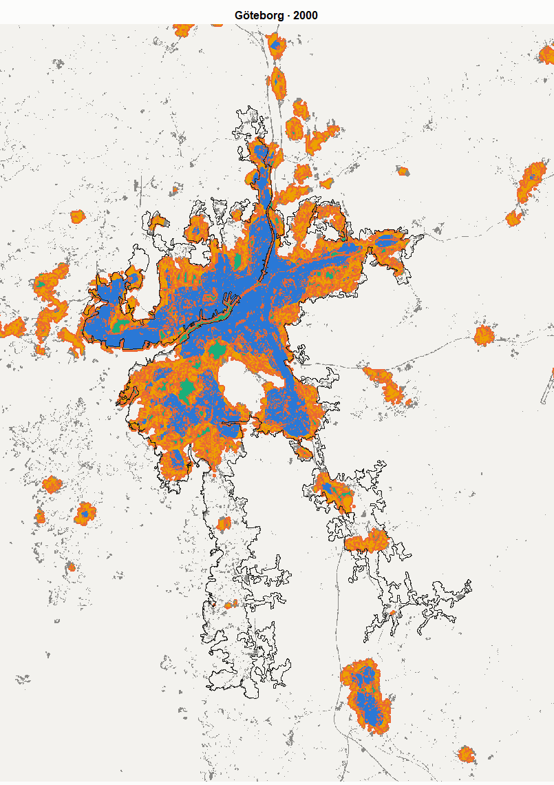</a></td></tr>
<tr><td><a href="img/maps/goteborg_2010.png">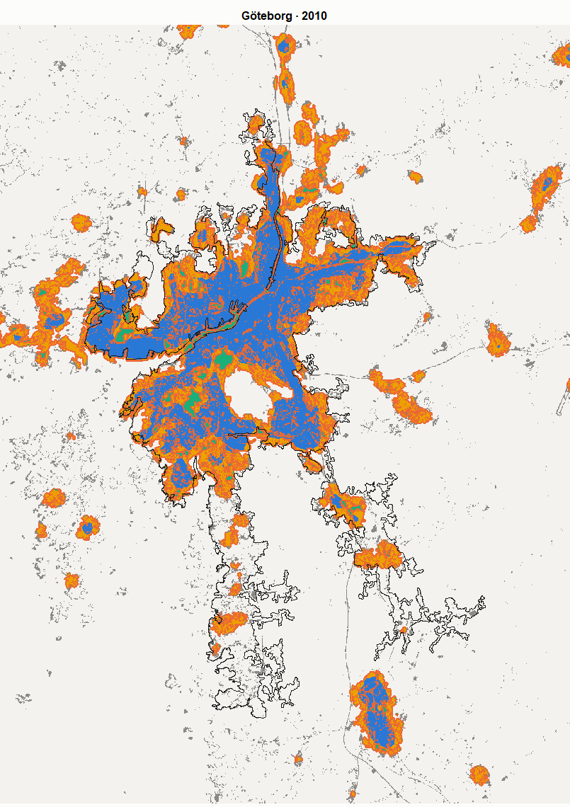</a></td><td><a href="img/maps/goteborg_2020.png">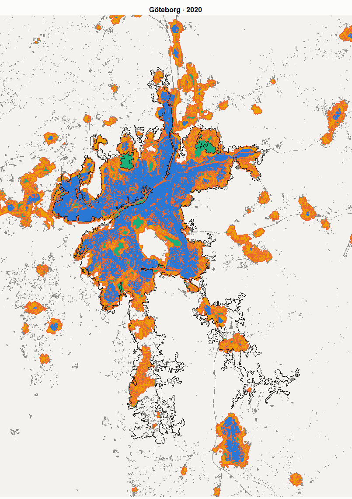</a></td></tr>
</table>

Maps are framed on the tätort plus 5 km; the metrics use the larger box of `cajas.md` (slug `goteborg`).

[Back to contents](#contents)

### Malmö

County: Skåne. Tätort population 2020 (SCB): 325,069.

Built-up land in the city's urban extent grew from **57.1 km²** in 1990 to **80.9 km²** in 2020, **1.17 % a year** (pace: **slow**). The urban extent went from 87.1 to 117.4 km². Saturation moved from 0.66 to 0.69 (shape: **filling in**).

The fringe open space was 32.7 % of the urban extent in 1990 and 29.5 % in 2020; in 2020 it adds 42 % to the rest of the extent. Counting it changes the 1990-2020 growth rate from 1.15 % to 1.00 % a year (-0.15 points).

#### Growth by class

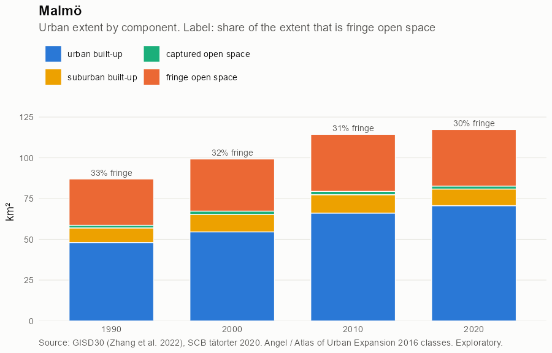

|  | urban built-up | suburban built-up | captured open space | fringe open space | extent | % fringe | built-up | saturation | openness | 2007 footprint |
|---|---|---|---|---|---|---|---|---|---|---|
| 1990 | 48.0 | 9.0 | 1.6 | 28.4 | 87.1 | 32.7 | 57.1 | 0.66 | 0.31 | 105.6 |
| 2000 | 54.6 | 10.7 | 2.1 | 32.0 | 99.3 | 32.2 | 65.4 | 0.66 | 0.30 | 131.5 |
| 2010 | 66.1 | 11.3 | 2.0 | 35.0 | 114.4 | 30.6 | 77.5 | 0.68 | 0.28 | 139.8 |
| 2020 | 70.7 | 10.2 | 1.8 | 34.7 | 117.4 | 29.5 | 80.9 | 0.69 | 0.27 | 144.3 |

km². Rural built-up and rural open space lie outside the urban extent; they appear on the maps.

#### Growth by decade

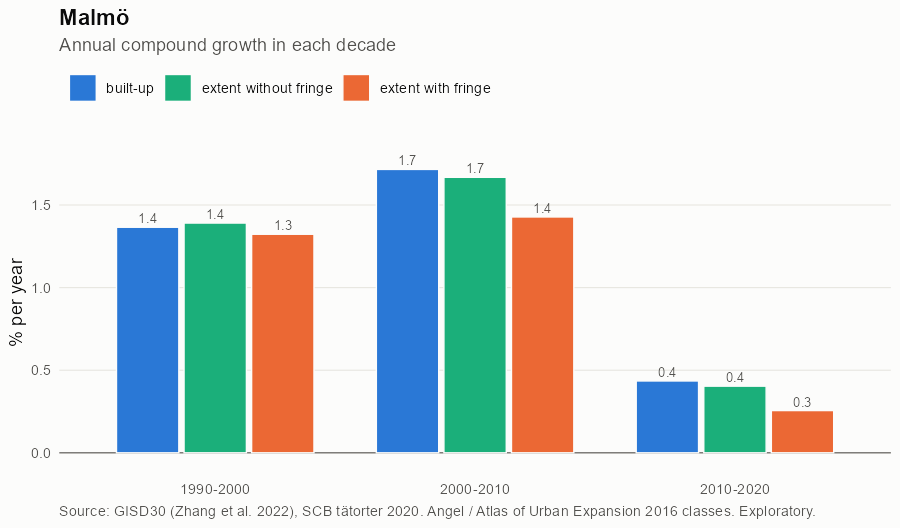

| Decade | built-up | extent without fringe | extent with fringe |
|---|---|---|---|
| 1990-2000 | 1.37 | 1.39 | 1.32 |
| 2000-2010 | 1.72 | 1.67 | 1.43 |
| 2010-2020 | 0.44 | 0.40 | 0.26 |

% per year.

#### Maps

<table>
<tr><td><a href="img/maps/malmo_1990.png">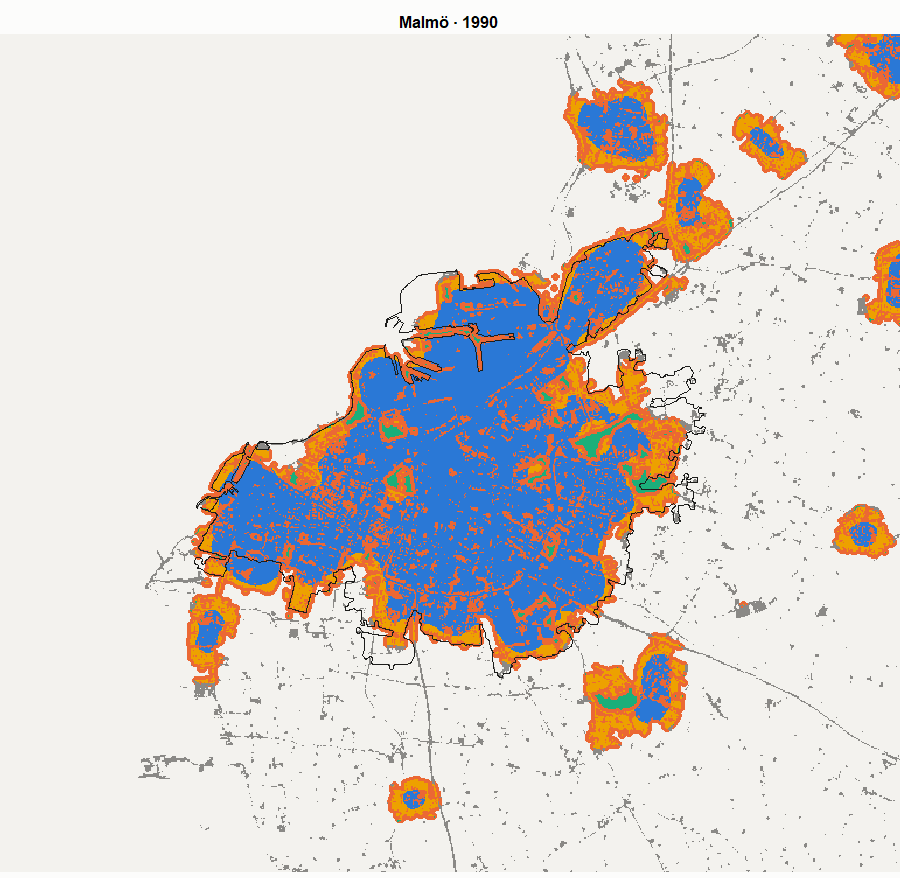</a></td><td><a href="img/maps/malmo_2000.png">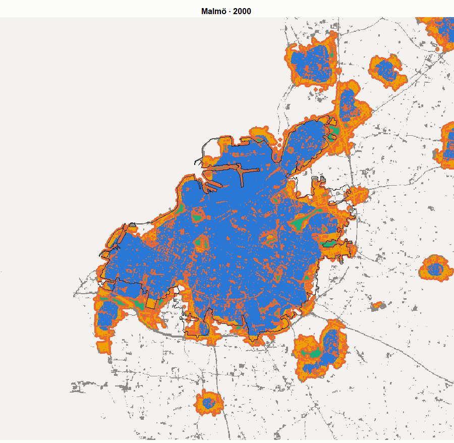</a></td></tr>
<tr><td><a href="img/maps/malmo_2010.png">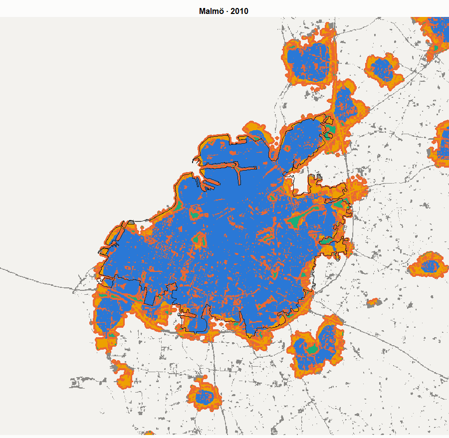</a></td><td><a href="img/maps/malmo_2020.png">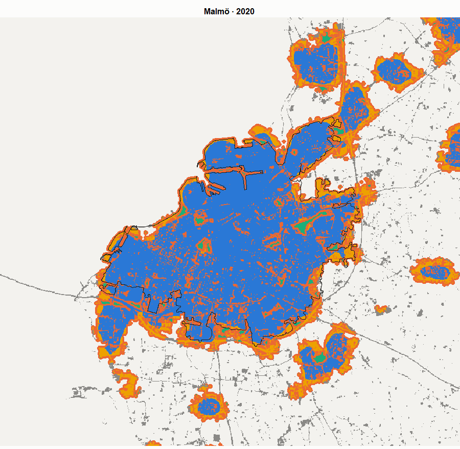</a></td></tr>
</table>

Maps are framed on the tätort plus 5 km; the metrics use the larger box of `cajas.md` (slug `malmo`).

[Back to contents](#contents)

### Uppsala

County: Uppsala. Tätort population 2020 (SCB): 166,698.

Built-up land in the city's urban extent grew from **16.6 km²** in 1990 to **27.6 km²** in 2020, **1.70 % a year** (pace: **moderate**). The urban extent went from 29.7 to 47.6 km². Saturation moved from 0.56 to 0.58 (shape: **stable**).

The fringe open space was 43.0 % of the urban extent in 1990 and 40.9 % in 2020; in 2020 it adds 69 % to the rest of the extent. Counting it changes the 1990-2020 growth rate from 1.71 % to 1.59 % a year (-0.12 points).

#### Growth by class

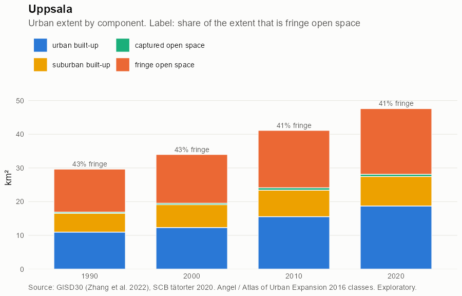

|  | urban built-up | suburban built-up | captured open space | fringe open space | extent | % fringe | built-up | saturation | openness | 2007 footprint |
|---|---|---|---|---|---|---|---|---|---|---|
| 1990 | 11.0 | 5.6 | 0.4 | 12.8 | 29.7 | 43.0 | 16.6 | 0.56 | 0.40 | 38.2 |
| 2000 | 12.3 | 6.8 | 0.4 | 14.5 | 34.0 | 42.6 | 19.2 | 0.56 | 0.40 | 44.9 |
| 2010 | 15.5 | 7.9 | 0.7 | 17.0 | 41.1 | 41.4 | 23.5 | 0.57 | 0.39 | 53.3 |
| 2020 | 18.7 | 8.7 | 0.7 | 19.5 | 47.6 | 40.9 | 27.6 | 0.58 | 0.38 | 58.4 |

km². Rural built-up and rural open space lie outside the urban extent; they appear on the maps.

#### Growth by decade

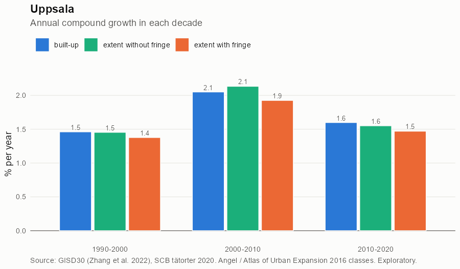

| Decade | built-up | extent without fringe | extent with fringe |
|---|---|---|---|
| 1990-2000 | 1.46 | 1.45 | 1.38 |
| 2000-2010 | 2.05 | 2.13 | 1.93 |
| 2010-2020 | 1.60 | 1.55 | 1.47 |

% per year.

#### Maps

<table>
<tr><td><a href="img/maps/uppsala_1990.png">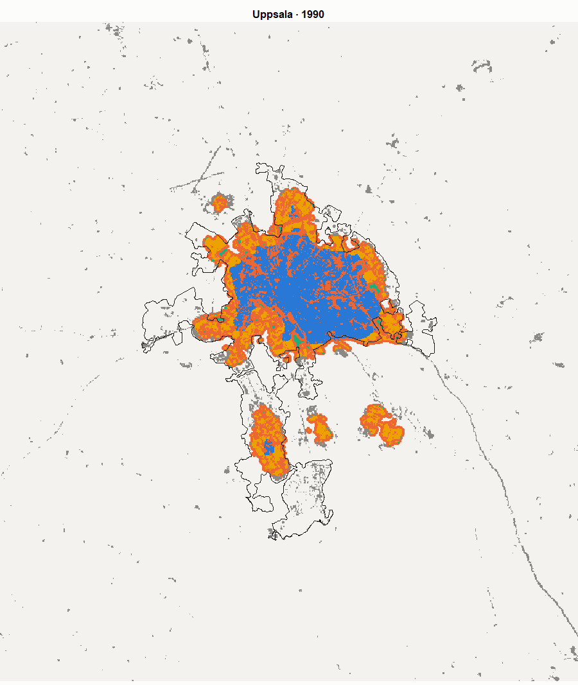</a></td><td><a href="img/maps/uppsala_2000.png">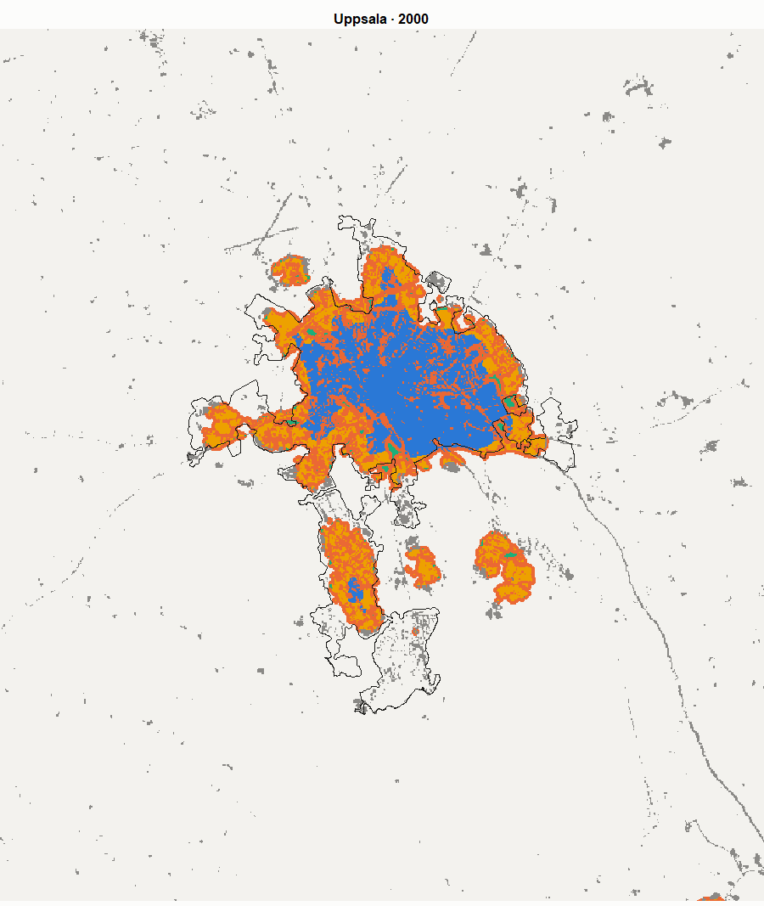</a></td></tr>
<tr><td><a href="img/maps/uppsala_2010.png">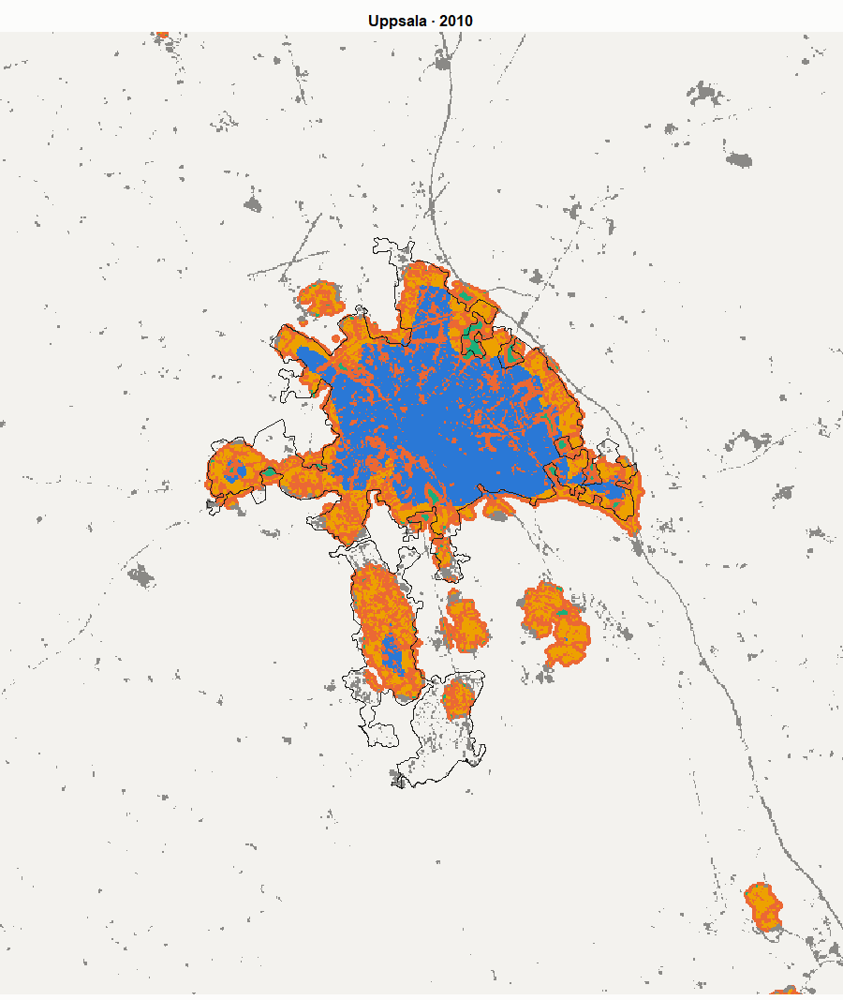</a></td><td><a href="img/maps/uppsala_2020.png">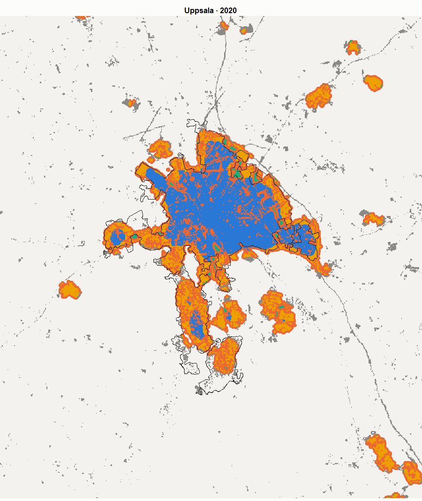</a></td></tr>
</table>

Maps are framed on the tätort plus 5 km; the metrics use the larger box of `cajas.md` (slug `uppsala`).

[Back to contents](#contents)

### Västerås

County: Västmanland. Tätort population 2020 (SCB): 128,660.

Built-up land in the city's urban extent grew from **22.5 km²** in 1990 to **33.2 km²** in 2020, **1.30 % a year** (pace: **slow**). The urban extent went from 43.1 to 56.6 km². Saturation moved from 0.52 to 0.59 (shape: **filling in**).

The fringe open space was 46.0 % of the urban extent in 1990 and 40.3 % in 2020; in 2020 it adds 68 % to the rest of the extent. Counting it changes the 1990-2020 growth rate from 1.25 % to 0.91 % a year (-0.34 points).

#### Growth by class

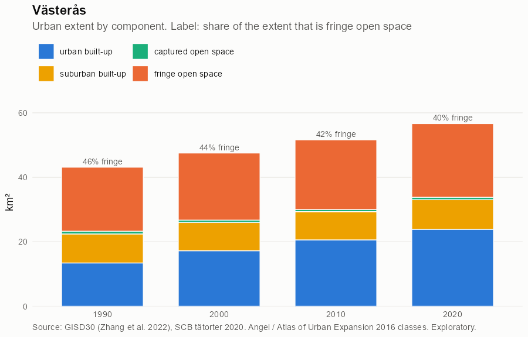

|  | urban built-up | suburban built-up | captured open space | fringe open space | extent | % fringe | built-up | saturation | openness | 2007 footprint |
|---|---|---|---|---|---|---|---|---|---|---|
| 1990 | 13.4 | 9.0 | 0.8 | 19.9 | 43.1 | 46.0 | 22.5 | 0.52 | 0.45 | 53.9 |
| 2000 | 17.2 | 8.7 | 0.7 | 20.8 | 47.5 | 43.8 | 26.1 | 0.55 | 0.43 | 57.3 |
| 2010 | 20.6 | 8.8 | 0.7 | 21.6 | 51.6 | 41.9 | 29.5 | 0.57 | 0.41 | 62.6 |
| 2020 | 23.9 | 9.2 | 0.7 | 22.8 | 56.6 | 40.3 | 33.2 | 0.59 | 0.39 | 66.0 |

km². Rural built-up and rural open space lie outside the urban extent; they appear on the maps.

#### Growth by decade

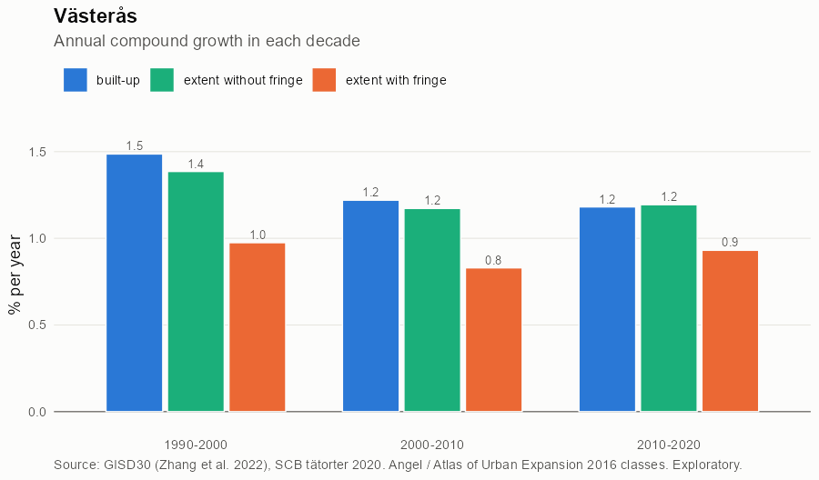

| Decade | built-up | extent without fringe | extent with fringe |
|---|---|---|---|
| 1990-2000 | 1.49 | 1.39 | 0.97 |
| 2000-2010 | 1.22 | 1.17 | 0.83 |
| 2010-2020 | 1.18 | 1.19 | 0.93 |

% per year.

#### Maps

<table>
<tr><td><a href="img/maps/vasteras_1990.png">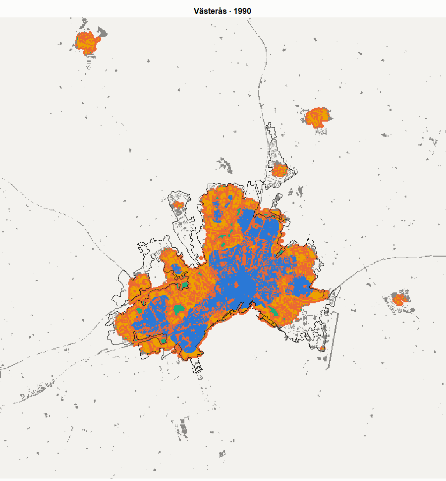</a></td><td><a href="img/maps/vasteras_2000.png">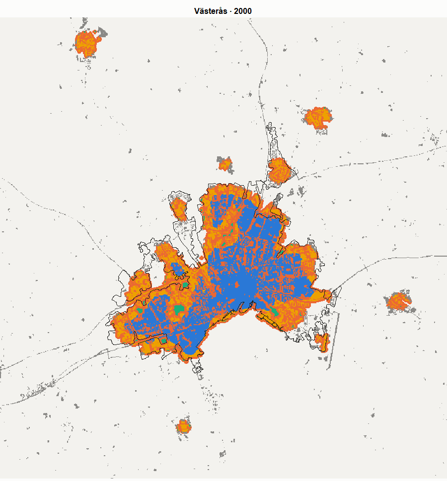</a></td></tr>
<tr><td><a href="img/maps/vasteras_2010.png">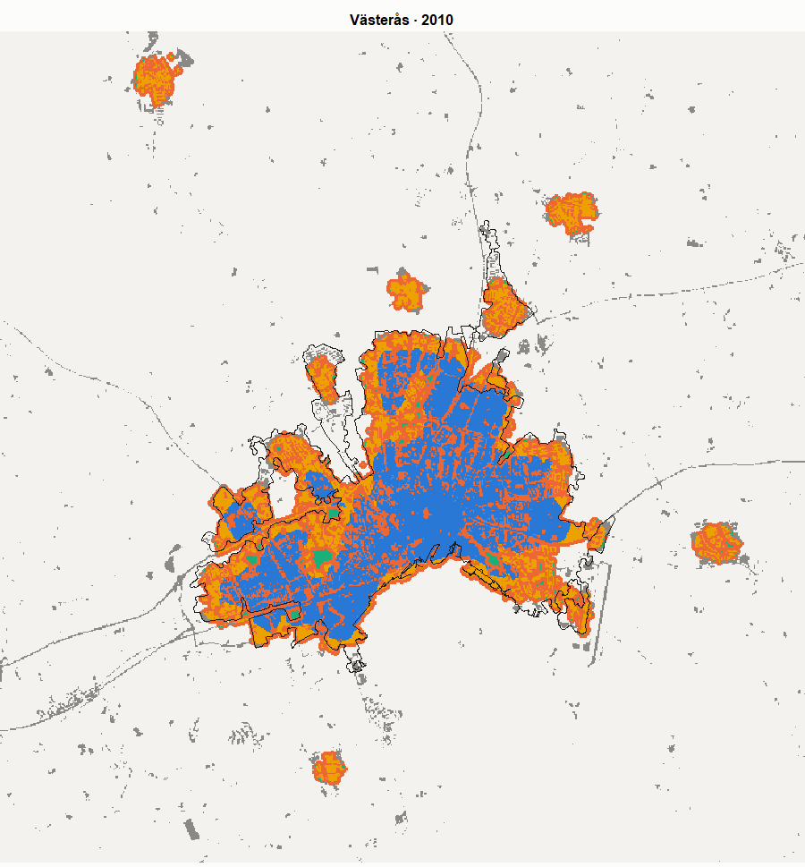</a></td><td><a href="img/maps/vasteras_2020.png">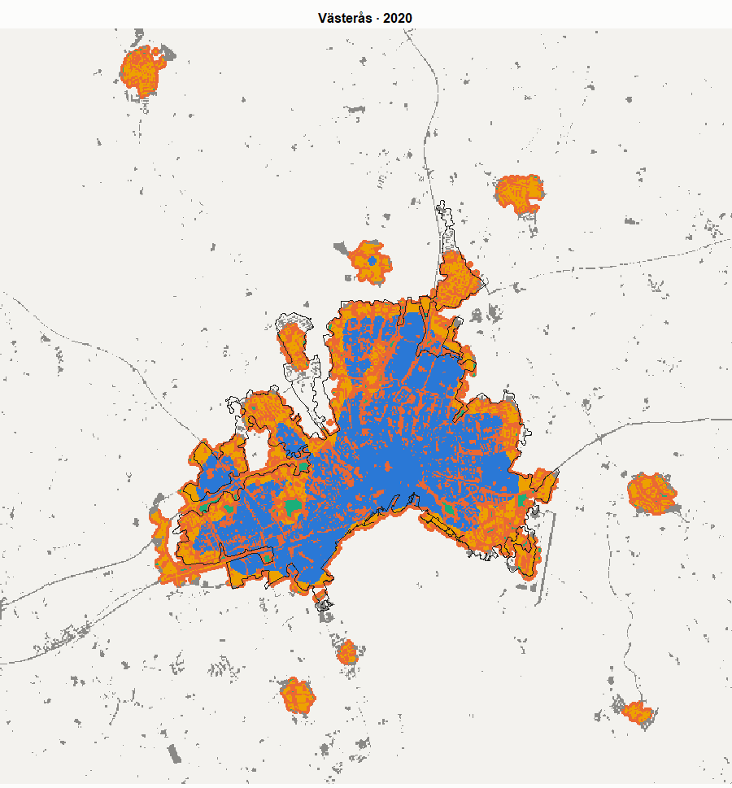</a></td></tr>
</table>

Maps are framed on the tätort plus 5 km; the metrics use the larger box of `cajas.md` (slug `vasteras`).

[Back to contents](#contents)

### Örebro

County: Örebro. Tätort population 2020 (SCB): 126,604.

Built-up land in the city's urban extent grew from **17.3 km²** in 1990 to **30.0 km²** in 2020, **1.85 % a year** (pace: **moderate**). The urban extent went from 31.9 to 52.1 km². Saturation moved from 0.54 to 0.58 (shape: **filling in**).

The fringe open space was 45.3 % of the urban extent in 1990 and 41.4 % in 2020; in 2020 it adds 71 % to the rest of the extent. Counting it changes the 1990-2020 growth rate from 1.88 % to 1.65 % a year (-0.23 points).

#### Growth by class

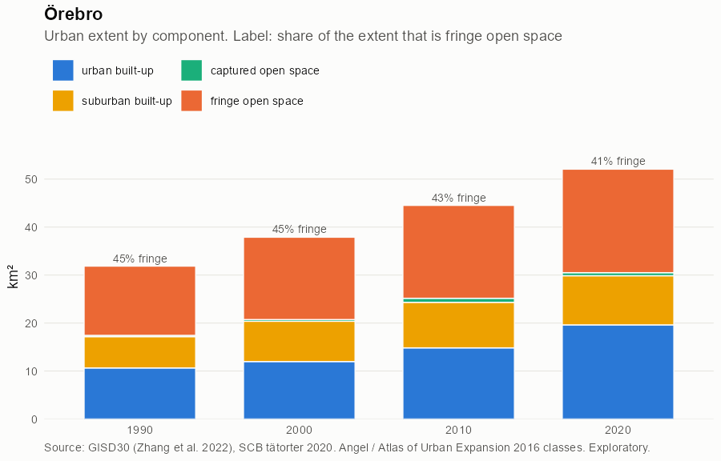

|  | urban built-up | suburban built-up | captured open space | fringe open space | extent | % fringe | built-up | saturation | openness | 2007 footprint |
|---|---|---|---|---|---|---|---|---|---|---|
| 1990 | 10.6 | 6.5 | 0.3 | 14.4 | 31.9 | 45.3 | 17.3 | 0.54 | 0.44 | 44.4 |
| 2000 | 12.0 | 8.4 | 0.4 | 17.2 | 37.9 | 45.3 | 20.5 | 0.54 | 0.44 | 49.0 |
| 2010 | 14.8 | 9.5 | 0.8 | 19.4 | 44.5 | 43.5 | 24.5 | 0.55 | 0.42 | 54.6 |
| 2020 | 19.6 | 10.2 | 0.6 | 21.6 | 52.1 | 41.4 | 30.0 | 0.58 | 0.40 | 61.9 |

km². Rural built-up and rural open space lie outside the urban extent; they appear on the maps.

#### Growth by decade

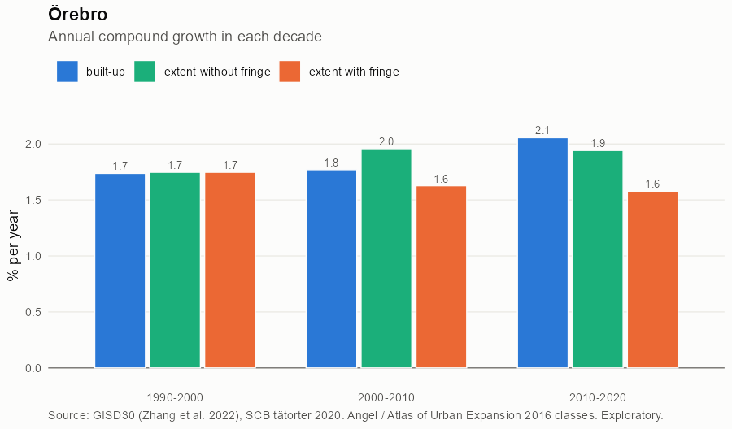

| Decade | built-up | extent without fringe | extent with fringe |
|---|---|---|---|
| 1990-2000 | 1.74 | 1.75 | 1.75 |
| 2000-2010 | 1.77 | 1.96 | 1.63 |
| 2010-2020 | 2.06 | 1.94 | 1.58 |

% per year.

#### Maps

<table>
<tr><td><a href="img/maps/orebro_1990.png">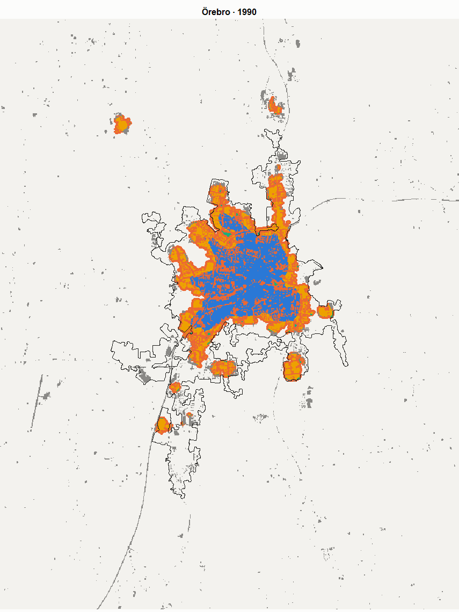</a></td><td><a href="img/maps/orebro_2000.png">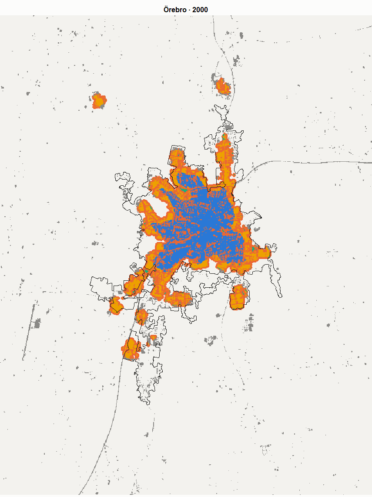</a></td></tr>
<tr><td><a href="img/maps/orebro_2010.png">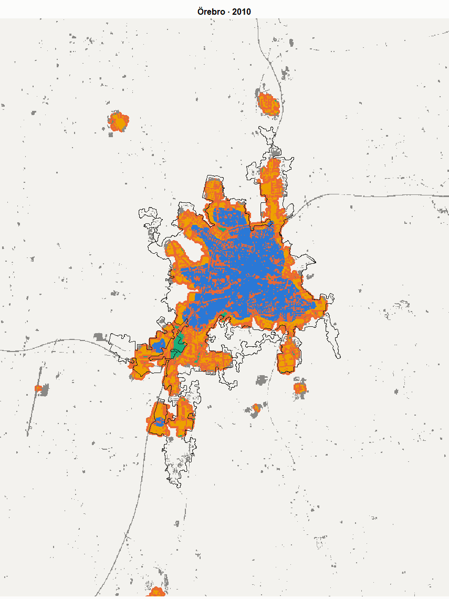</a></td><td><a href="img/maps/orebro_2020.png">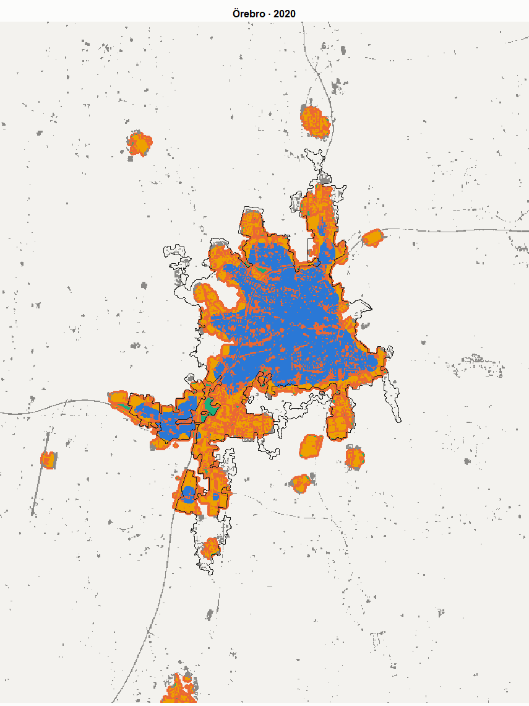</a></td></tr>
</table>

Maps are framed on the tätort plus 5 km; the metrics use the larger box of `cajas.md` (slug `orebro`).

[Back to contents](#contents)

### Linköping

County: Östergötland. Tätort population 2020 (SCB): 115,682.

Built-up land in the city's urban extent grew from **17.7 km²** in 1990 to **27.4 km²** in 2020, **1.46 % a year** (pace: **slow**). The urban extent went from 35.3 to 51.9 km². Saturation moved from 0.50 to 0.53 (shape: **stable**).

The fringe open space was 48.6 % of the urban extent in 1990 and 42.7 % in 2020; in 2020 it adds 75 % to the rest of the extent. Counting it changes the 1990-2020 growth rate from 1.66 % to 1.29 % a year (-0.37 points).

#### Growth by class

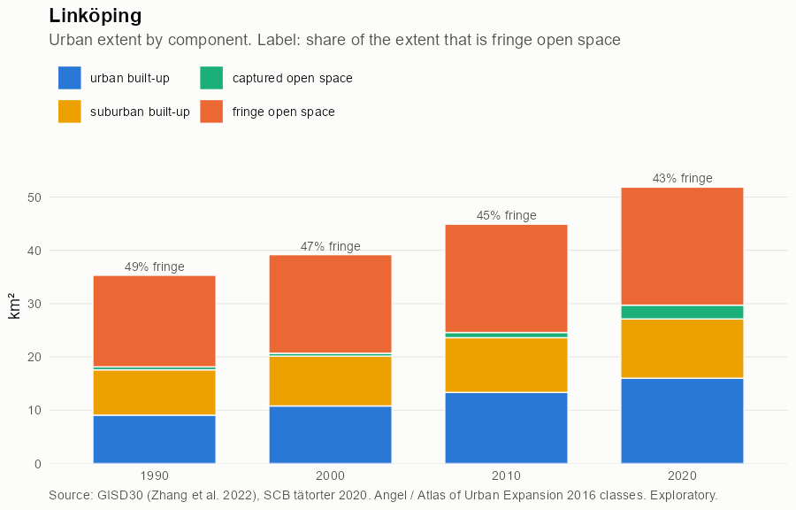

|  | urban built-up | suburban built-up | captured open space | fringe open space | extent | % fringe | built-up | saturation | openness | 2007 footprint |
|---|---|---|---|---|---|---|---|---|---|---|
| 1990 | 9.1 | 8.5 | 0.6 | 17.2 | 35.3 | 48.6 | 17.7 | 0.50 | 0.47 | 51.2 |
| 2000 | 10.8 | 9.4 | 0.5 | 18.5 | 39.2 | 47.2 | 20.3 | 0.52 | 0.46 | 56.2 |
| 2010 | 13.3 | 10.3 | 1.0 | 20.3 | 44.9 | 45.3 | 23.7 | 0.53 | 0.44 | 59.8 |
| 2020 | 16.0 | 11.1 | 2.6 | 22.1 | 51.9 | 42.7 | 27.4 | 0.53 | 0.43 | 64.1 |

km². Rural built-up and rural open space lie outside the urban extent; they appear on the maps.

#### Growth by decade

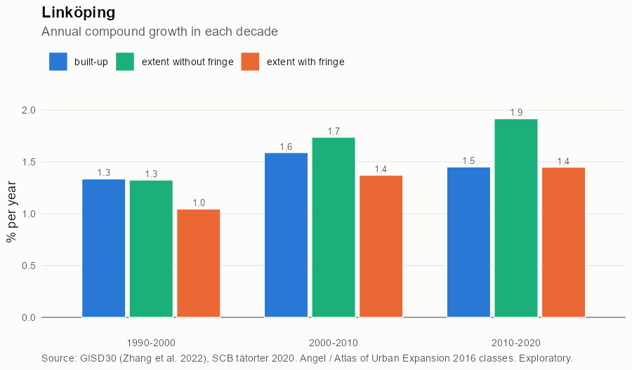

| Decade | built-up | extent without fringe | extent with fringe |
|---|---|---|---|
| 1990-2000 | 1.34 | 1.32 | 1.05 |
| 2000-2010 | 1.59 | 1.74 | 1.37 |
| 2010-2020 | 1.45 | 1.92 | 1.45 |

% per year.

#### Maps

<table>
<tr><td><a href="img/maps/linkoping_1990.png">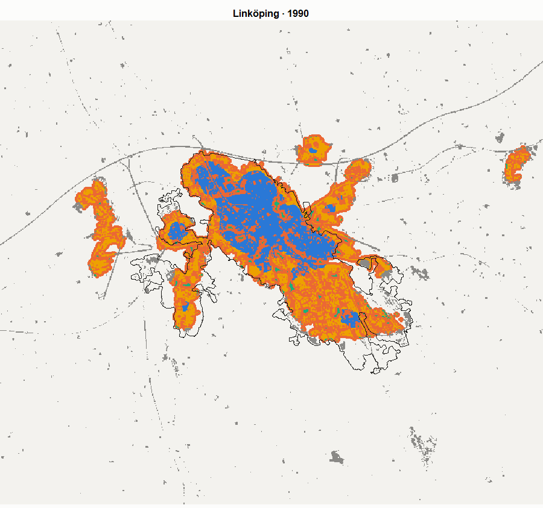</a></td><td><a href="img/maps/linkoping_2000.png">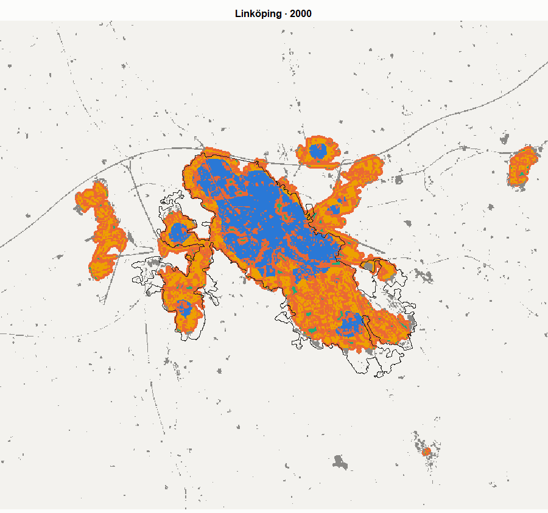</a></td></tr>
<tr><td><a href="img/maps/linkoping_2010.png">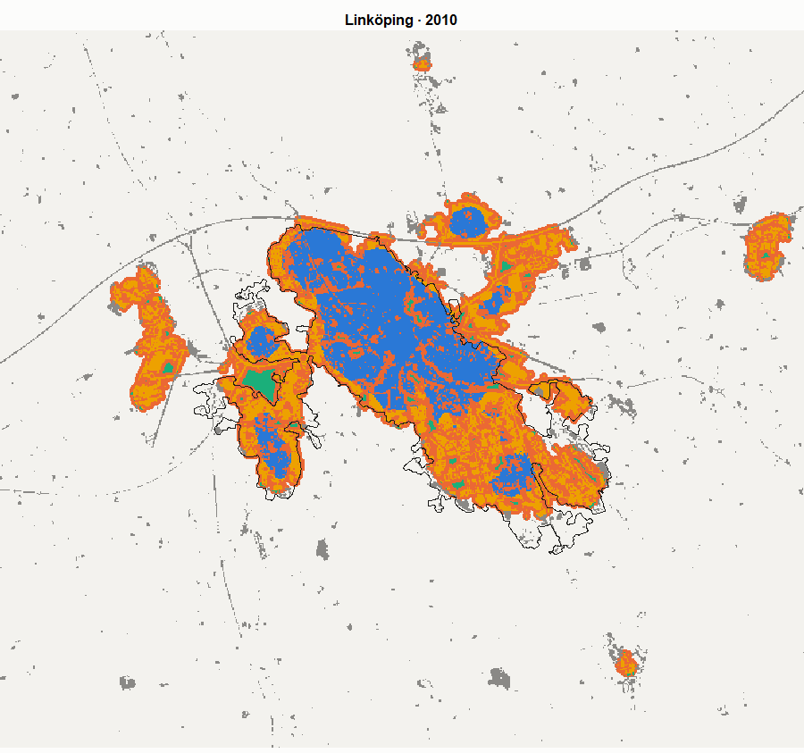</a></td><td><a href="img/maps/linkoping_2020.png">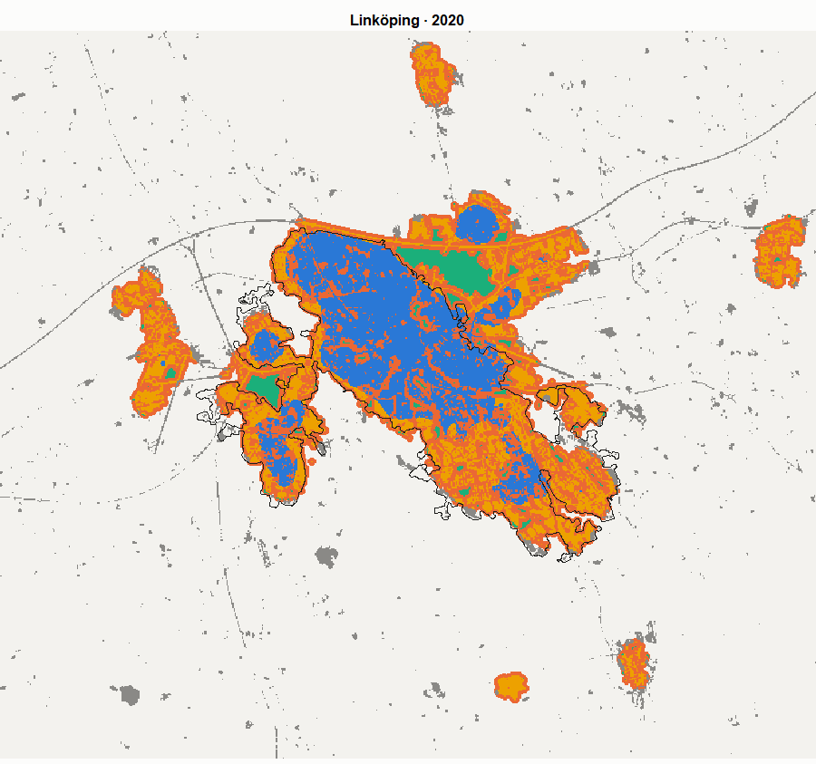</a></td></tr>
</table>

Maps are framed on the tätort plus 5 km; the metrics use the larger box of `cajas.md` (slug `linkoping`).

[Back to contents](#contents)

### Helsingborg

County: Skåne. Tätort population 2020 (SCB): 113,828.

Built-up land in the city's urban extent grew from **25.3 km²** in 1990 to **35.0 km²** in 2020, **1.08 % a year** (pace: **slow**). The urban extent went from 41.9 to 55.0 km². Saturation moved from 0.60 to 0.64 (shape: **filling in**).

The fringe open space was 38.5 % of the urban extent in 1990 and 34.9 % in 2020; in 2020 it adds 54 % to the rest of the extent. Counting it changes the 1990-2020 growth rate from 1.10 % to 0.91 % a year (-0.19 points).

#### Growth by class

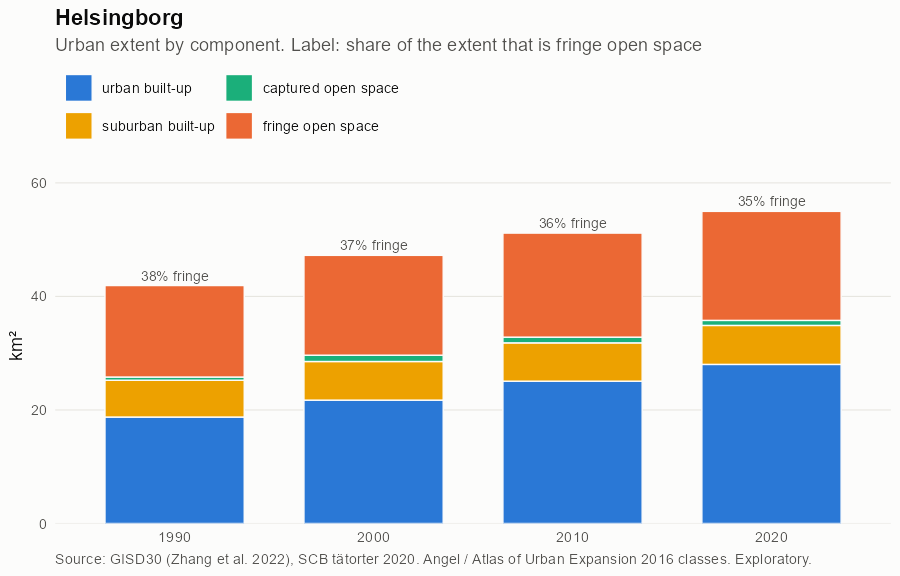

|  | urban built-up | suburban built-up | captured open space | fringe open space | extent | % fringe | built-up | saturation | openness | 2007 footprint |
|---|---|---|---|---|---|---|---|---|---|---|
| 1990 | 18.8 | 6.5 | 0.6 | 16.1 | 41.9 | 38.5 | 25.3 | 0.60 | 0.38 | 52.8 |
| 2000 | 21.7 | 6.8 | 1.1 | 17.6 | 47.2 | 37.2 | 28.6 | 0.61 | 0.37 | 67.6 |
| 2010 | 25.1 | 6.8 | 1.0 | 18.3 | 51.2 | 35.8 | 31.9 | 0.62 | 0.36 | 73.1 |
| 2020 | 28.0 | 6.9 | 0.9 | 19.2 | 55.0 | 34.9 | 35.0 | 0.64 | 0.34 | 79.4 |

km². Rural built-up and rural open space lie outside the urban extent; they appear on the maps.

#### Growth by decade

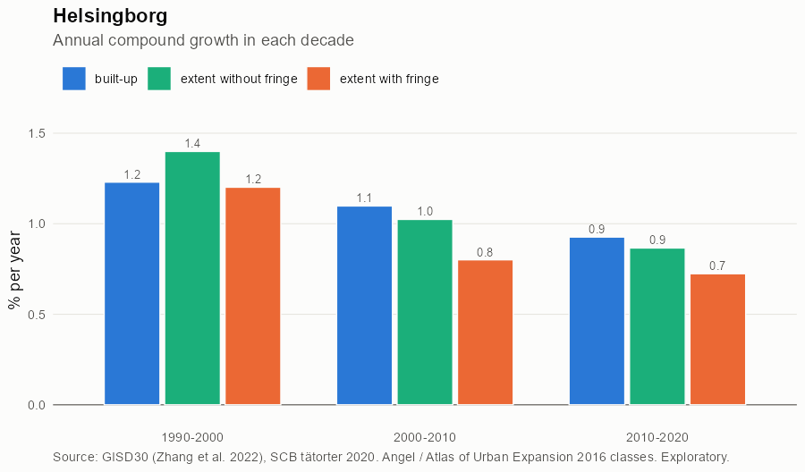

| Decade | built-up | extent without fringe | extent with fringe |
|---|---|---|---|
| 1990-2000 | 1.23 | 1.40 | 1.20 |
| 2000-2010 | 1.10 | 1.02 | 0.80 |
| 2010-2020 | 0.93 | 0.87 | 0.72 |

% per year.

#### Maps

<table>
<tr><td><a href="img/maps/helsingborg_1990.png">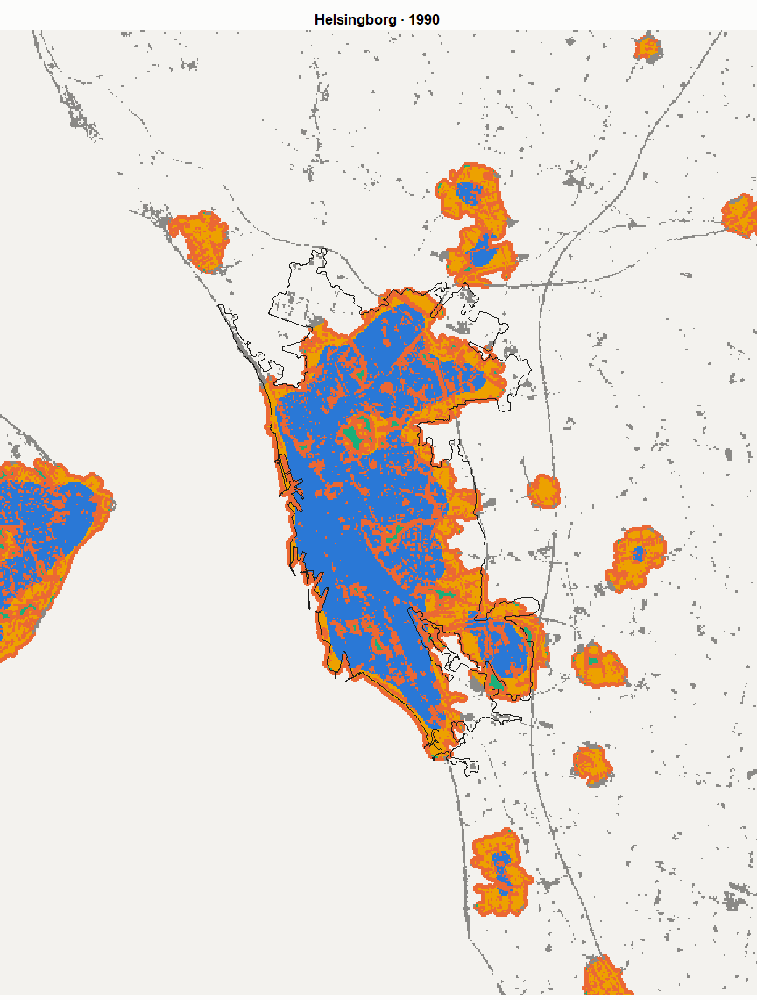</a></td><td></td></tr>
<tr><td></td><td></td></tr>
</table>

Maps are framed on the tätort plus 5 km; the metrics use the larger box of `cajas.md` (slug `helsingborg`).

[Back to contents](#contents)

### Jönköping

County: Jönköping. Tätort population 2020 (SCB): 100,579.

Built-up land in the city's urban extent grew from **12.6 km²** in 1990 to **19.6 km²** in 2020, **1.48 % a year** (pace: **slow**). The urban extent went from 26.2 to 37.3 km². Saturation moved from 0.48 to 0.52 (shape: **filling in**).

The fringe open space was 46.7 % of the urban extent in 1990 and 43.9 % in 2020; in 2020 it adds 78 % to the rest of the extent. Counting it changes the 1990-2020 growth rate from 1.36 % to 1.18 % a year (-0.18 points).

#### Growth by class

|  | urban built-up | suburban built-up | captured open space | fringe open space | extent | % fringe | built-up | saturation | openness | 2007 footprint |
|---|---|---|---|---|---|---|---|---|---|---|
| 1990 | 6.0 | 6.5 | 1.5 | 12.3 | 26.2 | 46.7 | 12.6 | 0.48 | 0.50 | 37.1 |
| 2000 | 6.9 | 7.7 | 1.5 | 13.9 | 30.1 | 46.2 | 14.8 | 0.49 | 0.49 | 41.4 |
| 2010 | 9.4 | 8.4 | 1.5 | 15.6 | 34.9 | 44.6 | 17.9 | 0.51 | 0.47 | 46.8 |
| 2020 | 10.8 | 8.6 | 1.5 | 16.4 | 37.3 | 43.9 | 19.6 | 0.52 | 0.46 | 50.4 |

km². Rural built-up and rural open space lie outside the urban extent; they appear on the maps.

#### Growth by decade

| Decade | built-up | extent without fringe | extent with fringe |
|---|---|---|---|
| 1990-2000 | 1.61 | 1.49 | 1.38 |
| 2000-2010 | 1.95 | 1.79 | 1.49 |
| 2010-2020 | 0.88 | 0.80 | 0.67 |

% per year.

#### Maps

<table>
<tr><td></td><td></td></tr>
<tr><td></td><td></td></tr>
</table>

Maps are framed on the tätort plus 5 km; the metrics use the larger box of `cajas.md` (slug `jonkoping`).

[Back to contents](#contents)

### Norrköping

County: Östergötland. Tätort population 2020 (SCB): 98,088.

Built-up land in the city's urban extent grew from **16.9 km²** in 1990 to **26.5 km²** in 2020, **1.51 % a year** (pace: **moderate**). The urban extent went from 30.9 to 46.7 km². Saturation moved from 0.55 to 0.57 (shape: **stable**).

The fringe open space was 44.2 % of the urban extent in 1990 and 39.0 % in 2020; in 2020 it adds 64 % to the rest of the extent. Counting it changes the 1990-2020 growth rate from 1.68 % to 1.38 % a year (-0.30 points).

#### Growth by class

|  | urban built-up | suburban built-up | captured open space | fringe open space | extent | % fringe | built-up | saturation | openness | 2007 footprint |
|---|---|---|---|---|---|---|---|---|---|---|
| 1990 | 10.2 | 6.6 | 0.4 | 13.7 | 30.9 | 44.2 | 16.9 | 0.55 | 0.44 | 41.8 |
| 2000 | 11.5 | 7.8 | 0.5 | 16.5 | 36.3 | 45.3 | 19.5 | 0.54 | 0.44 | 53.4 |
| 2010 | 14.7 | 8.6 | 0.7 | 17.8 | 41.7 | 42.7 | 23.3 | 0.56 | 0.42 | 57.9 |
| 2020 | 18.2 | 8.2 | 2.1 | 18.2 | 46.7 | 39.0 | 26.5 | 0.57 | 0.40 | 67.4 |

km². Rural built-up and rural open space lie outside the urban extent; they appear on the maps.

#### Growth by decade

| Decade | built-up | extent without fringe | extent with fringe |
|---|---|---|---|
| 1990-2000 | 1.40 | 1.42 | 1.63 |
| 2000-2010 | 1.82 | 1.88 | 1.40 |
| 2010-2020 | 1.31 | 1.75 | 1.12 |

% per year.

#### Maps

<table>
<tr><td></td><td></td></tr>
<tr><td></td><td></td></tr>
</table>

Maps are framed on the tätort plus 5 km; the metrics use the larger box of `cajas.md` (slug `norrkoping`).

[Back to contents](#contents)

### Lund

County: Skåne. Tätort population 2020 (SCB): 94,393.

Built-up land in the city's urban extent grew from **13.8 km²** in 1990 to **19.7 km²** in 2020, **1.20 % a year** (pace: **slow**). The urban extent went from 24.4 to 32.6 km². Saturation moved from 0.57 to 0.61 (shape: **filling in**).

The fringe open space was 43.0 % of the urban extent in 1990 and 38.3 % in 2020; in 2020 it adds 62 % to the rest of the extent. Counting it changes the 1990-2020 growth rate from 1.24 % to 0.97 % a year (-0.27 points).

#### Growth by class

|  | urban built-up | suburban built-up | captured open space | fringe open space | extent | % fringe | built-up | saturation | openness | 2007 footprint |
|---|---|---|---|---|---|---|---|---|---|---|
| 1990 | 9.5 | 4.3 | 0.1 | 10.5 | 24.4 | 43.0 | 13.8 | 0.57 | 0.43 | 30.5 |
| 2000 | 11.6 | 4.1 | 0.3 | 11.1 | 27.1 | 40.9 | 15.7 | 0.58 | 0.41 | 35.4 |
| 2010 | 14.2 | 3.4 | 0.3 | 11.4 | 29.3 | 38.8 | 17.6 | 0.60 | 0.38 | 40.6 |
| 2020 | 15.5 | 4.2 | 0.4 | 12.5 | 32.6 | 38.3 | 19.7 | 0.61 | 0.38 | 44.8 |

km². Rural built-up and rural open space lie outside the urban extent; they appear on the maps.

#### Growth by decade

| Decade | built-up | extent without fringe | extent with fringe |
|---|---|---|---|
| 1990-2000 | 1.31 | 1.44 | 1.07 |
| 2000-2010 | 1.14 | 1.13 | 0.77 |
| 2010-2020 | 1.14 | 1.14 | 1.06 |

% per year.

#### Maps

<table>
<tr><td></td><td></td></tr>
<tr><td></td><td></td></tr>
</table>

Maps are framed on the tätort plus 5 km; the metrics use the larger box of `cajas.md` (slug `lund`).

[Back to contents](#contents)

### Umeå

County: Västerbotten. Tätort population 2020 (SCB): 91,916.

Built-up land in the city's urban extent grew from **17.0 km²** in 1990 to **26.7 km²** in 2020, **1.52 % a year** (pace: **moderate**). The urban extent went from 31.5 to 46.8 km². Saturation moved from 0.54 to 0.57 (shape: **stable**).

The fringe open space was 40.2 % of the urban extent in 1990 and 36.0 % in 2020; in 2020 it adds 56 % to the rest of the extent. Counting it changes the 1990-2020 growth rate from 1.57 % to 1.33 % a year (-0.23 points).

#### Growth by class

|  | urban built-up | suburban built-up | captured open space | fringe open space | extent | % fringe | built-up | saturation | openness | 2007 footprint |
|---|---|---|---|---|---|---|---|---|---|---|
| 1990 | 10.2 | 6.7 | 1.9 | 12.7 | 31.5 | 40.2 | 17.0 | 0.54 | 0.44 | 38.3 |
| 2000 | 11.5 | 7.6 | 1.9 | 14.1 | 35.2 | 40.2 | 19.2 | 0.55 | 0.44 | 43.0 |
| 2010 | 14.5 | 8.2 | 3.5 | 15.8 | 42.0 | 37.5 | 23.0 | 0.55 | 0.42 | 48.6 |
| 2020 | 18.6 | 8.0 | 3.4 | 16.9 | 46.8 | 36.0 | 26.7 | 0.57 | 0.40 | 53.6 |

km². Rural built-up and rural open space lie outside the urban extent; they appear on the maps.

#### Growth by decade

| Decade | built-up | extent without fringe | extent with fringe |
|---|---|---|---|
| 1990-2000 | 1.24 | 1.12 | 1.11 |
| 2000-2010 | 1.80 | 2.25 | 1.81 |
| 2010-2020 | 1.52 | 1.33 | 1.09 |

% per year.

#### Maps

<table>
<tr><td></td><td></td></tr>
<tr><td></td><td></td></tr>
</table>

Maps are framed on the tätort plus 5 km; the metrics use the larger box of `cajas.md` (slug `umea`).

[Back to contents](#contents)

### Gävle

County: Gävleborg. Tätort population 2020 (SCB): 79,004.

Built-up land in the city's urban extent grew from **25.3 km²** in 1990 to **34.0 km²** in 2020, **0.99 % a year** (pace: **slow**). The urban extent went from 44.5 to 61.2 km². Saturation moved from 0.57 to 0.56 (shape: **stable**).

The fringe open space was 39.4 % of the urban extent in 1990 and 41.7 % in 2020; in 2020 it adds 72 % to the rest of the extent. Counting it changes the 1990-2020 growth rate from 0.93 % to 1.07 % a year (+0.13 points).

#### Growth by class

|  | urban built-up | suburban built-up | captured open space | fringe open space | extent | % fringe | built-up | saturation | openness | 2007 footprint |
|---|---|---|---|---|---|---|---|---|---|---|
| 1990 | 16.1 | 8.9 | 1.9 | 17.5 | 44.5 | 39.4 | 25.3 | 0.57 | 0.39 | 64.5 |
| 2000 | 17.1 | 9.2 | 1.8 | 18.3 | 46.4 | 39.4 | 26.5 | 0.57 | 0.38 | 68.1 |
| 2010 | 20.0 | 11.2 | 1.7 | 23.2 | 56.2 | 41.3 | 31.4 | 0.56 | 0.40 | 72.8 |
| 2020 | 22.0 | 11.9 | 1.8 | 25.5 | 61.2 | 41.7 | 34.0 | 0.56 | 0.40 | 78.8 |

km². Rural built-up and rural open space lie outside the urban extent; they appear on the maps.

#### Growth by decade

| Decade | built-up | extent without fringe | extent with fringe |
|---|---|---|---|
| 1990-2000 | 0.46 | 0.40 | 0.41 |
| 2000-2010 | 1.73 | 1.62 | 1.94 |
| 2010-2020 | 0.79 | 0.78 | 0.86 |

% per year.

#### Maps

<table>
<tr><td></td><td></td></tr>
<tr><td></td><td></td></tr>
</table>

Maps are framed on the tätort plus 5 km; the metrics use the larger box of `cajas.md` (slug `gavle`).

[Back to contents](#contents)

### Södertälje

County: Stockholm. Tätort population 2020 (SCB): 76,320.

Built-up land in the city's urban extent grew from **11.4 km²** in 1990 to **18.6 km²** in 2020, **1.67 % a year** (pace: **moderate**). The urban extent went from 24.1 to 33.9 km². Saturation moved from 0.47 to 0.55 (shape: **filling in**).

The fringe open space was 50.7 % of the urban extent in 1990 and 43.5 % in 2020; in 2020 it adds 77 % to the rest of the extent. Counting it changes the 1990-2020 growth rate from 1.60 % to 1.14 % a year (-0.46 points).

#### Growth by class

|  | urban built-up | suburban built-up | captured open space | fringe open space | extent | % fringe | built-up | saturation | openness | 2007 footprint |
|---|---|---|---|---|---|---|---|---|---|---|
| 1990 | 4.5 | 6.8 | 0.6 | 12.2 | 24.1 | 50.7 | 11.4 | 0.47 | 0.52 | 28.9 |
| 2000 | 6.2 | 7.2 | 0.6 | 13.3 | 27.3 | 48.8 | 13.4 | 0.49 | 0.50 | 31.7 |
| 2010 | 8.5 | 7.4 | 0.6 | 14.3 | 30.7 | 46.5 | 15.9 | 0.52 | 0.47 | 34.4 |
| 2020 | 11.7 | 6.9 | 0.6 | 14.8 | 33.9 | 43.5 | 18.6 | 0.55 | 0.44 | 38.1 |

km². Rural built-up and rural open space lie outside the urban extent; they appear on the maps.

#### Growth by decade

| Decade | built-up | extent without fringe | extent with fringe |
|---|---|---|---|
| 1990-2000 | 1.69 | 1.61 | 1.24 |
| 2000-2010 | 1.69 | 1.63 | 1.18 |
| 2010-2020 | 1.62 | 1.55 | 1.00 |

% per year.

#### Maps

<table>
<tr><td></td><td></td></tr>
<tr><td></td><td></td></tr>
</table>

Maps are framed on the tätort plus 5 km; the metrics use the larger box of `cajas.md` (slug `sodertalje`).

[Back to contents](#contents)

### Borås

County: Västra Götaland. Tätort population 2020 (SCB): 74,042.

Built-up land in the city's urban extent grew from **9.6 km²** in 1990 to **16.0 km²** in 2020, **1.72 % a year** (pace: **moderate**). The urban extent went from 19.6 to 30.8 km². Saturation moved from 0.49 to 0.52 (shape: **stable**).

The fringe open space was 49.1 % of the urban extent in 1990 and 46.5 % in 2020; in 2020 it adds 87 % to the rest of the extent. Counting it changes the 1990-2020 growth rate from 1.69 % to 1.52 % a year (-0.17 points).

#### Growth by class

|  | urban built-up | suburban built-up | captured open space | fringe open space | extent | % fringe | built-up | saturation | openness | 2007 footprint |
|---|---|---|---|---|---|---|---|---|---|---|
| 1990 | 4.3 | 5.1 | 0.5 | 9.6 | 19.6 | 49.1 | 9.6 | 0.49 | 0.49 | 27.0 |
| 2000 | 4.7 | 5.7 | 0.5 | 10.7 | 21.7 | 49.3 | 10.6 | 0.49 | 0.49 | 30.7 |
| 2010 | 5.4 | 7.3 | 0.5 | 12.6 | 25.8 | 48.7 | 12.8 | 0.50 | 0.49 | 37.8 |
| 2020 | 7.4 | 8.5 | 0.6 | 14.3 | 30.8 | 46.5 | 16.0 | 0.52 | 0.47 | 43.3 |

km². Rural built-up and rural open space lie outside the urban extent; they appear on the maps.

#### Growth by decade

| Decade | built-up | extent without fringe | extent with fringe |
|---|---|---|---|
| 1990-2000 | 1.00 | 1.03 | 1.06 |
| 2000-2010 | 1.92 | 1.84 | 1.74 |
| 2010-2020 | 2.25 | 2.21 | 1.78 |

% per year.

#### Maps

<table>
<tr><td></td><td></td></tr>
<tr><td></td><td></td></tr>
</table>

Maps are framed on the tätort plus 5 km; the metrics use the larger box of `cajas.md` (slug `boras`).

[Back to contents](#contents)

### Halmstad

County: Halland. Tätort population 2020 (SCB): 71,422.

Built-up land in the city's urban extent grew from **17.7 km²** in 1990 to **24.4 km²** in 2020, **1.08 % a year** (pace: **slow**). The urban extent went from 32.0 to 42.3 km². Saturation moved from 0.55 to 0.58 (shape: **stable**).

The fringe open space was 43.5 % of the urban extent in 1990 and 40.5 % in 2020; in 2020 it adds 68 % to the rest of the extent. Counting it changes the 1990-2020 growth rate from 1.11 % to 0.93 % a year (-0.18 points).

#### Growth by class

|  | urban built-up | suburban built-up | captured open space | fringe open space | extent | % fringe | built-up | saturation | openness | 2007 footprint |
|---|---|---|---|---|---|---|---|---|---|---|
| 1990 | 10.6 | 7.0 | 0.5 | 13.9 | 32.0 | 43.5 | 17.7 | 0.55 | 0.41 | 44.0 |
| 2000 | 11.6 | 7.8 | 0.7 | 15.5 | 35.6 | 43.5 | 19.5 | 0.55 | 0.41 | 46.7 |
| 2010 | 14.1 | 8.2 | 0.8 | 16.6 | 39.9 | 41.8 | 22.5 | 0.56 | 0.40 | 49.6 |
| 2020 | 16.0 | 8.4 | 0.9 | 17.1 | 42.3 | 40.5 | 24.4 | 0.58 | 0.39 | 51.6 |

km². Rural built-up and rural open space lie outside the urban extent; they appear on the maps.

#### Growth by decade

| Decade | built-up | extent without fringe | extent with fringe |
|---|---|---|---|
| 1990-2000 | 0.97 | 1.07 | 1.08 |
| 2000-2010 | 1.43 | 1.44 | 1.13 |
| 2010-2020 | 0.83 | 0.82 | 0.60 |

% per year.

#### Maps

<table>
<tr><td></td><td></td></tr>
<tr><td></td><td></td></tr>
</table>

Maps are framed on the tätort plus 5 km; the metrics use the larger box of `cajas.md` (slug `halmstad`).

[Back to contents](#contents)

### Växjö

County: Kronoberg. Tätort population 2020 (SCB): 71,282.

Built-up land in the city's urban extent grew from **10.9 km²** in 1990 to **20.1 km²** in 2020, **2.07 % a year** (pace: **moderate**). The urban extent went from 21.1 to 35.2 km². Saturation moved from 0.52 to 0.57 (shape: **filling in**).

The fringe open space was 47.6 % of the urban extent in 1990 and 41.4 % in 2020; in 2020 it adds 71 % to the rest of the extent. Counting it changes the 1990-2020 growth rate from 2.11 % to 1.72 % a year (-0.38 points).

#### Growth by class

|  | urban built-up | suburban built-up | captured open space | fringe open space | extent | % fringe | built-up | saturation | openness | 2007 footprint |
|---|---|---|---|---|---|---|---|---|---|---|
| 1990 | 5.9 | 4.9 | 0.3 | 10.0 | 21.1 | 47.6 | 10.9 | 0.52 | 0.48 | 29.9 |
| 2000 | 7.1 | 5.4 | 0.2 | 11.2 | 24.0 | 46.6 | 12.7 | 0.53 | 0.47 | 32.5 |
| 2010 | 10.3 | 6.8 | 0.6 | 13.3 | 31.1 | 42.8 | 17.2 | 0.55 | 0.44 | 37.0 |
| 2020 | 12.2 | 7.8 | 0.6 | 14.6 | 35.2 | 41.4 | 20.1 | 0.57 | 0.42 | 42.1 |

km². Rural built-up and rural open space lie outside the urban extent; they appear on the maps.

#### Growth by decade

| Decade | built-up | extent without fringe | extent with fringe |
|---|---|---|---|
| 1990-2000 | 1.53 | 1.49 | 1.28 |
| 2000-2010 | 3.12 | 3.34 | 2.64 |
| 2010-2020 | 1.58 | 1.51 | 1.26 |

% per year.

#### Maps

<table>
<tr><td></td><td></td></tr>
<tr><td></td><td></td></tr>
</table>

Maps are framed on the tätort plus 5 km; the metrics use the larger box of `cajas.md` (slug `vaxjo`).

[Back to contents](#contents)

### Eskilstuna

County: Södermanland. Tätort population 2020 (SCB): 69,948.

Built-up land in the city's urban extent grew from **11.1 km²** in 1990 to **14.6 km²** in 2020, **0.92 % a year** (pace: **slow**). The urban extent went from 20.1 to 25.9 km². Saturation moved from 0.55 to 0.56 (shape: **stable**).

The fringe open space was 44.1 % of the urban extent in 1990 and 42.8 % in 2020; in 2020 it adds 75 % to the rest of the extent. Counting it changes the 1990-2020 growth rate from 0.94 % to 0.86 % a year (-0.08 points).

#### Growth by class

|  | urban built-up | suburban built-up | captured open space | fringe open space | extent | % fringe | built-up | saturation | openness | 2007 footprint |
|---|---|---|---|---|---|---|---|---|---|---|
| 1990 | 7.0 | 4.0 | 0.2 | 8.9 | 20.1 | 44.1 | 11.1 | 0.55 | 0.41 | 35.7 |
| 2000 | 7.8 | 4.2 | 0.3 | 9.4 | 21.6 | 43.4 | 12.0 | 0.56 | 0.41 | 43.2 |
| 2010 | 8.9 | 4.3 | 0.2 | 10.3 | 23.7 | 43.2 | 13.3 | 0.56 | 0.40 | 46.8 |
| 2020 | 9.9 | 4.6 | 0.3 | 11.1 | 25.9 | 42.8 | 14.6 | 0.56 | 0.40 | 52.9 |

km². Rural built-up and rural open space lie outside the urban extent; they appear on the maps.

#### Growth by decade

| Decade | built-up | extent without fringe | extent with fringe |
|---|---|---|---|
| 1990-2000 | 0.82 | 0.88 | 0.76 |
| 2000-2010 | 1.01 | 0.96 | 0.92 |
| 2010-2020 | 0.93 | 0.97 | 0.89 |

% per year.

#### Maps

<table>
<tr><td></td><td></td></tr>
<tr><td></td><td></td></tr>
</table>

Maps are framed on the tätort plus 5 km; the metrics use the larger box of `cajas.md` (slug `eskilstuna`).

[Back to contents](#contents)

### Karlstad

County: Värmland. Tätort population 2020 (SCB): 67,122.

Built-up land in the city's urban extent grew from **12.8 km²** in 1990 to **18.8 km²** in 2020, **1.29 % a year** (pace: **slow**). The urban extent went from 25.5 to 36.1 km². Saturation moved from 0.50 to 0.52 (shape: **stable**).

The fringe open space was 48.1 % of the urban extent in 1990 and 41.3 % in 2020; in 2020 it adds 70 % to the rest of the extent. Counting it changes the 1990-2020 growth rate from 1.58 % to 1.16 % a year (-0.42 points).

#### Growth by class

|  | urban built-up | suburban built-up | captured open space | fringe open space | extent | % fringe | built-up | saturation | openness | 2007 footprint |
|---|---|---|---|---|---|---|---|---|---|---|
| 1990 | 6.6 | 6.1 | 0.5 | 12.3 | 25.5 | 48.1 | 12.8 | 0.50 | 0.49 | 32.6 |
| 2000 | 7.3 | 6.6 | 0.5 | 13.2 | 27.5 | 47.8 | 13.9 | 0.51 | 0.49 | 35.6 |
| 2010 | 9.4 | 7.2 | 0.5 | 13.8 | 30.9 | 44.7 | 16.7 | 0.54 | 0.46 | 38.4 |
| 2020 | 10.6 | 8.0 | 2.6 | 14.9 | 36.1 | 41.3 | 18.8 | 0.52 | 0.45 | 46.0 |

km². Rural built-up and rural open space lie outside the urban extent; they appear on the maps.

#### Growth by decade

| Decade | built-up | extent without fringe | extent with fringe |
|---|---|---|---|
| 1990-2000 | 0.81 | 0.81 | 0.75 |
| 2000-2010 | 1.86 | 1.77 | 1.18 |
| 2010-2020 | 1.20 | 2.17 | 1.56 |

% per year.

#### Maps

<table>
<tr><td></td><td></td></tr>
<tr><td></td><td></td></tr>
</table>

Maps are framed on the tätort plus 5 km; the metrics use the larger box of `cajas.md` (slug `karlstad`).

[Back to contents](#contents)

### Sundsvall

County: Västernorrland. Tätort population 2020 (SCB): 58,813.

Built-up land in the city's urban extent grew from **25.6 km²** in 1990 to **34.1 km²** in 2020, **0.96 % a year** (pace: **slow**). The urban extent went from 46.9 to 60.9 km². Saturation moved from 0.55 to 0.56 (shape: **stable**).

The fringe open space was 42.1 % of the urban extent in 1990 and 41.7 % in 2020; in 2020 it adds 72 % to the rest of the extent. Counting it changes the 1990-2020 growth rate from 0.89 % to 0.87 % a year (-0.02 points).

#### Growth by class

|  | urban built-up | suburban built-up | captured open space | fringe open space | extent | % fringe | built-up | saturation | openness | 2007 footprint |
|---|---|---|---|---|---|---|---|---|---|---|
| 1990 | 14.1 | 11.4 | 1.7 | 19.7 | 46.9 | 42.1 | 25.6 | 0.55 | 0.45 | 77.0 |
| 2000 | 14.7 | 11.7 | 1.7 | 20.3 | 48.3 | 41.9 | 26.5 | 0.55 | 0.45 | 79.2 |
| 2010 | 16.6 | 12.9 | 1.6 | 22.0 | 53.0 | 41.5 | 29.6 | 0.56 | 0.44 | 85.0 |
| 2020 | 18.8 | 15.1 | 1.6 | 25.4 | 60.9 | 41.7 | 34.1 | 0.56 | 0.45 | 97.8 |

km². Rural built-up and rural open space lie outside the urban extent; they appear on the maps.

#### Growth by decade

| Decade | built-up | extent without fringe | extent with fringe |
|---|---|---|---|
| 1990-2000 | 0.35 | 0.31 | 0.29 |
| 2000-2010 | 1.11 | 1.01 | 0.94 |
| 2010-2020 | 1.41 | 1.36 | 1.39 |

% per year.

#### Maps

<table>
<tr><td></td><td></td></tr>
<tr><td></td><td></td></tr>
</table>

Maps are framed on the tätort plus 5 km; the metrics use the larger box of `cajas.md` (slug `sundsvall`).

[Back to contents](#contents)

### Östersund

County: Jämtland. Tätort population 2020 (SCB): 52,980.

Built-up land in the city's urban extent grew from **2.6 km²** in 1990 to **3.4 km²** in 2020, **0.97 % a year** (pace: **slow**). The urban extent went from 5.9 to 8.0 km². Saturation moved from 0.43 to 0.43 (shape: **stable**).

The fringe open space was 56.3 % of the urban extent in 1990 and 57.1 % in 2020; in 2020 it adds 133 % to the rest of the extent. Counting it changes the 1990-2020 growth rate from 0.98 % to 1.04 % a year (+0.06 points).

#### Growth by class

|  | urban built-up | suburban built-up | captured open space | fringe open space | extent | % fringe | built-up | saturation | openness | 2007 footprint |
|---|---|---|---|---|---|---|---|---|---|---|
| 1990 | 0.4 | 2.1 | 0.1 | 3.3 | 5.9 | 56.3 | 2.6 | 0.43 | 0.60 | 9.3 |
| 2000 | 0.5 | 2.2 | 0.0 | 3.7 | 6.5 | 56.9 | 2.8 | 0.43 | 0.59 | 11.0 |
| 2010 | 0.7 | 2.5 | 0.1 | 4.4 | 7.7 | 57.2 | 3.3 | 0.42 | 0.59 | 13.5 |
| 2020 | 0.7 | 2.6 | 0.1 | 4.6 | 8.0 | 57.1 | 3.4 | 0.43 | 0.58 | 14.7 |

km². Rural built-up and rural open space lie outside the urban extent; they appear on the maps.

#### Growth by decade

| Decade | built-up | extent without fringe | extent with fringe |
|---|---|---|---|
| 1990-2000 | 0.87 | 0.87 | 1.00 |
| 2000-2010 | 1.58 | 1.65 | 1.72 |
| 2010-2020 | 0.47 | 0.43 | 0.40 |

% per year.

#### Maps

<table>
<tr><td></td><td></td></tr>
<tr><td></td><td></td></tr>
</table>

Maps are framed on the tätort plus 5 km; the metrics use the larger box of `cajas.md` (slug `ostersund`).

[Back to contents](#contents)

### Trollhättan

County: Västra Götaland. Tätort population 2020 (SCB): 50,502.

Built-up land in the city's urban extent grew from **10.2 km²** in 1990 to **14.0 km²** in 2020, **1.07 % a year** (pace: **slow**). The urban extent went from 20.7 to 26.5 km². Saturation moved from 0.49 to 0.53 (shape: **filling in**).

The fringe open space was 48.6 % of the urban extent in 1990 and 45.5 % in 2020; in 2020 it adds 84 % to the rest of the extent. Counting it changes the 1990-2020 growth rate from 1.02 % to 0.82 % a year (-0.20 points).

#### Growth by class

|  | urban built-up | suburban built-up | captured open space | fringe open space | extent | % fringe | built-up | saturation | openness | 2007 footprint |
|---|---|---|---|---|---|---|---|---|---|---|
| 1990 | 4.7 | 5.4 | 0.5 | 10.1 | 20.7 | 48.6 | 10.2 | 0.49 | 0.50 | 25.6 |
| 2000 | 5.8 | 5.5 | 0.5 | 10.7 | 22.5 | 47.6 | 11.4 | 0.51 | 0.48 | 28.5 |
| 2010 | 6.9 | 5.9 | 0.5 | 11.5 | 24.8 | 46.5 | 12.8 | 0.52 | 0.47 | 30.1 |
| 2020 | 7.9 | 6.0 | 0.5 | 12.1 | 26.5 | 45.5 | 14.0 | 0.53 | 0.45 | 31.9 |

km². Rural built-up and rural open space lie outside the urban extent; they appear on the maps.

#### Growth by decade

| Decade | built-up | extent without fringe | extent with fringe |
|---|---|---|---|
| 1990-2000 | 1.11 | 1.00 | 0.81 |
| 2000-2010 | 1.22 | 1.21 | 1.00 |
| 2010-2020 | 0.89 | 0.84 | 0.66 |

% per year.

#### Maps

<table>
<tr><td></td><td></td></tr>
<tr><td></td><td></td></tr>
</table>

Maps are framed on the tätort plus 5 km; the metrics use the larger box of `cajas.md` (slug `trollhattan`).

[Back to contents](#contents)

### Luleå

County: Norrbotten. Tätort population 2020 (SCB): 49,123.

Built-up land in the city's urban extent grew from **4.3 km²** in 1990 to **12.5 km²** in 2020, **3.66 % a year** (pace: **fast**). The urban extent went from 10.6 to 26.3 km². Saturation moved from 0.40 to 0.47 (shape: **filling in**).

The fringe open space was 59.4 % of the urban extent in 1990 and 50.6 % in 2020; in 2020 it adds 102 % to the rest of the extent. Counting it changes the 1990-2020 growth rate from 3.76 % to 3.08 % a year (-0.68 points).

#### Growth by class

|  | urban built-up | suburban built-up | captured open space | fringe open space | extent | % fringe | built-up | saturation | openness | 2007 footprint |
|---|---|---|---|---|---|---|---|---|---|---|
| 1990 | 0.0 | 4.2 | 0.1 | 6.3 | 10.6 | 59.4 | 4.3 | 0.40 | 0.65 | 19.3 |
| 2000 | 0.1 | 4.8 | 0.3 | 6.9 | 12.1 | 57.5 | 5.0 | 0.41 | 0.63 | 22.4 |
| 2010 | 1.3 | 6.5 | 0.3 | 9.5 | 17.6 | 54.1 | 7.9 | 0.45 | 0.60 | 37.3 |
| 2020 | 4.4 | 7.9 | 0.6 | 13.3 | 26.3 | 50.6 | 12.5 | 0.47 | 0.55 | 42.4 |

km². Rural built-up and rural open space lie outside the urban extent; they appear on the maps.

#### Growth by decade

| Decade | built-up | extent without fringe | extent with fringe |
|---|---|---|---|
| 1990-2000 | 1.57 | 1.78 | 1.32 |
| 2000-2010 | 4.75 | 4.65 | 3.83 |
| 2010-2020 | 4.68 | 4.88 | 4.11 |

% per year.

#### Maps

<table>
<tr><td></td><td></td></tr>
<tr><td></td><td></td></tr>
</table>

Maps are framed on the tätort plus 5 km; the metrics use the larger box of `cajas.md` (slug `lulea`).

[Back to contents](#contents)

### Borlänge

County: Dalarna. Tätort population 2020 (SCB): 44,898.

Built-up land in the city's urban extent grew from **18.1 km²** in 1990 to **20.9 km²** in 2020, **0.48 % a year** (pace: **slow**). The urban extent went from 33.0 to 38.3 km². Saturation moved from 0.55 to 0.55 (shape: **stable**).

The fringe open space was 43.6 % of the urban extent in 1990 and 43.8 % in 2020; in 2020 it adds 78 % to the rest of the extent. Counting it changes the 1990-2020 growth rate from 0.48 % to 0.49 % a year (+0.01 points).

#### Growth by class

|  | urban built-up | suburban built-up | captured open space | fringe open space | extent | % fringe | built-up | saturation | openness | 2007 footprint |
|---|---|---|---|---|---|---|---|---|---|---|
| 1990 | 11.4 | 6.6 | 0.6 | 14.4 | 33.0 | 43.6 | 18.1 | 0.55 | 0.41 | 47.4 |
| 2000 | 11.8 | 6.8 | 0.6 | 14.8 | 34.0 | 43.5 | 18.7 | 0.55 | 0.41 | 48.2 |
| 2010 | 12.6 | 7.1 | 0.6 | 16.0 | 36.3 | 44.0 | 19.9 | 0.55 | 0.41 | 55.3 |
| 2020 | 13.3 | 7.5 | 0.7 | 16.8 | 38.3 | 43.8 | 20.9 | 0.55 | 0.41 | 58.2 |

km². Rural built-up and rural open space lie outside the urban extent; they appear on the maps.

#### Growth by decade

| Decade | built-up | extent without fringe | extent with fringe |
|---|---|---|---|
| 1990-2000 | 0.31 | 0.32 | 0.30 |
| 2000-2010 | 0.59 | 0.56 | 0.65 |
| 2010-2020 | 0.52 | 0.56 | 0.52 |

% per year.

#### Maps

<table>
<tr><td></td><td></td></tr>
<tr><td></td><td></td></tr>
</table>

Maps are framed on the tätort plus 5 km; the metrics use the larger box of `cajas.md` (slug `borlange`).

[Back to contents](#contents)

### Kalmar

County: Kalmar. Tätort population 2020 (SCB): 41,852.

Built-up land in the city's urban extent grew from **9.2 km²** in 1990 to **15.0 km²** in 2020, **1.64 % a year** (pace: **moderate**). The urban extent went from 17.3 to 27.3 km². Saturation moved from 0.53 to 0.55 (shape: **stable**).

The fringe open space was 45.2 % of the urban extent in 1990 and 42.8 % in 2020; in 2020 it adds 75 % to the rest of the extent. Counting it changes the 1990-2020 growth rate from 1.68 % to 1.53 % a year (-0.15 points).

#### Growth by class

|  | urban built-up | suburban built-up | captured open space | fringe open space | extent | % fringe | built-up | saturation | openness | 2007 footprint |
|---|---|---|---|---|---|---|---|---|---|---|
| 1990 | 4.9 | 4.3 | 0.3 | 7.8 | 17.3 | 45.2 | 9.2 | 0.53 | 0.44 | 23.2 |
| 2000 | 5.4 | 4.2 | 0.4 | 8.0 | 18.1 | 44.4 | 9.7 | 0.54 | 0.43 | 24.3 |
| 2010 | 7.6 | 3.8 | 0.4 | 8.0 | 19.8 | 40.5 | 11.4 | 0.58 | 0.40 | 30.8 |
| 2020 | 9.6 | 5.4 | 0.7 | 11.7 | 27.3 | 42.8 | 15.0 | 0.55 | 0.41 | 37.6 |

km². Rural built-up and rural open space lie outside the urban extent; they appear on the maps.

#### Growth by decade

| Decade | built-up | extent without fringe | extent with fringe |
|---|---|---|---|
| 1990-2000 | 0.53 | 0.62 | 0.46 |
| 2000-2010 | 1.64 | 1.57 | 0.89 |
| 2010-2020 | 2.77 | 2.87 | 3.27 |

% per year.

#### Maps

<table>
<tr><td></td><td></td></tr>
<tr><td></td><td></td></tr>
</table>

Maps are framed on the tätort plus 5 km; the metrics use the larger box of `cajas.md` (slug `kalmar`).

[Back to contents](#contents)

### Kristianstad

County: Skåne. Tätort population 2020 (SCB): 41,299.

Built-up land in the city's urban extent grew from **9.6 km²** in 1990 to **13.8 km²** in 2020, **1.21 % a year** (pace: **slow**). The urban extent went from 19.1 to 24.8 km². Saturation moved from 0.50 to 0.55 (shape: **filling in**).

The fringe open space was 49.1 % of the urban extent in 1990 and 43.8 % in 2020; in 2020 it adds 78 % to the rest of the extent. Counting it changes the 1990-2020 growth rate from 1.21 % to 0.88 % a year (-0.33 points).

#### Growth by class

|  | urban built-up | suburban built-up | captured open space | fringe open space | extent | % fringe | built-up | saturation | openness | 2007 footprint |
|---|---|---|---|---|---|---|---|---|---|---|
| 1990 | 5.0 | 4.5 | 0.2 | 9.4 | 19.1 | 49.1 | 9.6 | 0.50 | 0.49 | 28.0 |
| 2000 | 5.8 | 4.8 | 0.2 | 9.7 | 20.5 | 47.2 | 10.7 | 0.52 | 0.47 | 29.5 |
| 2010 | 7.0 | 5.2 | 0.2 | 10.2 | 22.6 | 45.1 | 12.3 | 0.54 | 0.45 | 31.4 |
| 2020 | 8.0 | 5.6 | 0.3 | 10.9 | 24.8 | 43.8 | 13.8 | 0.55 | 0.44 | 33.2 |

km². Rural built-up and rural open space lie outside the urban extent; they appear on the maps.

#### Growth by decade

| Decade | built-up | extent without fringe | extent with fringe |
|---|---|---|---|
| 1990-2000 | 1.07 | 1.10 | 0.74 |
| 2000-2010 | 1.39 | 1.34 | 0.95 |
| 2010-2020 | 1.18 | 1.19 | 0.95 |

% per year.

#### Maps

<table>
<tr><td></td><td></td></tr>
<tr><td></td><td></td></tr>
</table>

Maps are framed on the tätort plus 5 km; the metrics use the larger box of `cajas.md` (slug `kristianstad`).

[Back to contents](#contents)

### Skövde

County: Västra Götaland. Tätort population 2020 (SCB): 39,580.

Built-up land in the city's urban extent grew from **6.9 km²** in 1990 to **11.5 km²** in 2020, **1.72 % a year** (pace: **moderate**). The urban extent went from 13.7 to 22.4 km². Saturation moved from 0.50 to 0.51 (shape: **stable**).

The fringe open space was 48.7 % of the urban extent in 1990 and 47.0 % in 2020; in 2020 it adds 89 % to the rest of the extent. Counting it changes the 1990-2020 growth rate from 1.77 % to 1.66 % a year (-0.11 points).

#### Growth by class

|  | urban built-up | suburban built-up | captured open space | fringe open space | extent | % fringe | built-up | saturation | openness | 2007 footprint |
|---|---|---|---|---|---|---|---|---|---|---|
| 1990 | 3.6 | 3.3 | 0.1 | 6.7 | 13.7 | 48.7 | 6.9 | 0.50 | 0.49 | 20.7 |
| 2000 | 4.0 | 3.7 | 0.2 | 7.3 | 15.3 | 48.1 | 7.8 | 0.51 | 0.48 | 21.9 |
| 2010 | 4.9 | 4.7 | 0.4 | 9.1 | 19.1 | 47.7 | 9.7 | 0.50 | 0.47 | 24.5 |
| 2020 | 6.2 | 5.3 | 0.4 | 10.5 | 22.4 | 47.0 | 11.5 | 0.51 | 0.47 | 28.3 |

km². Rural built-up and rural open space lie outside the urban extent; they appear on the maps.

#### Growth by decade

| Decade | built-up | extent without fringe | extent with fringe |
|---|---|---|---|
| 1990-2000 | 1.22 | 1.22 | 1.10 |
| 2000-2010 | 2.17 | 2.36 | 2.30 |
| 2010-2020 | 1.76 | 1.72 | 1.59 |

% per year.

#### Maps

<table>
<tr><td></td><td></td></tr>
<tr><td></td><td></td></tr>
</table>

Maps are framed on the tätort plus 5 km; the metrics use the larger box of `cajas.md` (slug `skovde`).

[Back to contents](#contents)

### Falun

County: Dalarna. Tätort population 2020 (SCB): 39,492.

Built-up land in the city's urban extent grew from **13.4 km²** in 1990 to **17.2 km²** in 2020, **0.83 % a year** (pace: **slow**). The urban extent went from 24.1 to 30.5 km². Saturation moved from 0.56 to 0.56 (shape: **stable**).

The fringe open space was 42.7 % of the urban extent in 1990 and 41.6 % in 2020; in 2020 it adds 71 % to the rest of the extent. Counting it changes the 1990-2020 growth rate from 0.85 % to 0.79 % a year (-0.06 points).

#### Growth by class

|  | urban built-up | suburban built-up | captured open space | fringe open space | extent | % fringe | built-up | saturation | openness | 2007 footprint |
|---|---|---|---|---|---|---|---|---|---|---|
| 1990 | 8.2 | 5.1 | 0.5 | 10.3 | 24.1 | 42.7 | 13.4 | 0.56 | 0.43 | 29.0 |
| 2000 | 8.7 | 5.5 | 0.5 | 11.0 | 25.7 | 42.8 | 14.3 | 0.56 | 0.43 | 30.4 |
| 2010 | 9.2 | 6.1 | 0.8 | 11.8 | 27.9 | 42.3 | 15.4 | 0.55 | 0.44 | 32.2 |
| 2020 | 10.6 | 6.5 | 0.7 | 12.7 | 30.5 | 41.6 | 17.2 | 0.56 | 0.43 | 34.3 |

km². Rural built-up and rural open space lie outside the urban extent; they appear on the maps.

#### Growth by decade

| Decade | built-up | extent without fringe | extent with fringe |
|---|---|---|---|
| 1990-2000 | 0.63 | 0.62 | 0.65 |
| 2000-2010 | 0.75 | 0.91 | 0.82 |
| 2010-2020 | 1.11 | 1.01 | 0.90 |

% per year.

#### Maps

<table>
<tr><td></td><td></td></tr>
<tr><td></td><td></td></tr>
</table>

Maps are framed on the tätort plus 5 km; the metrics use the larger box of `cajas.md` (slug `falun`).

[Back to contents](#contents)

### Nyköping

County: Södermanland. Tätort population 2020 (SCB): 38,780.

Built-up land in the city's urban extent grew from **6.1 km²** in 1990 to **10.1 km²** in 2020, **1.70 % a year** (pace: **moderate**). The urban extent went from 12.1 to 19.0 km². Saturation moved from 0.50 to 0.53 (shape: **stable**).

The fringe open space was 49.1 % of the urban extent in 1990 and 46.8 % in 2020; in 2020 it adds 88 % to the rest of the extent. Counting it changes the 1990-2020 growth rate from 1.68 % to 1.53 % a year (-0.15 points).

#### Growth by class

|  | urban built-up | suburban built-up | captured open space | fringe open space | extent | % fringe | built-up | saturation | openness | 2007 footprint |
|---|---|---|---|---|---|---|---|---|---|---|
| 1990 | 2.8 | 3.2 | 0.1 | 5.9 | 12.1 | 49.1 | 6.1 | 0.50 | 0.48 | 18.1 |
| 2000 | 3.1 | 3.6 | 0.1 | 6.8 | 13.6 | 49.6 | 6.8 | 0.50 | 0.48 | 19.1 |
| 2010 | 3.7 | 4.4 | 0.2 | 7.7 | 16.1 | 48.2 | 8.2 | 0.51 | 0.49 | 20.8 |
| 2020 | 5.0 | 4.9 | 0.1 | 8.9 | 19.0 | 46.8 | 10.1 | 0.53 | 0.47 | 25.1 |

km². Rural built-up and rural open space lie outside the urban extent; they appear on the maps.

#### Growth by decade

| Decade | built-up | extent without fringe | extent with fringe |
|---|---|---|---|
| 1990-2000 | 1.15 | 1.11 | 1.22 |
| 2000-2010 | 1.94 | 1.96 | 1.67 |
| 2010-2020 | 2.00 | 1.97 | 1.70 |

% per year.

#### Maps

<table>
<tr><td></td><td></td></tr>
<tr><td></td><td></td></tr>
</table>

Maps are framed on the tätort plus 5 km; the metrics use the larger box of `cajas.md` (slug `nykoping`).

[Back to contents](#contents)

### Karlskrona

County: Blekinge. Tätort population 2020 (SCB): 36,904.

Built-up land in the city's urban extent grew from **7.0 km²** in 1990 to **11.0 km²** in 2020, **1.51 % a year** (pace: **moderate**). The urban extent went from 14.5 to 21.0 km². Saturation moved from 0.48 to 0.52 (shape: **filling in**).

The fringe open space was 50.3 % of the urban extent in 1990 and 46.6 % in 2020; in 2020 it adds 87 % to the rest of the extent. Counting it changes the 1990-2020 growth rate from 1.50 % to 1.26 % a year (-0.25 points).

#### Growth by class

|  | urban built-up | suburban built-up | captured open space | fringe open space | extent | % fringe | built-up | saturation | openness | 2007 footprint |
|---|---|---|---|---|---|---|---|---|---|---|
| 1990 | 2.9 | 4.1 | 0.3 | 7.3 | 14.5 | 50.3 | 7.0 | 0.48 | 0.52 | 21.4 |
| 2000 | 3.3 | 4.2 | 0.2 | 7.6 | 15.4 | 49.6 | 7.6 | 0.49 | 0.51 | 22.5 |
| 2010 | 4.6 | 4.9 | 0.4 | 9.2 | 19.0 | 48.6 | 9.5 | 0.50 | 0.50 | 24.9 |
| 2020 | 5.8 | 5.1 | 0.4 | 9.8 | 21.0 | 46.6 | 11.0 | 0.52 | 0.48 | 27.8 |

km². Rural built-up and rural open space lie outside the urban extent; they appear on the maps.

#### Growth by decade

| Decade | built-up | extent without fringe | extent with fringe |
|---|---|---|---|
| 1990-2000 | 0.80 | 0.78 | 0.63 |
| 2000-2010 | 2.31 | 2.34 | 2.13 |
| 2010-2020 | 1.44 | 1.39 | 1.01 |

% per year.

#### Maps

<table>
<tr><td></td><td></td></tr>
<tr><td></td><td></td></tr>
</table>

Maps are framed on the tätort plus 5 km; the metrics use the larger box of `cajas.md` (slug `karlskrona`).

[Back to contents](#contents)

### Skellefteå

County: Västerbotten. Tätort population 2020 (SCB): 36,388.

Built-up land in the city's urban extent grew from **7.4 km²** in 1990 to **10.9 km²** in 2020, **1.30 % a year** (pace: **slow**). The urban extent went from 15.9 to 21.9 km². Saturation moved from 0.47 to 0.50 (shape: **filling in**).

The fringe open space was 52.9 % of the urban extent in 1990 and 49.8 % in 2020; in 2020 it adds 99 % to the rest of the extent. Counting it changes the 1990-2020 growth rate from 1.29 % to 1.07 % a year (-0.22 points).

#### Growth by class

|  | urban built-up | suburban built-up | captured open space | fringe open space | extent | % fringe | built-up | saturation | openness | 2007 footprint |
|---|---|---|---|---|---|---|---|---|---|---|
| 1990 | 2.5 | 4.8 | 0.2 | 8.4 | 15.9 | 52.9 | 7.4 | 0.47 | 0.53 | 21.9 |
| 2000 | 2.8 | 5.2 | 0.2 | 9.0 | 17.2 | 52.1 | 8.1 | 0.47 | 0.52 | 24.2 |
| 2010 | 3.5 | 6.0 | 0.2 | 10.1 | 19.7 | 51.1 | 9.5 | 0.48 | 0.52 | 25.9 |
| 2020 | 4.3 | 6.5 | 0.2 | 10.9 | 21.9 | 49.8 | 10.9 | 0.50 | 0.50 | 28.5 |

km². Rural built-up and rural open space lie outside the urban extent; they appear on the maps.

#### Growth by decade

| Decade | built-up | extent without fringe | extent with fringe |
|---|---|---|---|
| 1990-2000 | 0.94 | 0.99 | 0.81 |
| 2000-2010 | 1.60 | 1.55 | 1.33 |
| 2010-2020 | 1.34 | 1.33 | 1.07 |

% per year.

#### Maps

<table>
<tr><td></td><td></td></tr>
<tr><td></td><td></td></tr>
</table>

Maps are framed on the tätort plus 5 km; the metrics use the larger box of `cajas.md` (slug `skelleftea`).

[Back to contents](#contents)

### Varberg

County: Halland. Tätort population 2020 (SCB): 36,327.

Built-up land in the city's urban extent grew from **8.1 km²** in 1990 to **13.3 km²** in 2020, **1.66 % a year** (pace: **moderate**). The urban extent went from 14.9 to 23.3 km². Saturation moved from 0.54 to 0.57 (shape: **stable**).

The fringe open space was 43.1 % of the urban extent in 1990 and 40.9 % in 2020; in 2020 it adds 69 % to the rest of the extent. Counting it changes the 1990-2020 growth rate from 1.64 % to 1.51 % a year (-0.13 points).

#### Growth by class

|  | urban built-up | suburban built-up | captured open space | fringe open space | extent | % fringe | built-up | saturation | openness | 2007 footprint |
|---|---|---|---|---|---|---|---|---|---|---|
| 1990 | 5.3 | 2.8 | 0.4 | 6.4 | 14.9 | 43.1 | 8.1 | 0.54 | 0.43 | 21.1 |
| 2000 | 5.9 | 3.1 | 0.4 | 7.1 | 16.6 | 42.8 | 9.1 | 0.55 | 0.43 | 24.8 |
| 2010 | 7.1 | 4.4 | 0.5 | 8.7 | 20.7 | 42.2 | 11.6 | 0.56 | 0.42 | 29.0 |
| 2020 | 8.4 | 4.9 | 0.5 | 9.6 | 23.3 | 40.9 | 13.3 | 0.57 | 0.41 | 31.6 |

km². Rural built-up and rural open space lie outside the urban extent; they appear on the maps.

#### Growth by decade

| Decade | built-up | extent without fringe | extent with fringe |
|---|---|---|---|
| 1990-2000 | 1.22 | 1.11 | 1.06 |
| 2000-2010 | 2.38 | 2.38 | 2.27 |
| 2010-2020 | 1.40 | 1.42 | 1.20 |

% per year.

#### Maps

<table>
<tr><td></td><td></td></tr>
<tr><td></td><td></td></tr>
</table>

Maps are framed on the tätort plus 5 km; the metrics use the larger box of `cajas.md` (slug `varberg`).

[Back to contents](#contents)

### Uddevalla

County: Västra Götaland. Tätort population 2020 (SCB): 35,916.

Built-up land in the city's urban extent grew from **7.9 km²** in 1990 to **11.1 km²** in 2020, **1.13 % a year** (pace: **slow**). The urban extent went from 16.3 to 21.7 km². Saturation moved from 0.48 to 0.51 (shape: **stable**).

The fringe open space was 48.9 % of the urban extent in 1990 and 47.0 % in 2020; in 2020 it adds 89 % to the rest of the extent. Counting it changes the 1990-2020 growth rate from 1.07 % to 0.95 % a year (-0.12 points).

#### Growth by class

|  | urban built-up | suburban built-up | captured open space | fringe open space | extent | % fringe | built-up | saturation | openness | 2007 footprint |
|---|---|---|---|---|---|---|---|---|---|---|
| 1990 | 3.1 | 4.8 | 0.5 | 8.0 | 16.3 | 48.9 | 7.9 | 0.48 | 0.53 | 21.3 |
| 2000 | 3.3 | 5.6 | 0.5 | 9.0 | 18.4 | 48.9 | 8.9 | 0.49 | 0.53 | 24.2 |
| 2010 | 3.8 | 6.1 | 0.5 | 9.5 | 19.8 | 47.8 | 9.9 | 0.50 | 0.52 | 27.1 |
| 2020 | 4.8 | 6.2 | 0.5 | 10.2 | 21.7 | 47.0 | 11.1 | 0.51 | 0.50 | 30.0 |

km². Rural built-up and rural open space lie outside the urban extent; they appear on the maps.

#### Growth by decade

| Decade | built-up | extent without fringe | extent with fringe |
|---|---|---|---|
| 1990-2000 | 1.24 | 1.17 | 1.18 |
| 2000-2010 | 1.03 | 0.98 | 0.75 |
| 2010-2020 | 1.11 | 1.06 | 0.92 |

% per year.

#### Maps

<table>
<tr><td></td><td></td></tr>
<tr><td></td><td></td></tr>
</table>

Maps are framed on the tätort plus 5 km; the metrics use the larger box of `cajas.md` (slug `uddevalla`).

[Back to contents](#contents)

### Åkersberga

County: Stockholm. Tätort population 2020 (SCB): 35,747.

Built-up land in the city's urban extent grew from **1.8 km²** in 1990 to **5.8 km²** in 2020, **4.00 % a year** (pace: **very fast**). The urban extent went from 4.0 to 12.4 km². Saturation moved from 0.44 to 0.47 (shape: **stable**).

The fringe open space was 54.7 % of the urban extent in 1990 and 52.9 % in 2020; in 2020 it adds 112 % to the rest of the extent. Counting it changes the 1990-2020 growth rate from 3.96 % to 3.82 % a year (-0.14 points).

- **Check:** built-up grows 4.00 % a year, at or above the 4 % flag; confirm against GHSL or imagery before using these numbers.

#### Growth by class

|  | urban built-up | suburban built-up | captured open space | fringe open space | extent | % fringe | built-up | saturation | openness | 2007 footprint |
|---|---|---|---|---|---|---|---|---|---|---|
| 1990 | 0.5 | 1.2 | 0.1 | 2.2 | 4.0 | 54.7 | 1.8 | 0.44 | 0.58 | 10.3 |
| 2000 | 0.8 | 1.9 | 0.1 | 3.4 | 6.2 | 54.6 | 2.7 | 0.45 | 0.57 | 12.5 |
| 2010 | 1.6 | 2.3 | 0.1 | 4.4 | 8.4 | 52.3 | 3.9 | 0.46 | 0.52 | 17.4 |
| 2020 | 2.5 | 3.2 | 0.1 | 6.6 | 12.4 | 52.9 | 5.8 | 0.47 | 0.51 | 21.3 |

km². Rural built-up and rural open space lie outside the urban extent; they appear on the maps.

#### Growth by decade

| Decade | built-up | extent without fringe | extent with fringe |
|---|---|---|---|
| 1990-2000 | 4.40 | 4.36 | 4.33 |
| 2000-2010 | 3.62 | 3.70 | 3.19 |
| 2010-2020 | 3.99 | 3.83 | 3.95 |

% per year.

#### Maps

<table>
<tr><td></td><td></td></tr>
<tr><td></td><td></td></tr>
</table>

Maps are framed on the tätort plus 5 km; the metrics use the larger box of `cajas.md` (slug `akersberga`).

[Back to contents](#contents)

### Landskrona

County: Skåne. Tätort population 2020 (SCB): 33,466.

Built-up land in the city's urban extent grew from **8.9 km²** in 1990 to **11.7 km²** in 2020, **0.92 % a year** (pace: **slow**). The urban extent went from 14.9 to 18.0 km². Saturation moved from 0.60 to 0.65 (shape: **filling in**).

The fringe open space was 38.7 % of the urban extent in 1990 and 33.4 % in 2020; in 2020 it adds 50 % to the rest of the extent. Counting it changes the 1990-2020 growth rate from 0.92 % to 0.64 % a year (-0.28 points).

#### Growth by class

|  | urban built-up | suburban built-up | captured open space | fringe open space | extent | % fringe | built-up | saturation | openness | 2007 footprint |
|---|---|---|---|---|---|---|---|---|---|---|
| 1990 | 6.3 | 2.5 | 0.3 | 5.8 | 14.9 | 38.7 | 8.9 | 0.60 | 0.39 | 19.6 |
| 2000 | 7.5 | 2.7 | 0.3 | 5.9 | 16.4 | 36.2 | 10.2 | 0.62 | 0.36 | 21.5 |
| 2010 | 8.2 | 2.5 | 0.2 | 5.8 | 16.7 | 34.7 | 10.7 | 0.64 | 0.34 | 22.6 |
| 2020 | 9.2 | 2.5 | 0.3 | 6.0 | 18.0 | 33.4 | 11.7 | 0.65 | 0.33 | 25.7 |

km². Rural built-up and rural open space lie outside the urban extent; they appear on the maps.

#### Growth by decade

| Decade | built-up | extent without fringe | extent with fringe |
|---|---|---|---|
| 1990-2000 | 1.39 | 1.37 | 0.97 |
| 2000-2010 | 0.51 | 0.42 | 0.19 |
| 2010-2020 | 0.87 | 0.97 | 0.76 |

% per year.

#### Maps

<table>
<tr><td></td><td></td></tr>
<tr><td></td><td></td></tr>
</table>

Maps are framed on the tätort plus 5 km; the metrics use the larger box of `cajas.md` (slug `landskrona`).

[Back to contents](#contents)

