# Angel / Atlas 2016-mått på GISD30 · 35 svenska städer, 1990-2020

[In English](REPORT_en.md)

Explorativt. Hela rapporten, varje siffra och varje etikett, genereras av `scripts/06_reporte.R` från `outputs/angel/resumen.csv` (steg 04b). Körning 2026-11-04.

**Fråga:** hur växer varje stad, och hur mycket ändras bilden om man räknar den *öppna randzonen* (ringen på 100 m obebyggd mark runt urban och förortsbebyggelse) som en del av staden?

## Innehåll

1. [Sammanfattning](#sammanfattning)
2. [Metod](#metod)
3. [Sverige](#sverige)
4. [Städer](#städer): [Stockholm](#stockholm) · [Göteborg](#göteborg) · [Malmö](#malmö) · [Uppsala](#uppsala) · [Västerås](#västerås) · [Örebro](#örebro) · [Linköping](#linköping) · [Helsingborg](#helsingborg) · [Jönköping](#jönköping) · [Norrköping](#norrköping) · [Lund](#lund) · [Umeå](#umeå) · [Gävle](#gävle) · [Södertälje](#södertälje) · [Borås](#borås) · [Halmstad](#halmstad) · [Växjö](#växjö) · [Eskilstuna](#eskilstuna) · [Karlstad](#karlstad) · [Sundsvall](#sundsvall) · [Östersund](#östersund) · [Trollhättan](#trollhättan) · [Luleå](#luleå) · [Borlänge](#borlänge) · [Kalmar](#kalmar) · [Kristianstad](#kristianstad) · [Skövde](#skövde) · [Falun](#falun) · [Nyköping](#nyköping) · [Karlskrona](#karlskrona) · [Skellefteå](#skellefteå) · [Varberg](#varberg) · [Uddevalla](#uddevalla) · [Åkersberga](#åkersberga) · [Landskrona](#landskrona)

## Sammanfattning

I de 35 städerna växte den bebyggda marken inom den urbana utbredningen från 662 km² år 1990 till 1 051 km² år 2020 (1,55 % per år); utan Stockholm, från 546 till 816 km² (1,35 % per år). Den öppna randzonen utgör 41,7 % av den samlade urbana utbredningen 2020, och mellan 29,5 % och 57,1 % stad för stad. Att räkna med den lägger till 42-133 % till varje stads yta, och ändrar tillväxttakten 1990-2020 med mindre än 0,2 procentenheter per år i 20 av de 35.

## Metod

### Data

- **GISD30** (Zhang m.fl. 2022, *Earth System Science Data* 14:1831-1856, CC BY 4.0): global hårdgjord yta i 30 m upplösning från Landsat. Varje pixel anger perioden då den först upptäcktes: 0 aldrig, 1 före 1985, 2-8 femårsperioder 1985-2020. Serien är kumulativ: en pixel slutar aldrig vara bebyggd.
- **Decennier** (`01_gisd30_decadas.R`): bebyggt till 1990 = värde 1-2, till 2000 = 1-4, till 2010 = 1-6, till 2020 = 1-8.
- **Stadsgränser** (`07_limites_aglomerados.R`): SCB:s statistiska tätorter 2020 (öppna geodata). En tätort är en sammanhängande bebyggelse med minst 200 invånare där husen ligger högst 200 m från varandra.
- **Rutor** (`cajas.md`): tätortens omskrivande rektangel plus 10 km åt varje håll, så att grannskapet på 1 km² aldrig tar slut vid stadens kant.
- Varje ruta projiceras om till sin UTM-zon i 30 m (närmaste granne) så att avstånd blir metriska.

### Klasser

Varje pixel på 30 m tittar på cirkeln på 1 km² runt sig (radie 564 m) och den andel av cirkeln som är bebyggd. Landsbygdsgräns som används här: **0,25** (Atlas 2016).

| Värde | Klass | Regel | I den urbana utbredningen? |
|---|---|---|---|
| 0 | öppen landsbygd | obebyggd, inget av nedanstående | nej |
| 1 | urban bebyggelse | bebyggd, cirkeln > 50 % bebyggd | ja |
| 2 | förortsbebyggelse | bebyggd, cirkeln 25-50 % bebyggd | ja |
| 3 | landsbygdsbebyggelse | bebyggd, cirkeln < 25 % bebyggd | nej |
| 4 | öppen randzon | obebyggd, inom 100 m från urban eller förortsbebyggelse | ja |
| 5 | innesluten öppen mark | öppen fläck (4-grannskap) under 200 ha, helt omsluten, rör inte rutans kant | ja |

**Urban utbredning** = urban + förort + randzon + innesluten.

#### Hur randzonen ritas

En cirkel på 100 m centreras på varje urban och förortspixel; varje obebyggd pixel inom någon av cirklarna är randzon. På rutnätet når cirkeln 3 pixlar rakt ut (90 m) och 85-95 m diagonalt. Landsbygdsbebyggelse ger ingen randzon. Innesluten öppen mark tilldelas efter randzonen, så de överlappar aldrig.

Eftersom varje bebyggd kant får sin egen ring växer randzonen med *längden på stadens kant*, inte med dess yta: splittrade städer har mest randzon, och en stad som bygger på sin gamla randzon förlorar randzon när den växer.

### "Staden"

Inom varje ruta är staden de fläckar av urban utbredning (8-grannskap) som rör tätortsgränsen. En ort i rutan som aldrig rör gränsen räknas inte; en grannort vars utbredning växer ihop med staden (via randzonen räcker) räknas med.

När en fläck rör två städers tätorter går varje pixel till den närmaste gränsen. Det gäller här: Stockholm, Malmö, Helsingborg, Lund, Södertälje, Borlänge, Falun, Åkersberga, Landskrona.

### Mått

| Mått | Definition |
|---|---|
| bebyggd mark | bebyggda pixlar inom stadens urbana utbredning |
| mättnad | bebyggd mark / urban utbredning |
| öppenhet | genomsnittlig obebyggd andel av cirkeln på 1 km² runt stadens urbana och förortspixlar |
| randzonsandel | öppen randzon / urban utbredning |
| tillväxt | årlig genomsnittlig takt, (x1 / x0)^(1 / år) - 1 |
| fotavtryck 2007 | definitionen från Angel, Parent & Civco 2007 (landsbygdsgräns 0,10): bebyggt med ≥ 10 % av cirkeln bebyggd, plus obebyggda pixlar med > 50 % bebyggt runt sig eller inom 100 m från den bebyggelsen; fläckar som rör gränsen |

### Regler för att beskriva städerna

- **Takt** (tillväxt i bebyggd mark 1990-2020 per år): mycket snabb ≥ 4 %, snabb ≥ 2,5 %, måttlig ≥ 1,5 %, långsam < 1,5 %.
- **Form** (förändring i mättnad 1990-2020): förtätas ≥ +0,03, sprids ut ≤ -0,03, stabil däremellan.
- **Kontroll**: tillväxt i bebyggd mark ≥ 4 % per år flaggas för granskning mot GHSL eller bilder.

### Förbehåll

- **GISD30 är den enda indatan.** Upptäckten 1985-2000 är seriens svagaste (få Landsat 5-scener), så en del av accelerationen efter 2000 kan komma från datan. På svenska breddgrader minskar snötäcke, låg solhöjd och moln antalet användbara scener, och gles småhusbebyggelse bland träd kan underskattas i 30 m.
- **Vatten räknas som öppen mark.** GISD30 har ingen vattenmask, så stränder och kuster intill staden blir randzon eller innesluten öppen mark. Det väger tungt i Sverige (Mälaren, skärgården, Göta älv). Atlas tar bort vatten från den öppna marken; det gör inte den här kedjan ännu.
- **Tätortsgränsen är från 2020.** Den avgör vilka fläckar som är "staden" alla fyra åren; den används inte för att klippa pixlar.
- **Närhet redovisas inte**: mätt mot tyngdpunkten säger den lite om stadens form.
- **Landsbygdsgräns**: Atlas 2016 sätter förort till 25-50 %; definitionen från 2007 använder 10 %, så dess fotavtryck är större än utbredningen som mäts här.
- **Ingen täthet ännu**: det kräver befolkning per ruta (SCB:s befolkningsrutnät är ett naturligt nästa steg).

### Kedjan (`scripts/`)

| Steg | Skript | Vad det gör |
|---|---|---|
| 00 | `00_gisd30_descarga.R` | GISD30-rutor för Sverige (Zenodo, md5 kontrollerad) |
| 01 | `01_gisd30_decadas.R` | åtta femårsperioder till fyra kumulativa decennier |
| 07 | `07_limites_aglomerados.R` | SCB:s tätorter 2020 för de valda städerna, och deras rutor i `cajas.md` |
| 04b | `04b_angel_sin_landsat.R` | Angels klasser och mått per decennium, GISD30 klippt med varje ruta |
| 06 | `06_reporte.R` | den här rapporten, på engelska och svenska |
| 08 | `08_sitio.R` | samma resultat som en GitHub Pages-webbplats |

## Sverige

### Summor

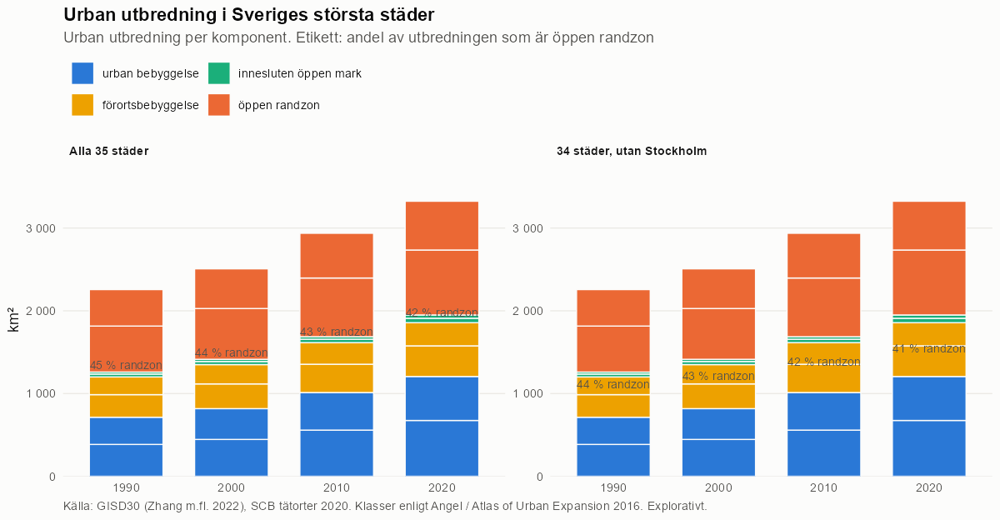

#### Alla 35 städer (km²)

|  | urban bebyggelse | förortsbebyggelse | innesluten öppen mark | öppen randzon | utbredning | % randzon | bebyggd mark |
|---|---|---|---|---|---|---|---|
| 1990 | 384,7 | 273,1 | 34,7 | 555,8 | 1 248,2 | 44,5 | 662,1 |
| 2000 | 445,1 | 299,2 | 37,8 | 613,8 | 1 395,8 | 44,0 | 749,0 |
| 2010 | 557,8 | 341,8 | 41,6 | 709,8 | 1 651,0 | 43,0 | 904,4 |
| 2020 | 674,4 | 370,6 | 53,6 | 785,2 | 1 883,8 | 41,7 | 1 050,9 |

#### 34 städer, utan Stockholm (km²)

|  | urban bebyggelse | förortsbebyggelse | innesluten öppen mark | öppen randzon | utbredning | % randzon | bebyggd mark |
|---|---|---|---|---|---|---|---|
| 1990 | 328,7 | 214,1 | 24,5 | 440,8 | 1 008,1 | 43,7 | 546,1 |
| 2000 | 372,2 | 233,3 | 26,2 | 479,8 | 1 111,6 | 43,2 | 608,8 |
| 2010 | 454,5 | 261,1 | 30,2 | 540,6 | 1 286,3 | 42,0 | 719,2 |
| 2020 | 531,7 | 279,4 | 40,0 | 589,7 | 1 440,8 | 40,9 | 815,5 |

Årlig tillväxt 1990-2020: bebyggd mark 1,55 %, utbredning utan randzon 1,55 %, utbredning med randzon 1,38 % (alla 35); 1,35, 1,36 och 1,20 % utan Stockholm.

### Hur varje stad växer

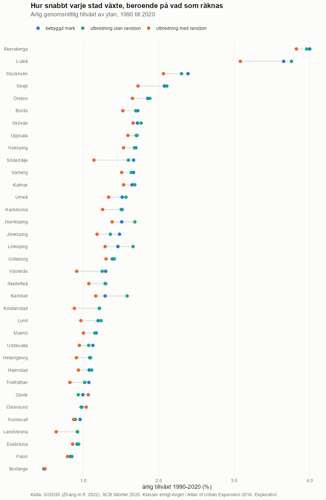

| Takt | Städer |
|---|---|
| **mycket snabb** | [Åkersberga](#åkersberga) |
| **snabb** | [Luleå](#luleå) |
| **måttlig** | [Stockholm](#stockholm), [Uppsala](#uppsala), [Örebro](#örebro), [Norrköping](#norrköping), [Umeå](#umeå), [Södertälje](#södertälje), [Borås](#borås), [Växjö](#växjö), [Kalmar](#kalmar), [Skövde](#skövde), [Nyköping](#nyköping), [Karlskrona](#karlskrona), [Varberg](#varberg) |
| **långsam** | [Göteborg](#göteborg), [Malmö](#malmö), [Västerås](#västerås), [Linköping](#linköping), [Helsingborg](#helsingborg), [Jönköping](#jönköping), [Lund](#lund), [Gävle](#gävle), [Halmstad](#halmstad), [Eskilstuna](#eskilstuna), [Karlstad](#karlstad), [Sundsvall](#sundsvall), [Östersund](#östersund), [Trollhättan](#trollhättan), [Borlänge](#borlänge), [Kristianstad](#kristianstad), [Falun](#falun), [Skellefteå](#skellefteå), [Uddevalla](#uddevalla), [Landskrona](#landskrona) |

| Form | Städer |
|---|---|
| **förtätas** | [Stockholm](#stockholm), [Malmö](#malmö), [Västerås](#västerås), [Örebro](#örebro), [Helsingborg](#helsingborg), [Jönköping](#jönköping), [Lund](#lund), [Södertälje](#södertälje), [Växjö](#växjö), [Trollhättan](#trollhättan), [Luleå](#luleå), [Kristianstad](#kristianstad), [Karlskrona](#karlskrona), [Skellefteå](#skellefteå), [Landskrona](#landskrona) |
| **stabil** | [Göteborg](#göteborg), [Uppsala](#uppsala), [Linköping](#linköping), [Norrköping](#norrköping), [Umeå](#umeå), [Gävle](#gävle), [Borås](#borås), [Halmstad](#halmstad), [Eskilstuna](#eskilstuna), [Karlstad](#karlstad), [Sundsvall](#sundsvall), [Östersund](#östersund), [Borlänge](#borlänge), [Kalmar](#kalmar), [Skövde](#skövde), [Falun](#falun), [Nyköping](#nyköping), [Varberg](#varberg), [Uddevalla](#uddevalla), [Åkersberga](#åkersberga) |
| **sprids ut** | inga |

**Att kontrollera** (bebyggd mark ≥ 4 % per år, se förbehållen): [Åkersberga](#åkersberga).

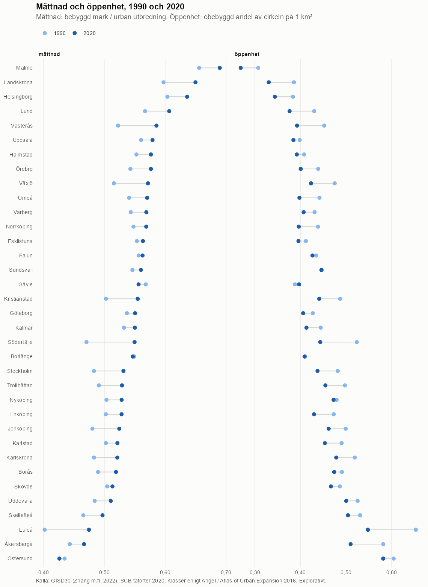

### Hur mycket den öppna randzonen betyder

#### För stadens storlek

År 2020 är randzonen mellan 29,5 % och 57,1 % av den urbana utbredningen; att räkna med den lägger till 42-133 % till ytan av resten. Allt som delas med den urbana utbredningen (befolkningstäthet, andel av staden i ett visst tillstånd) rör sig så mycket beroende på om randzonen räknas.

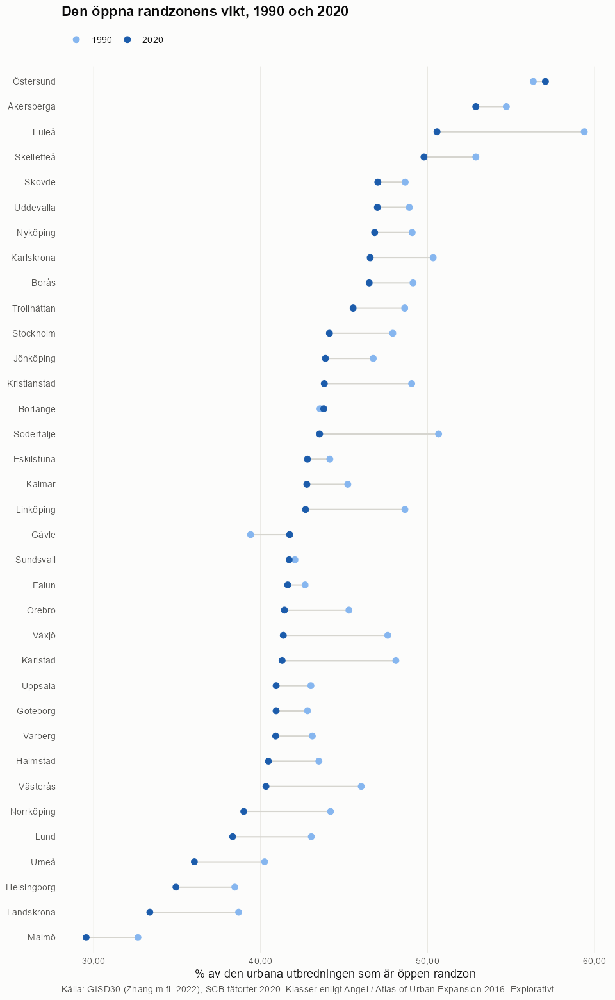

#### För tillväxten

Att räkna med randzonen ändrar tillväxttakten 1990-2020 med mindre än 0,2 procentenheter per år i 20 av de 35 städerna. Den sänker tillväxten mest där staden bygger på sin gamla randzon ([Luleå](#luleå), [Södertälje](#södertälje), [Karlstad](#karlstad)) och höjer den mest där nya spridda fläckar ger ny randzon ([Gävle](#gävle), [Östersund](#östersund), [Borlänge](#borlänge)).

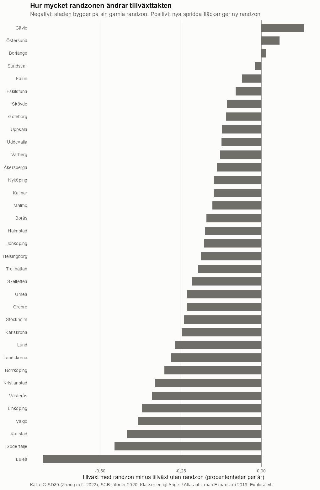

### Alla städer

Tillväxt i % per år, 1990-2020. Utbredning i km², 2020. Befolkning: tätort 2020 (SCB).

| Stad | Län | befolkning | utbredning 2020 | bebyggd mark | utan randzon | med randzon | skillnad | % randzon 2020 | mättnad | takt | form |
|---|---|---|---|---|---|---|---|---|---|---|---|
| [Stockholm](#stockholm) | Stockholm | 1 617 407 | 443,0 | 2,39 | 2,30 | 2,06 | -0,24 | 44,1 | 0,48 → 0,53 | måttlig | förtätas |
| [Göteborg](#göteborg) | Västra Götaland | 607 882 | 228,9 | 1,39 | 1,41 | 1,30 | -0,11 | 40,9 | 0,54 → 0,55 | långsam | stabil |
| [Malmö](#malmö) | Skåne | 325 069 | 117,4 | 1,17 | 1,15 | 1,00 | -0,15 | 29,5 | 0,66 → 0,69 | långsam | förtätas |
| [Uppsala](#uppsala) | Uppsala | 166 698 | 47,6 | 1,70 | 1,71 | 1,59 | -0,12 | 40,9 | 0,56 → 0,58 | måttlig | stabil |
| [Västerås](#västerås) | Västmanland | 128 660 | 56,6 | 1,30 | 1,25 | 0,91 | -0,34 | 40,3 | 0,52 → 0,59 | långsam | förtätas |
| [Örebro](#örebro) | Örebro | 126 604 | 52,1 | 1,85 | 1,88 | 1,65 | -0,23 | 41,4 | 0,54 → 0,58 | måttlig | förtätas |
| [Linköping](#linköping) | Östergötland | 115 682 | 51,9 | 1,46 | 1,66 | 1,29 | -0,37 | 42,7 | 0,50 → 0,53 | långsam | stabil |
| [Helsingborg](#helsingborg) | Skåne | 113 828 | 55,0 | 1,08 | 1,10 | 0,91 | -0,19 | 34,9 | 0,60 → 0,64 | långsam | förtätas |
| [Jönköping](#jönköping) | Jönköping | 100 579 | 37,3 | 1,48 | 1,36 | 1,18 | -0,18 | 43,9 | 0,48 → 0,52 | långsam | förtätas |
| [Norrköping](#norrköping) | Östergötland | 98 088 | 46,7 | 1,51 | 1,68 | 1,38 | -0,30 | 39,0 | 0,55 → 0,57 | måttlig | stabil |
| [Lund](#lund) | Skåne | 94 393 | 32,6 | 1,20 | 1,24 | 0,97 | -0,27 | 38,3 | 0,57 → 0,61 | långsam | förtätas |
| [Umeå](#umeå) | Västerbotten | 91 916 | 46,8 | 1,52 | 1,57 | 1,33 | -0,23 | 36,0 | 0,54 → 0,57 | måttlig | stabil |
| [Gävle](#gävle) | Gävleborg | 79 004 | 61,2 | 0,99 | 0,93 | 1,07 | +0,13 | 41,7 | 0,57 → 0,56 | långsam | stabil |
| [Södertälje](#södertälje) | Stockholm | 76 320 | 33,9 | 1,67 | 1,60 | 1,14 | -0,46 | 43,5 | 0,47 → 0,55 | måttlig | förtätas |
| [Borås](#borås) | Västra Götaland | 74 042 | 30,8 | 1,72 | 1,69 | 1,52 | -0,17 | 46,5 | 0,49 → 0,52 | måttlig | stabil |
| [Halmstad](#halmstad) | Halland | 71 422 | 42,3 | 1,08 | 1,11 | 0,93 | -0,18 | 40,5 | 0,55 → 0,58 | långsam | stabil |
| [Växjö](#växjö) | Kronoberg | 71 282 | 35,2 | 2,07 | 2,11 | 1,72 | -0,38 | 41,4 | 0,52 → 0,57 | måttlig | förtätas |
| [Eskilstuna](#eskilstuna) | Södermanland | 69 948 | 25,9 | 0,92 | 0,94 | 0,86 | -0,08 | 42,8 | 0,55 → 0,56 | långsam | stabil |
| [Karlstad](#karlstad) | Värmland | 67 122 | 36,1 | 1,29 | 1,58 | 1,16 | -0,42 | 41,3 | 0,50 → 0,52 | långsam | stabil |
| [Sundsvall](#sundsvall) | Västernorrland | 58 813 | 60,9 | 0,96 | 0,89 | 0,87 | -0,02 | 41,7 | 0,55 → 0,56 | långsam | stabil |
| [Östersund](#östersund) | Jämtland | 52 980 | 8,0 | 0,97 | 0,98 | 1,04 | +0,06 | 57,1 | 0,43 → 0,43 | långsam | stabil |
| [Trollhättan](#trollhättan) | Västra Götaland | 50 502 | 26,5 | 1,07 | 1,02 | 0,82 | -0,20 | 45,5 | 0,49 → 0,53 | långsam | förtätas |
| [Luleå](#luleå) | Norrbotten | 49 123 | 26,3 | 3,66 | 3,76 | 3,08 | -0,68 | 50,6 | 0,40 → 0,47 | snabb | förtätas |
| [Borlänge](#borlänge) | Dalarna | 44 898 | 38,3 | 0,48 | 0,48 | 0,49 | +0,01 | 43,8 | 0,55 → 0,55 | långsam | stabil |
| [Kalmar](#kalmar) | Kalmar | 41 852 | 27,3 | 1,64 | 1,68 | 1,53 | -0,15 | 42,8 | 0,53 → 0,55 | måttlig | stabil |
| [Kristianstad](#kristianstad) | Skåne | 41 299 | 24,8 | 1,21 | 1,21 | 0,88 | -0,33 | 43,8 | 0,50 → 0,55 | långsam | förtätas |
| [Skövde](#skövde) | Västra Götaland | 39 580 | 22,4 | 1,72 | 1,77 | 1,66 | -0,11 | 47,0 | 0,50 → 0,51 | måttlig | stabil |
| [Falun](#falun) | Dalarna | 39 492 | 30,5 | 0,83 | 0,85 | 0,79 | -0,06 | 41,6 | 0,56 → 0,56 | långsam | stabil |
| [Nyköping](#nyköping) | Södermanland | 38 780 | 19,0 | 1,70 | 1,68 | 1,53 | -0,15 | 46,8 | 0,50 → 0,53 | måttlig | stabil |
| [Karlskrona](#karlskrona) | Blekinge | 36 904 | 21,0 | 1,51 | 1,50 | 1,26 | -0,25 | 46,6 | 0,48 → 0,52 | måttlig | förtätas |
| [Skellefteå](#skellefteå) | Västerbotten | 36 388 | 21,9 | 1,30 | 1,29 | 1,07 | -0,22 | 49,8 | 0,47 → 0,50 | långsam | förtätas |
| [Varberg](#varberg) | Halland | 36 327 | 23,3 | 1,66 | 1,64 | 1,51 | -0,13 | 40,9 | 0,54 → 0,57 | måttlig | stabil |
| [Uddevalla](#uddevalla) | Västra Götaland | 35 916 | 21,7 | 1,13 | 1,07 | 0,95 | -0,12 | 47,0 | 0,48 → 0,51 | långsam | stabil |
| [Åkersberga](#åkersberga) | Stockholm | 35 747 | 12,4 | 4,00 | 3,96 | 3,82 | -0,14 | 52,9 | 0,44 → 0,47 | mycket snabb | stabil |
| [Landskrona](#landskrona) | Skåne | 33 466 | 18,0 | 0,92 | 0,92 | 0,64 | -0,28 | 33,4 | 0,60 → 0,65 | långsam | förtätas |

## Städer

### Stockholm

Län: Stockholm. Tätortens befolkning 2020 (SCB): 1 617 407.

Den bebyggda marken i stadens urbana utbredning växte från **116,0 km²** år 1990 till **235,4 km²** år 2020, **2,39 % per år** (takt: **måttlig**). Den urbana utbredningen gick från 240,1 till 443,0 km². Mättnaden gick från 0,48 till 0,53 (form: **förtätas**).

Den öppna randzonen var 47,9 % av den urbana utbredningen 1990 och 44,1 % 2020; år 2020 lägger den till 79 % till resten av utbredningen. Att räkna med den ändrar tillväxttakten 1990-2020 från 2,30 % till 2,06 % per år (-0,24 procentenheter).

#### Tillväxt per klass

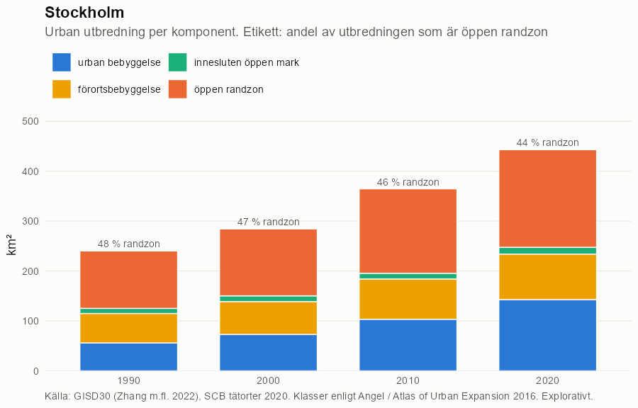

|  | urban bebyggelse | förortsbebyggelse | innesluten öppen mark | öppen randzon | utbredning | % randzon | bebyggd mark | mättnad | öppenhet | fotavtryck 2007 |
|---|---|---|---|---|---|---|---|---|---|---|
| 1990 | 55,9 | 59,0 | 10,2 | 115,1 | 240,1 | 47,9 | 116,0 | 0,48 | 0,48 | 375,4 |
| 2000 | 72,9 | 65,9 | 11,5 | 134,0 | 284,3 | 47,1 | 140,2 | 0,49 | 0,47 | 435,7 |
| 2010 | 103,3 | 80,7 | 11,4 | 169,3 | 364,7 | 46,4 | 185,2 | 0,51 | 0,46 | 507,8 |
| 2020 | 142,7 | 91,2 | 13,6 | 195,5 | 443,0 | 44,1 | 235,4 | 0,53 | 0,44 | 573,4 |

km². Landsbygdsbebyggelse och öppen landsbygd ligger utanför den urbana utbredningen; de syns på kartorna.

#### Tillväxt per decennium

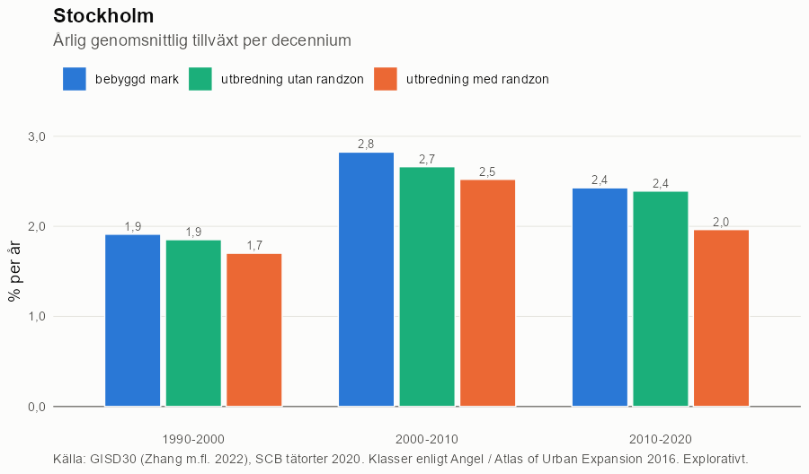

| Decennium | bebyggd mark | utbredning utan randzon | utbredning med randzon |
|---|---|---|---|
| 1990-2000 | 1,91 | 1,85 | 1,70 |
| 2000-2010 | 2,82 | 2,66 | 2,52 |
| 2010-2020 | 2,43 | 2,39 | 1,96 |

% per år.

#### Kartor

<table>
<tr><td><a href="img/maps/stockholm_1990.png">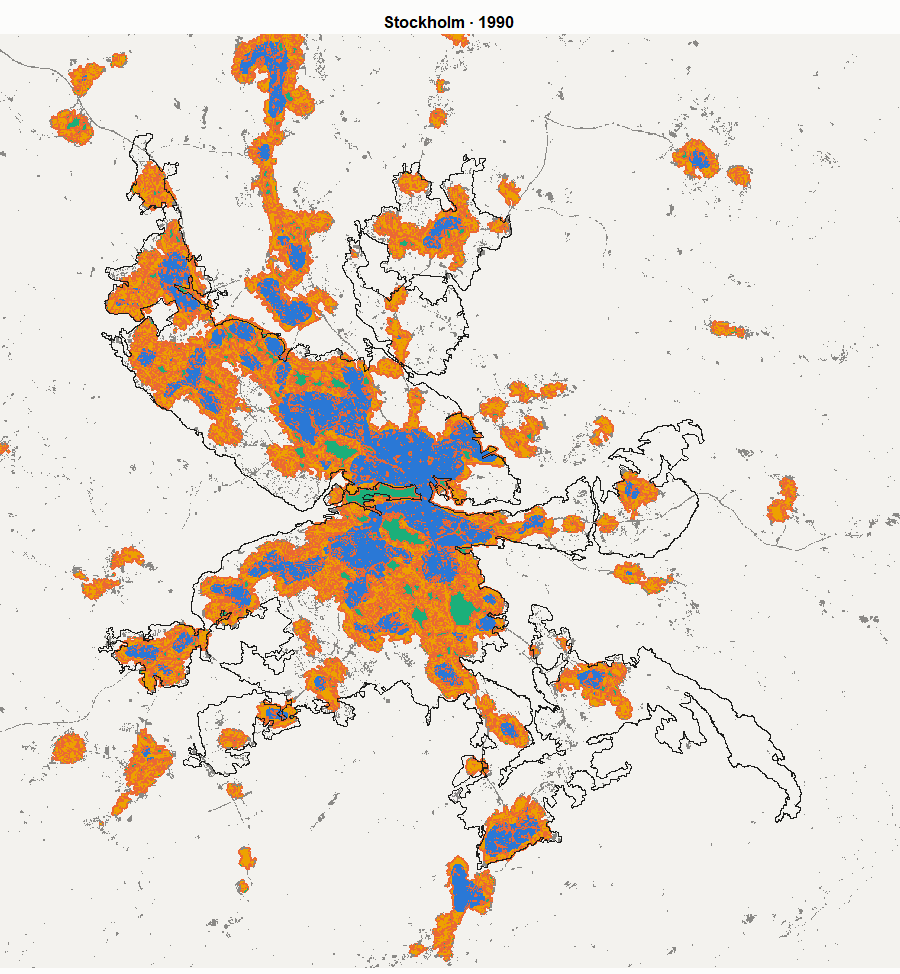</a></td><td><a href="img/maps/stockholm_2000.png">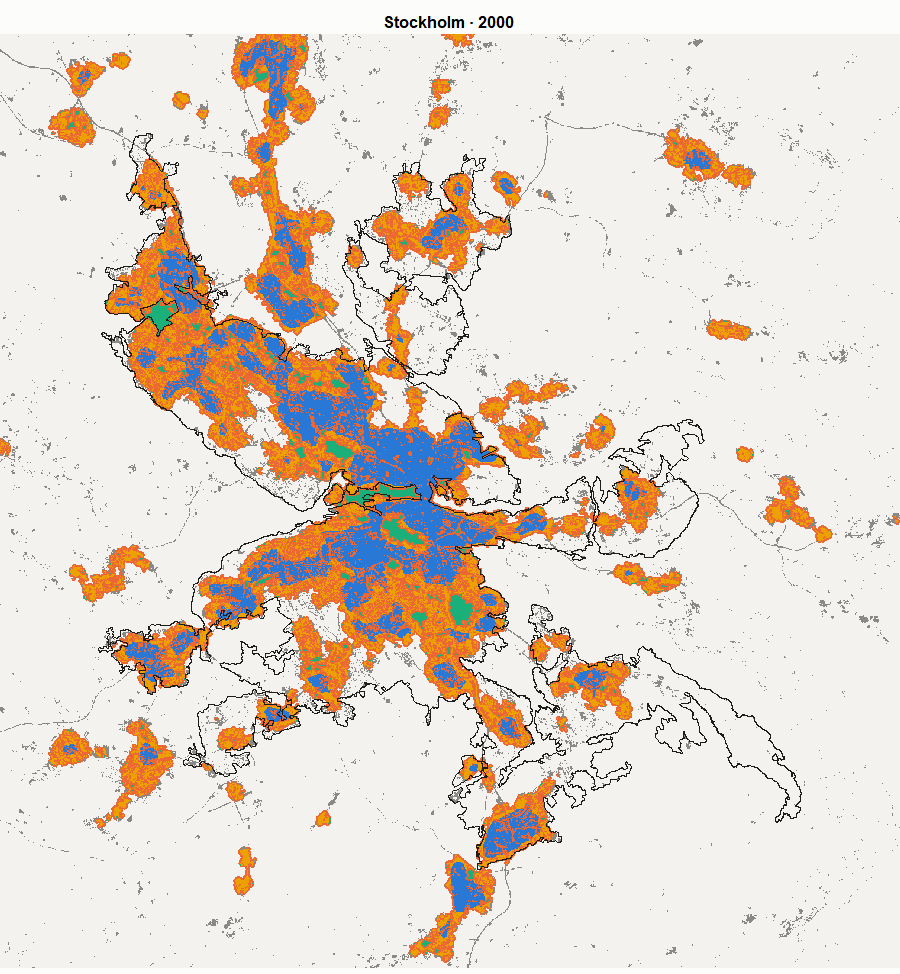</a></td></tr>
<tr><td><a href="img/maps/stockholm_2010.png">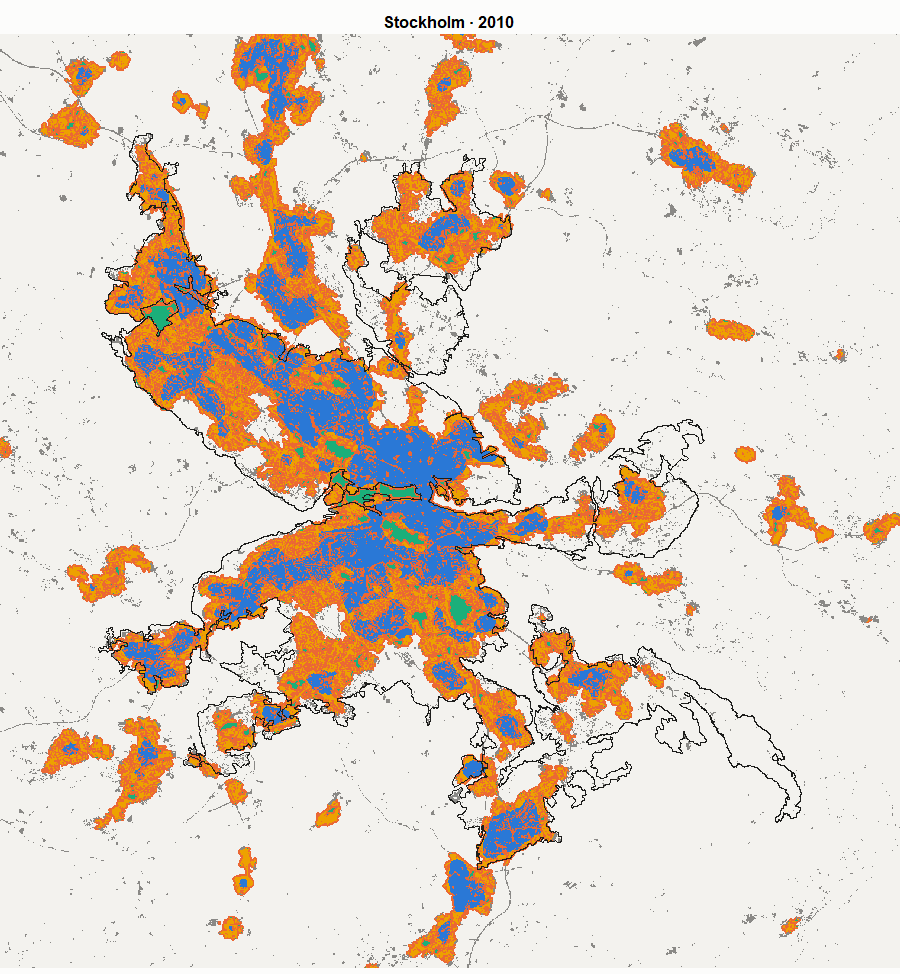</a></td><td><a href="img/maps/stockholm_2020.png">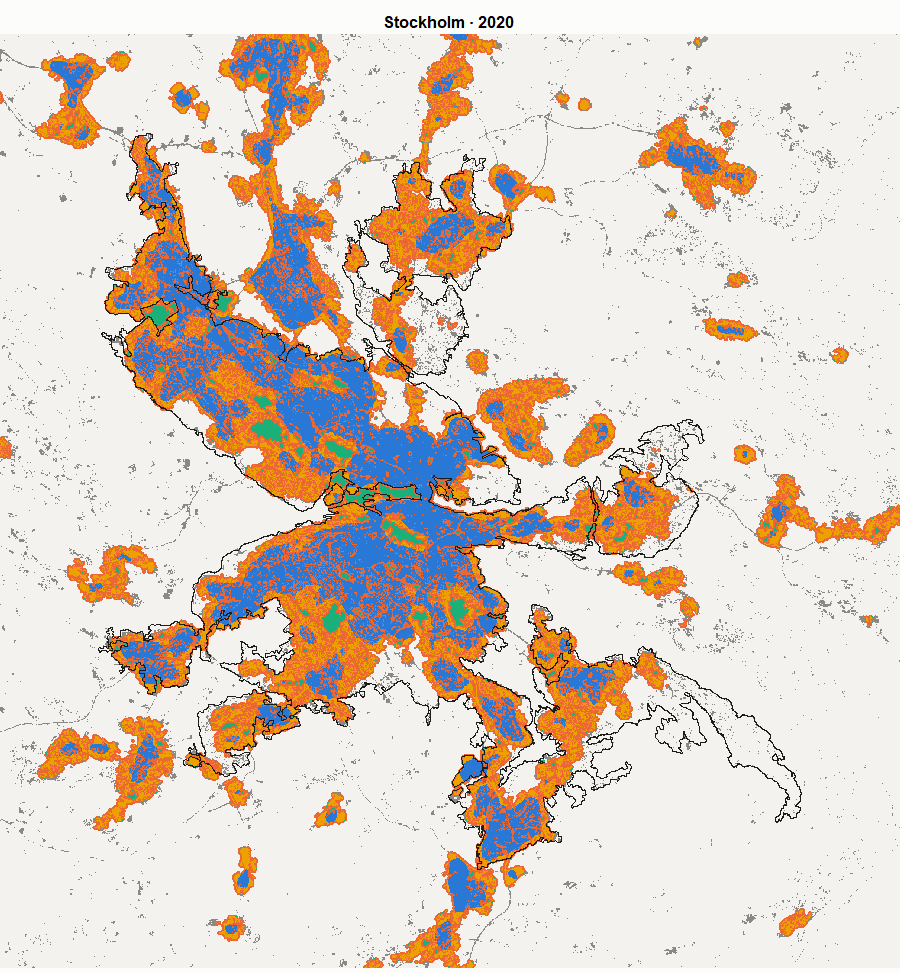</a></td></tr>
</table>

Kartorna visar tätorten plus 5 km; måtten använder den större rutan i `cajas.md` (slug `stockholm`).

[Tillbaka till innehållet](#innehåll)

### Göteborg

Län: Västra Götaland. Tätortens befolkning 2020 (SCB): 607 882.

Den bebyggda marken i stadens urbana utbredning växte från **83,4 km²** år 1990 till **126,0 km²** år 2020, **1,39 % per år** (takt: **långsam**). Den urbana utbredningen gick från 155,3 till 228,9 km². Mättnaden gick från 0,54 till 0,55 (form: **stabil**).

Den öppna randzonen var 42,8 % av den urbana utbredningen 1990 och 40,9 % 2020; år 2020 lägger den till 69 % till resten av utbredningen. Att räkna med den ändrar tillväxttakten 1990-2020 från 1,41 % till 1,30 % per år (-0,11 procentenheter).

#### Tillväxt per klass

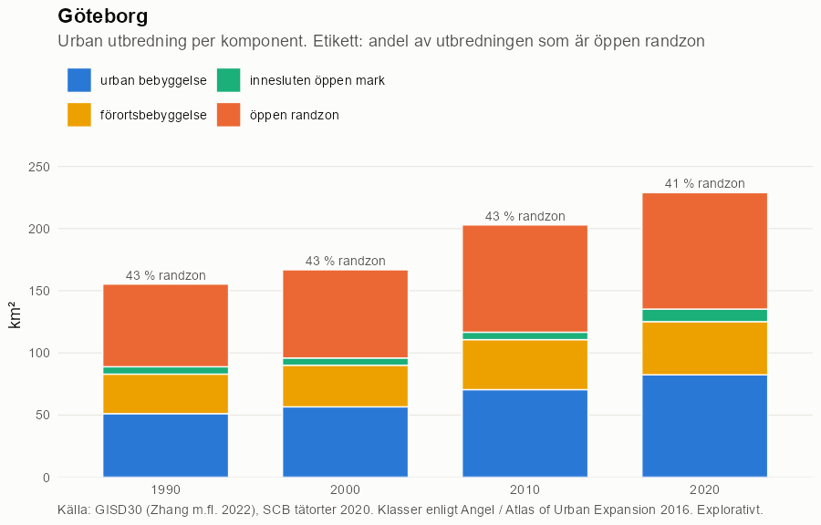

|  | urban bebyggelse | förortsbebyggelse | innesluten öppen mark | öppen randzon | utbredning | % randzon | bebyggd mark | mättnad | öppenhet | fotavtryck 2007 |
|---|---|---|---|---|---|---|---|---|---|---|
| 1990 | 51,1 | 31,8 | 5,9 | 66,5 | 155,3 | 42,8 | 83,4 | 0,54 | 0,43 | 217,6 |
| 2000 | 56,6 | 33,5 | 5,8 | 71,0 | 166,8 | 42,5 | 90,6 | 0,54 | 0,42 | 234,5 |
| 2010 | 70,4 | 40,2 | 6,0 | 86,3 | 202,9 | 42,5 | 111,3 | 0,55 | 0,42 | 263,0 |
| 2020 | 82,4 | 42,8 | 10,1 | 93,7 | 228,9 | 40,9 | 126,0 | 0,55 | 0,41 | 313,8 |

km². Landsbygdsbebyggelse och öppen landsbygd ligger utanför den urbana utbredningen; de syns på kartorna.

#### Tillväxt per decennium

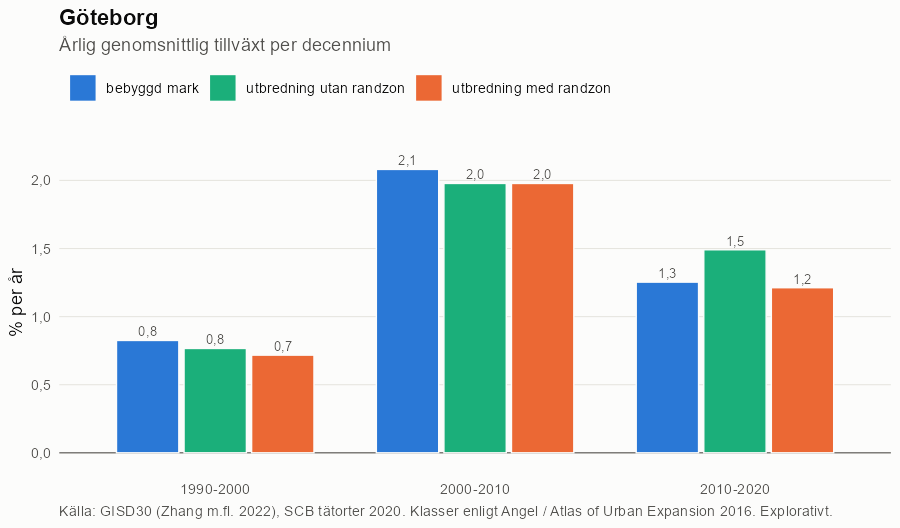

| Decennium | bebyggd mark | utbredning utan randzon | utbredning med randzon |
|---|---|---|---|
| 1990-2000 | 0,83 | 0,77 | 0,72 |
| 2000-2010 | 2,08 | 1,98 | 1,98 |
| 2010-2020 | 1,25 | 1,49 | 1,21 |

% per år.

#### Kartor

<table>
<tr><td><a href="img/maps/goteborg_1990.png">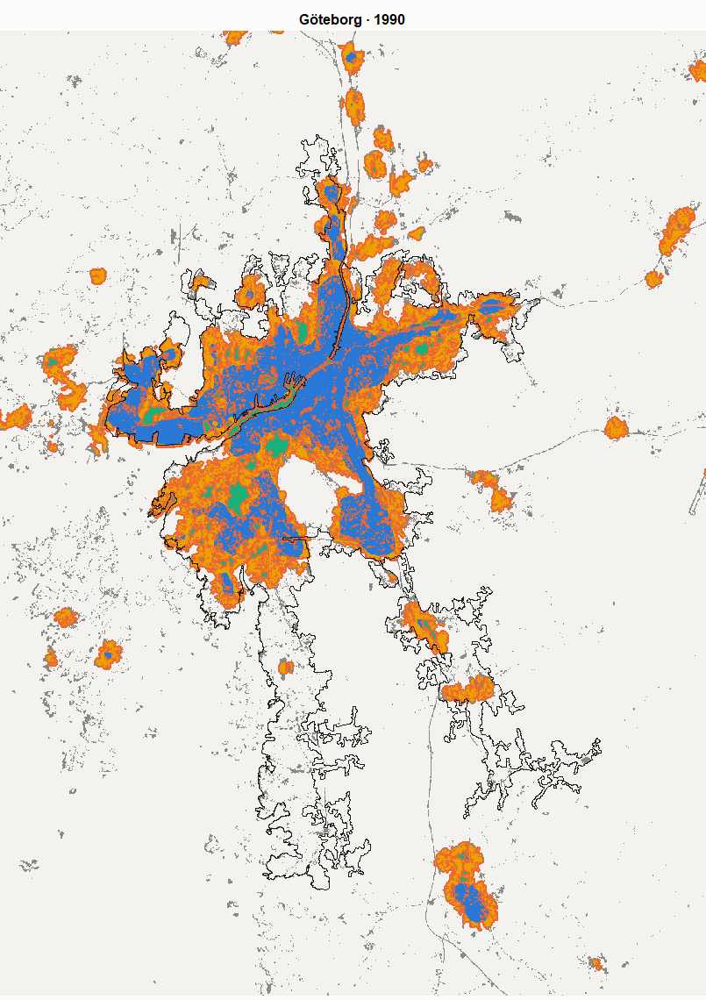</a></td><td><a href="img/maps/goteborg_2000.png">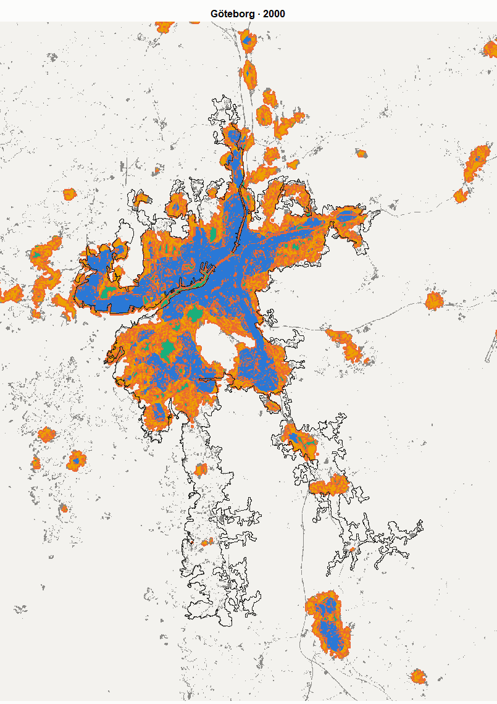</a></td></tr>
<tr><td><a href="img/maps/goteborg_2010.png">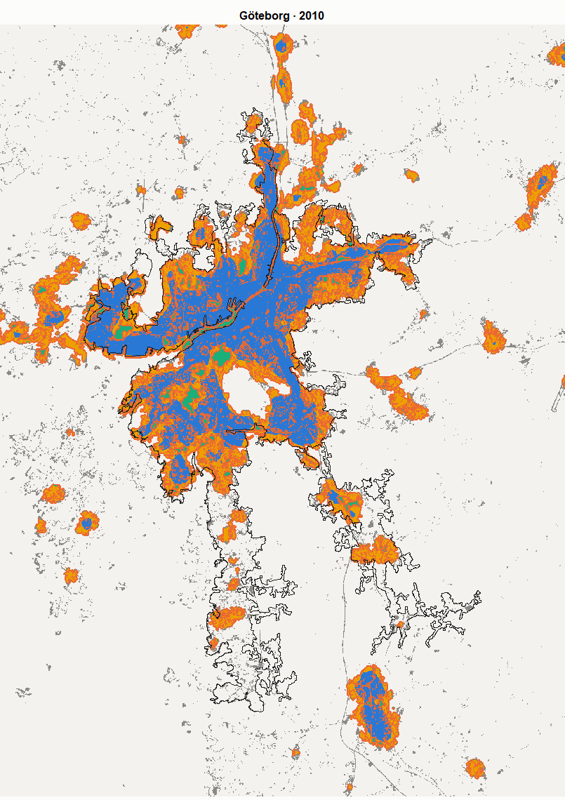</a></td><td><a href="img/maps/goteborg_2020.png">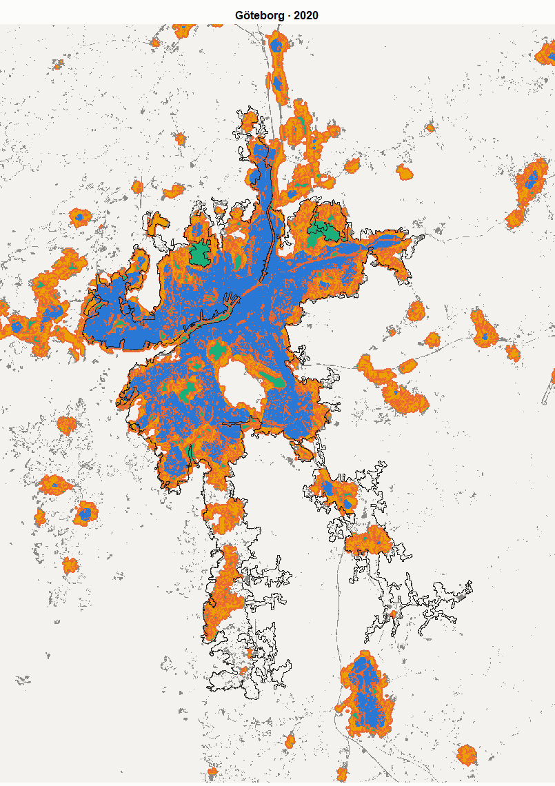</a></td></tr>
</table>

Kartorna visar tätorten plus 5 km; måtten använder den större rutan i `cajas.md` (slug `goteborg`).

[Tillbaka till innehållet](#innehåll)

### Malmö

Län: Skåne. Tätortens befolkning 2020 (SCB): 325 069.

Den bebyggda marken i stadens urbana utbredning växte från **57,1 km²** år 1990 till **80,9 km²** år 2020, **1,17 % per år** (takt: **långsam**). Den urbana utbredningen gick från 87,1 till 117,4 km². Mättnaden gick från 0,66 till 0,69 (form: **förtätas**).

Den öppna randzonen var 32,7 % av den urbana utbredningen 1990 och 29,5 % 2020; år 2020 lägger den till 42 % till resten av utbredningen. Att räkna med den ändrar tillväxttakten 1990-2020 från 1,15 % till 1,00 % per år (-0,15 procentenheter).

#### Tillväxt per klass

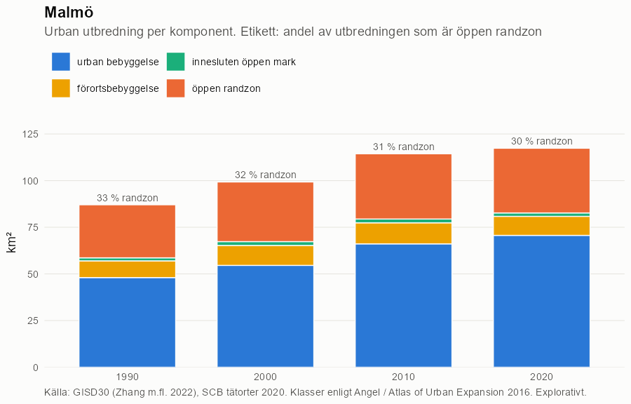

|  | urban bebyggelse | förortsbebyggelse | innesluten öppen mark | öppen randzon | utbredning | % randzon | bebyggd mark | mättnad | öppenhet | fotavtryck 2007 |
|---|---|---|---|---|---|---|---|---|---|---|
| 1990 | 48,0 | 9,0 | 1,6 | 28,4 | 87,1 | 32,7 | 57,1 | 0,66 | 0,31 | 105,6 |
| 2000 | 54,6 | 10,7 | 2,1 | 32,0 | 99,3 | 32,2 | 65,4 | 0,66 | 0,30 | 131,5 |
| 2010 | 66,1 | 11,3 | 2,0 | 35,0 | 114,4 | 30,6 | 77,5 | 0,68 | 0,28 | 139,8 |
| 2020 | 70,7 | 10,2 | 1,8 | 34,7 | 117,4 | 29,5 | 80,9 | 0,69 | 0,27 | 144,3 |

km². Landsbygdsbebyggelse och öppen landsbygd ligger utanför den urbana utbredningen; de syns på kartorna.

#### Tillväxt per decennium

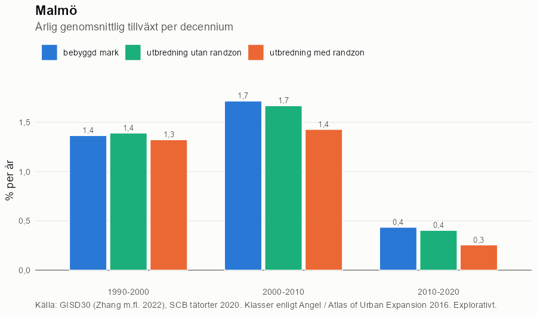

| Decennium | bebyggd mark | utbredning utan randzon | utbredning med randzon |
|---|---|---|---|
| 1990-2000 | 1,37 | 1,39 | 1,32 |
| 2000-2010 | 1,72 | 1,67 | 1,43 |
| 2010-2020 | 0,44 | 0,40 | 0,26 |

% per år.

#### Kartor

<table>
<tr><td><a href="img/maps/malmo_1990.png">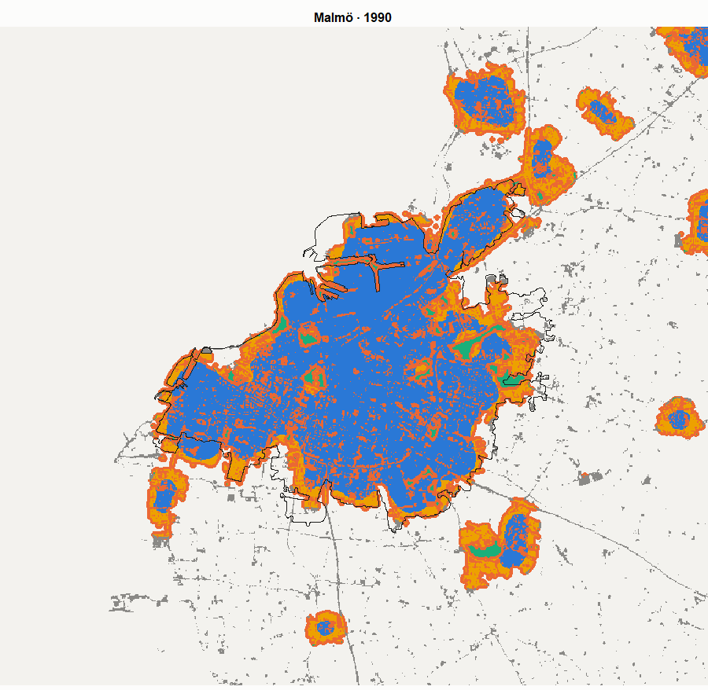</a></td><td><a href="img/maps/malmo_2000.png">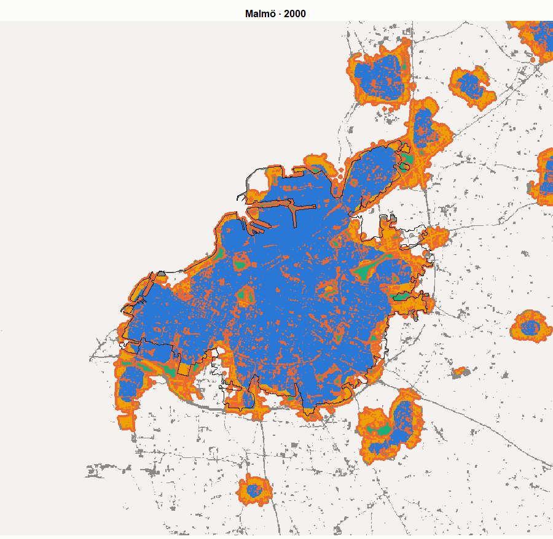</a></td></tr>
<tr><td><a href="img/maps/malmo_2010.png">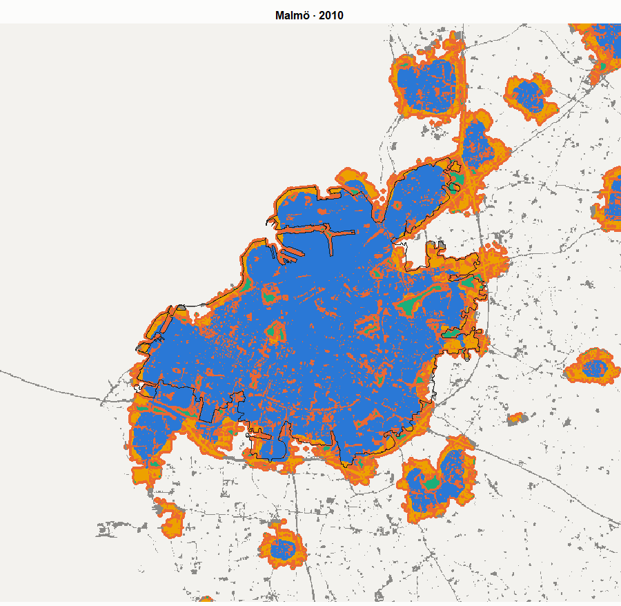</a></td><td><a href="img/maps/malmo_2020.png">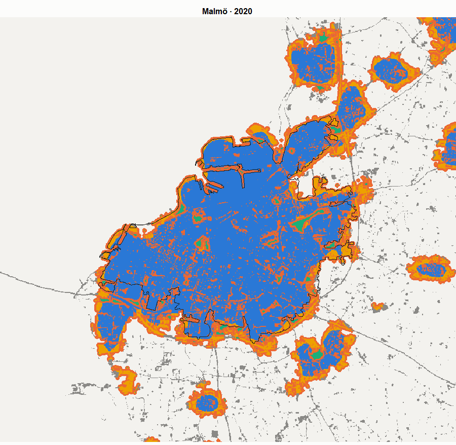</a></td></tr>
</table>

Kartorna visar tätorten plus 5 km; måtten använder den större rutan i `cajas.md` (slug `malmo`).

[Tillbaka till innehållet](#innehåll)

### Uppsala

Län: Uppsala. Tätortens befolkning 2020 (SCB): 166 698.

Den bebyggda marken i stadens urbana utbredning växte från **16,6 km²** år 1990 till **27,6 km²** år 2020, **1,70 % per år** (takt: **måttlig**). Den urbana utbredningen gick från 29,7 till 47,6 km². Mättnaden gick från 0,56 till 0,58 (form: **stabil**).

Den öppna randzonen var 43,0 % av den urbana utbredningen 1990 och 40,9 % 2020; år 2020 lägger den till 69 % till resten av utbredningen. Att räkna med den ändrar tillväxttakten 1990-2020 från 1,71 % till 1,59 % per år (-0,12 procentenheter).

#### Tillväxt per klass

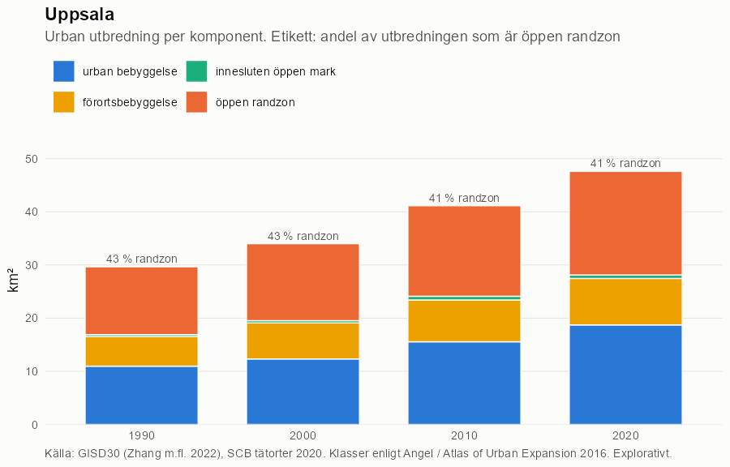

|  | urban bebyggelse | förortsbebyggelse | innesluten öppen mark | öppen randzon | utbredning | % randzon | bebyggd mark | mättnad | öppenhet | fotavtryck 2007 |
|---|---|---|---|---|---|---|---|---|---|---|
| 1990 | 11,0 | 5,6 | 0,4 | 12,8 | 29,7 | 43,0 | 16,6 | 0,56 | 0,40 | 38,2 |
| 2000 | 12,3 | 6,8 | 0,4 | 14,5 | 34,0 | 42,6 | 19,2 | 0,56 | 0,40 | 44,9 |
| 2010 | 15,5 | 7,9 | 0,7 | 17,0 | 41,1 | 41,4 | 23,5 | 0,57 | 0,39 | 53,3 |
| 2020 | 18,7 | 8,7 | 0,7 | 19,5 | 47,6 | 40,9 | 27,6 | 0,58 | 0,38 | 58,4 |

km². Landsbygdsbebyggelse och öppen landsbygd ligger utanför den urbana utbredningen; de syns på kartorna.

#### Tillväxt per decennium

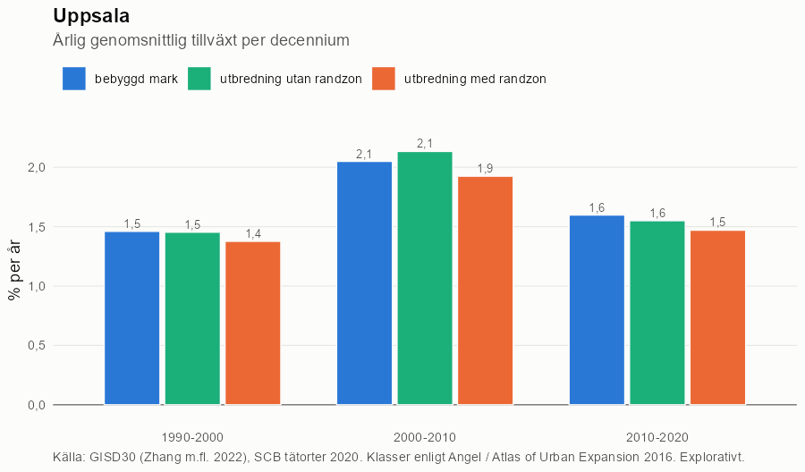

| Decennium | bebyggd mark | utbredning utan randzon | utbredning med randzon |
|---|---|---|---|
| 1990-2000 | 1,46 | 1,45 | 1,38 |
| 2000-2010 | 2,05 | 2,13 | 1,93 |
| 2010-2020 | 1,60 | 1,55 | 1,47 |

% per år.

#### Kartor

<table>
<tr><td><a href="img/maps/uppsala_1990.png">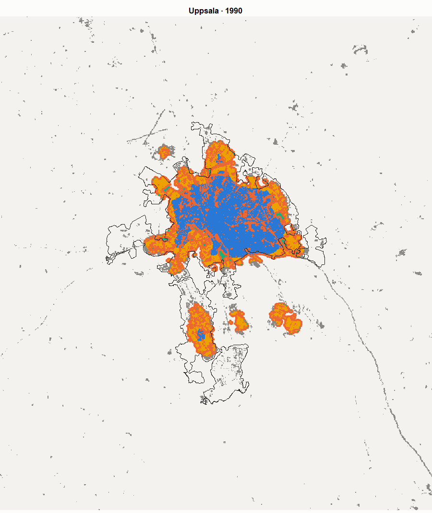</a></td><td><a href="img/maps/uppsala_2000.png">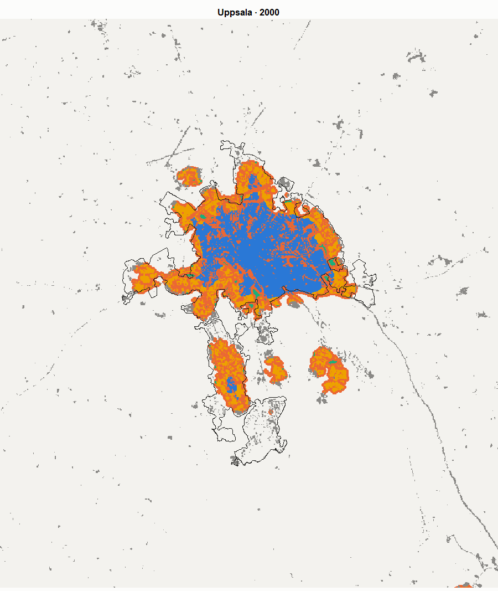</a></td></tr>
<tr><td><a href="img/maps/uppsala_2010.png">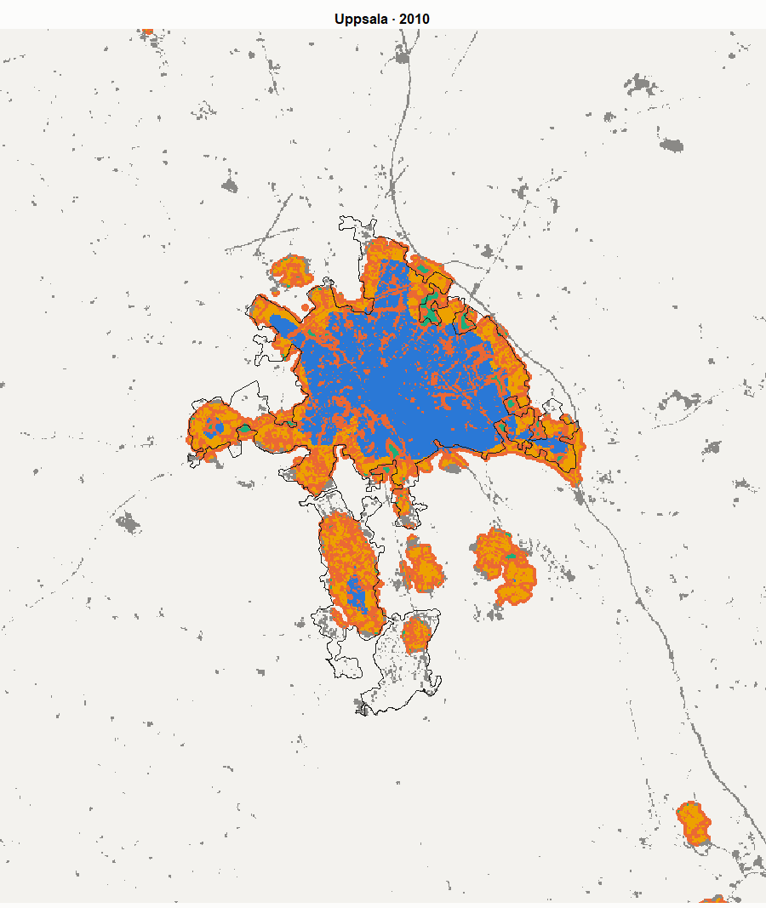</a></td><td><a href="img/maps/uppsala_2020.png">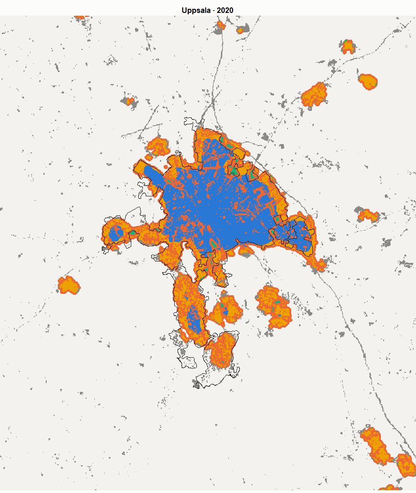</a></td></tr>
</table>

Kartorna visar tätorten plus 5 km; måtten använder den större rutan i `cajas.md` (slug `uppsala`).

[Tillbaka till innehållet](#innehåll)

### Västerås

Län: Västmanland. Tätortens befolkning 2020 (SCB): 128 660.

Den bebyggda marken i stadens urbana utbredning växte från **22,5 km²** år 1990 till **33,2 km²** år 2020, **1,30 % per år** (takt: **långsam**). Den urbana utbredningen gick från 43,1 till 56,6 km². Mättnaden gick från 0,52 till 0,59 (form: **förtätas**).

Den öppna randzonen var 46,0 % av den urbana utbredningen 1990 och 40,3 % 2020; år 2020 lägger den till 68 % till resten av utbredningen. Att räkna med den ändrar tillväxttakten 1990-2020 från 1,25 % till 0,91 % per år (-0,34 procentenheter).

#### Tillväxt per klass

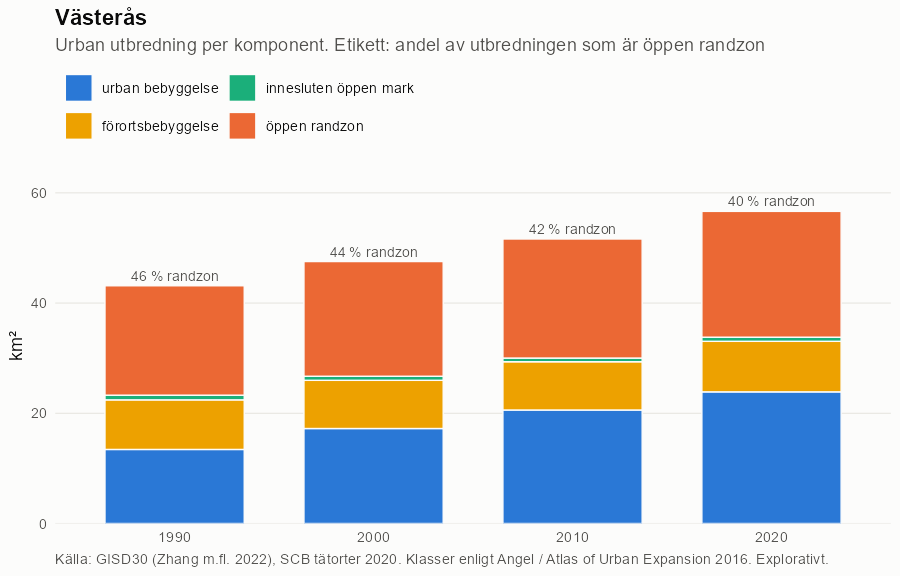

|  | urban bebyggelse | förortsbebyggelse | innesluten öppen mark | öppen randzon | utbredning | % randzon | bebyggd mark | mättnad | öppenhet | fotavtryck 2007 |
|---|---|---|---|---|---|---|---|---|---|---|
| 1990 | 13,4 | 9,0 | 0,8 | 19,9 | 43,1 | 46,0 | 22,5 | 0,52 | 0,45 | 53,9 |
| 2000 | 17,2 | 8,7 | 0,7 | 20,8 | 47,5 | 43,8 | 26,1 | 0,55 | 0,43 | 57,3 |
| 2010 | 20,6 | 8,8 | 0,7 | 21,6 | 51,6 | 41,9 | 29,5 | 0,57 | 0,41 | 62,6 |
| 2020 | 23,9 | 9,2 | 0,7 | 22,8 | 56,6 | 40,3 | 33,2 | 0,59 | 0,39 | 66,0 |

km². Landsbygdsbebyggelse och öppen landsbygd ligger utanför den urbana utbredningen; de syns på kartorna.

#### Tillväxt per decennium

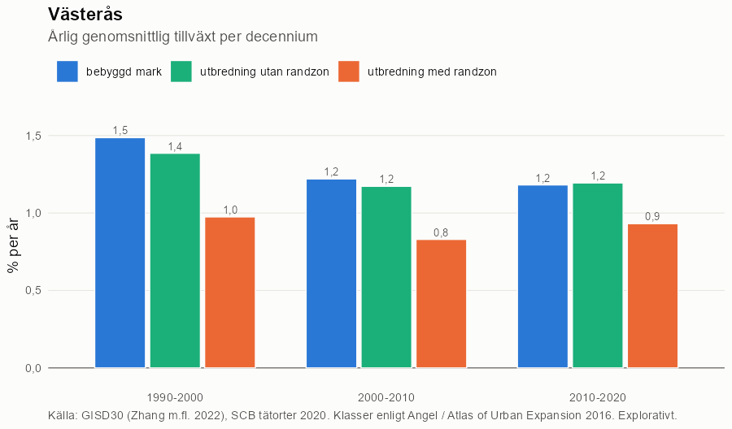

| Decennium | bebyggd mark | utbredning utan randzon | utbredning med randzon |
|---|---|---|---|
| 1990-2000 | 1,49 | 1,39 | 0,97 |
| 2000-2010 | 1,22 | 1,17 | 0,83 |
| 2010-2020 | 1,18 | 1,19 | 0,93 |

% per år.

#### Kartor

<table>
<tr><td><a href="img/maps/vasteras_1990.png">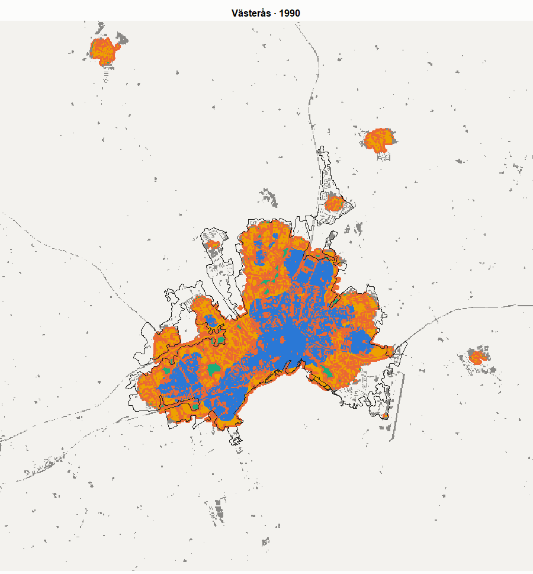</a></td><td><a href="img/maps/vasteras_2000.png">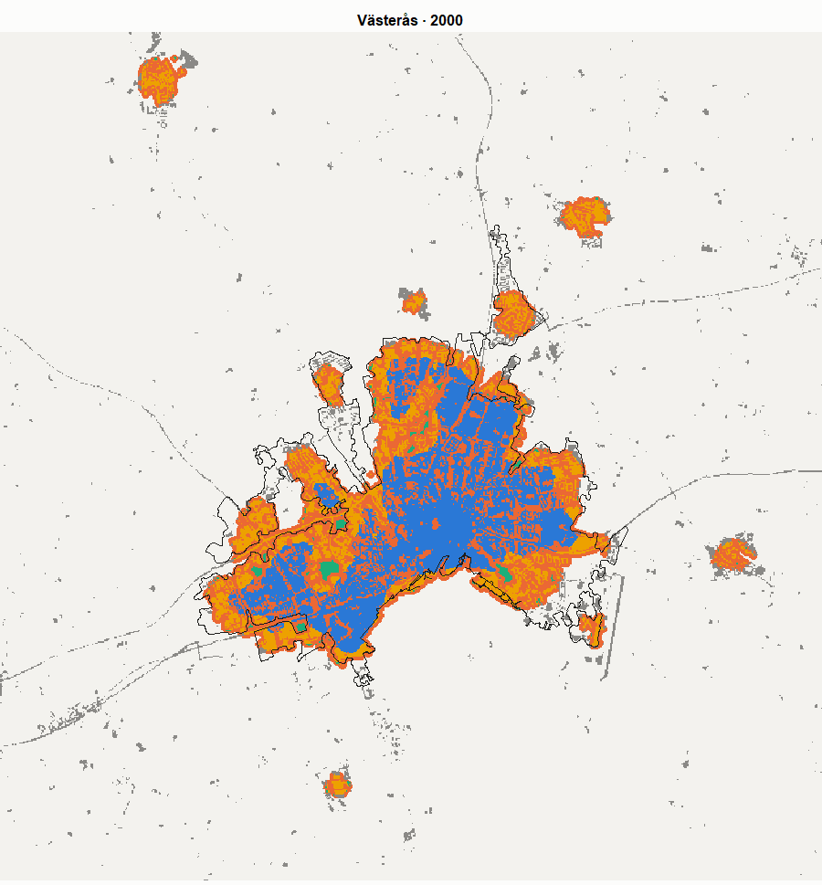</a></td></tr>
<tr><td><a href="img/maps/vasteras_2010.png">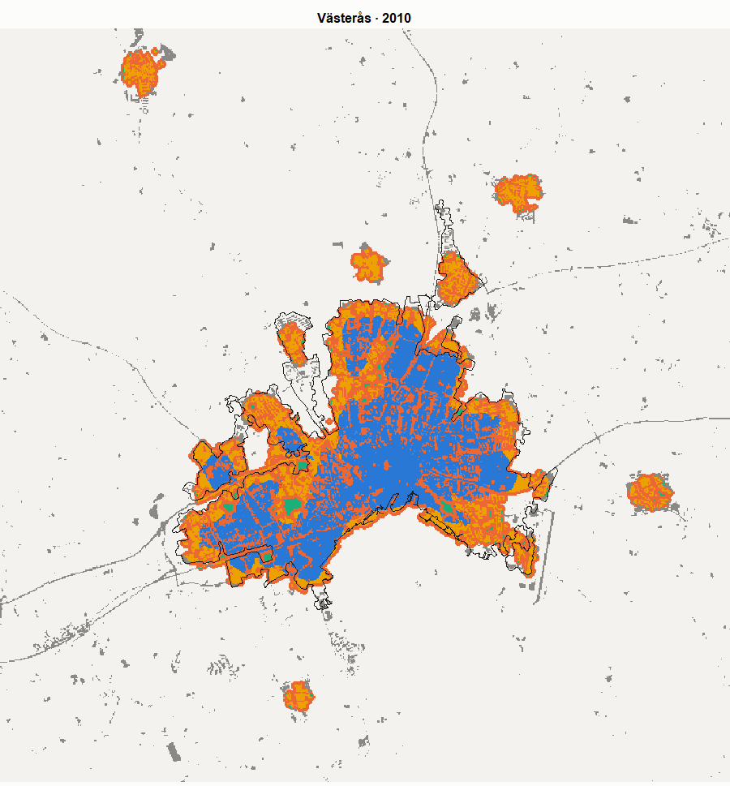</a></td><td><a href="img/maps/vasteras_2020.png">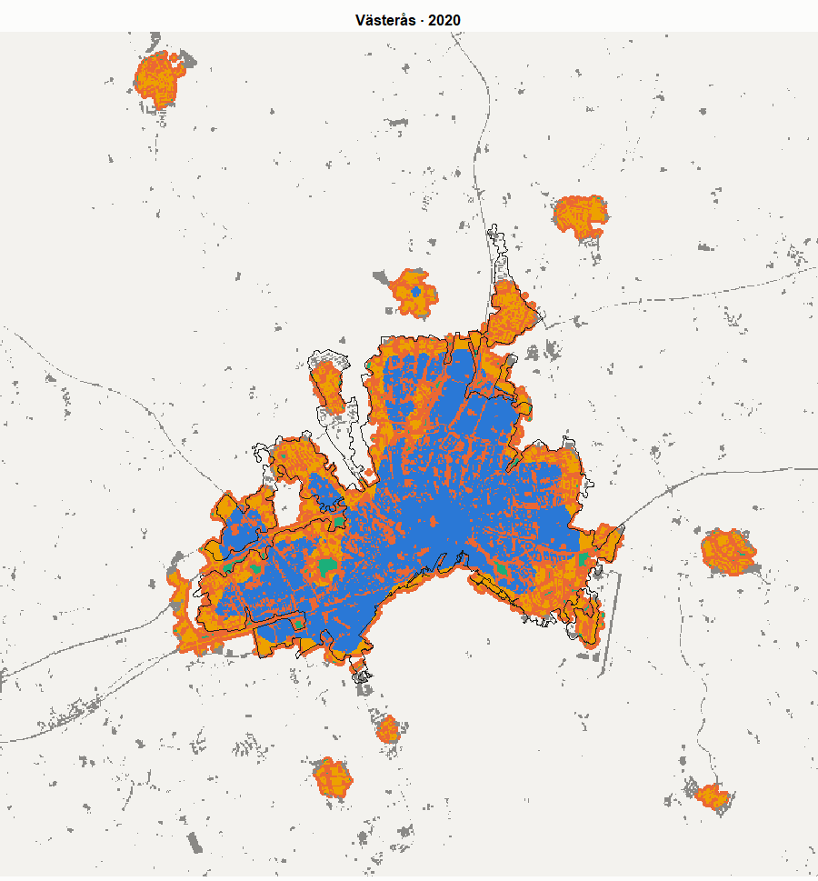</a></td></tr>
</table>

Kartorna visar tätorten plus 5 km; måtten använder den större rutan i `cajas.md` (slug `vasteras`).

[Tillbaka till innehållet](#innehåll)

### Örebro

Län: Örebro. Tätortens befolkning 2020 (SCB): 126 604.

Den bebyggda marken i stadens urbana utbredning växte från **17,3 km²** år 1990 till **30,0 km²** år 2020, **1,85 % per år** (takt: **måttlig**). Den urbana utbredningen gick från 31,9 till 52,1 km². Mättnaden gick från 0,54 till 0,58 (form: **förtätas**).

Den öppna randzonen var 45,3 % av den urbana utbredningen 1990 och 41,4 % 2020; år 2020 lägger den till 71 % till resten av utbredningen. Att räkna med den ändrar tillväxttakten 1990-2020 från 1,88 % till 1,65 % per år (-0,23 procentenheter).

#### Tillväxt per klass

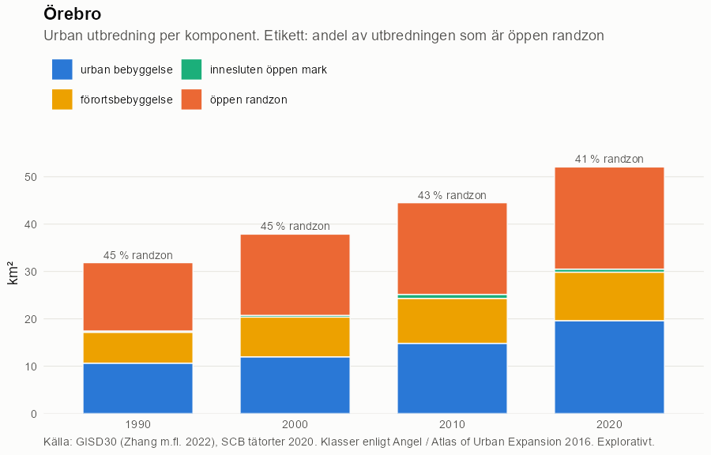

|  | urban bebyggelse | förortsbebyggelse | innesluten öppen mark | öppen randzon | utbredning | % randzon | bebyggd mark | mättnad | öppenhet | fotavtryck 2007 |
|---|---|---|---|---|---|---|---|---|---|---|
| 1990 | 10,6 | 6,5 | 0,3 | 14,4 | 31,9 | 45,3 | 17,3 | 0,54 | 0,44 | 44,4 |
| 2000 | 12,0 | 8,4 | 0,4 | 17,2 | 37,9 | 45,3 | 20,5 | 0,54 | 0,44 | 49,0 |
| 2010 | 14,8 | 9,5 | 0,8 | 19,4 | 44,5 | 43,5 | 24,5 | 0,55 | 0,42 | 54,6 |
| 2020 | 19,6 | 10,2 | 0,6 | 21,6 | 52,1 | 41,4 | 30,0 | 0,58 | 0,40 | 61,9 |

km². Landsbygdsbebyggelse och öppen landsbygd ligger utanför den urbana utbredningen; de syns på kartorna.

#### Tillväxt per decennium

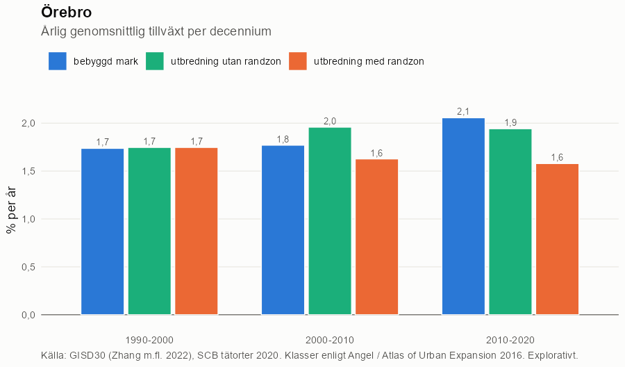

| Decennium | bebyggd mark | utbredning utan randzon | utbredning med randzon |
|---|---|---|---|
| 1990-2000 | 1,74 | 1,75 | 1,75 |
| 2000-2010 | 1,77 | 1,96 | 1,63 |
| 2010-2020 | 2,06 | 1,94 | 1,58 |

% per år.

#### Kartor

<table>
<tr><td><a href="img/maps/orebro_1990.png">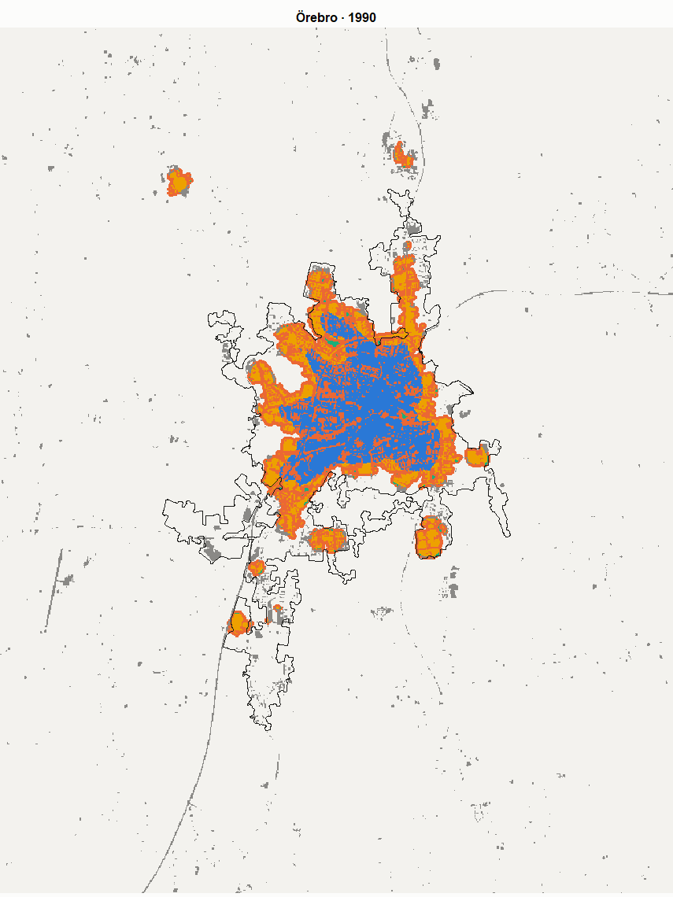</a></td><td><a href="img/maps/orebro_2000.png">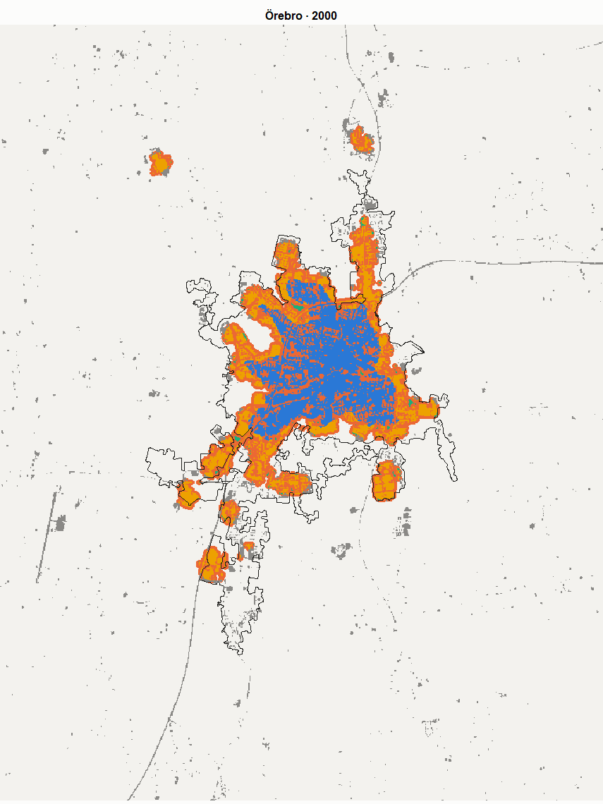</a></td></tr>
<tr><td><a href="img/maps/orebro_2010.png">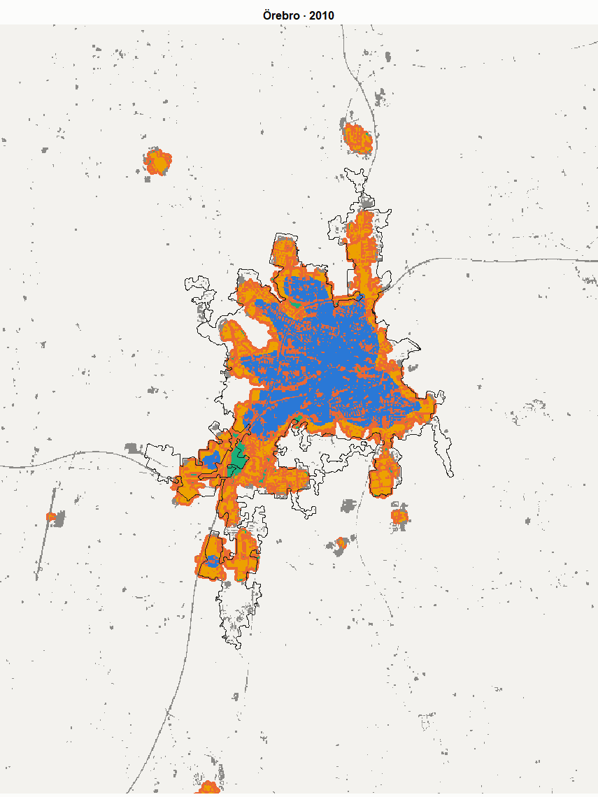</a></td><td><a href="img/maps/orebro_2020.png">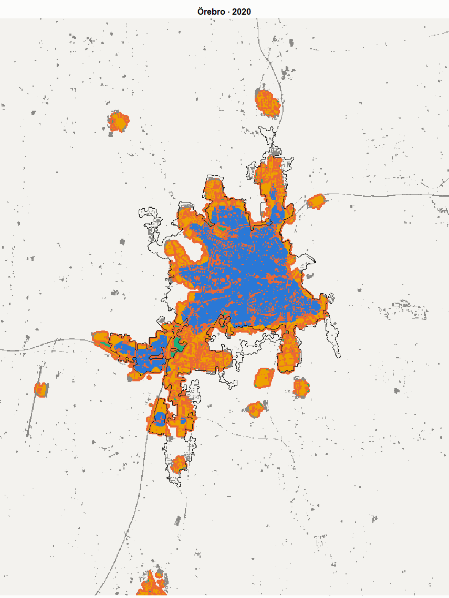</a></td></tr>
</table>

Kartorna visar tätorten plus 5 km; måtten använder den större rutan i `cajas.md` (slug `orebro`).

[Tillbaka till innehållet](#innehåll)

### Linköping

Län: Östergötland. Tätortens befolkning 2020 (SCB): 115 682.

Den bebyggda marken i stadens urbana utbredning växte från **17,7 km²** år 1990 till **27,4 km²** år 2020, **1,46 % per år** (takt: **långsam**). Den urbana utbredningen gick från 35,3 till 51,9 km². Mättnaden gick från 0,50 till 0,53 (form: **stabil**).

Den öppna randzonen var 48,6 % av den urbana utbredningen 1990 och 42,7 % 2020; år 2020 lägger den till 75 % till resten av utbredningen. Att räkna med den ändrar tillväxttakten 1990-2020 från 1,66 % till 1,29 % per år (-0,37 procentenheter).

#### Tillväxt per klass

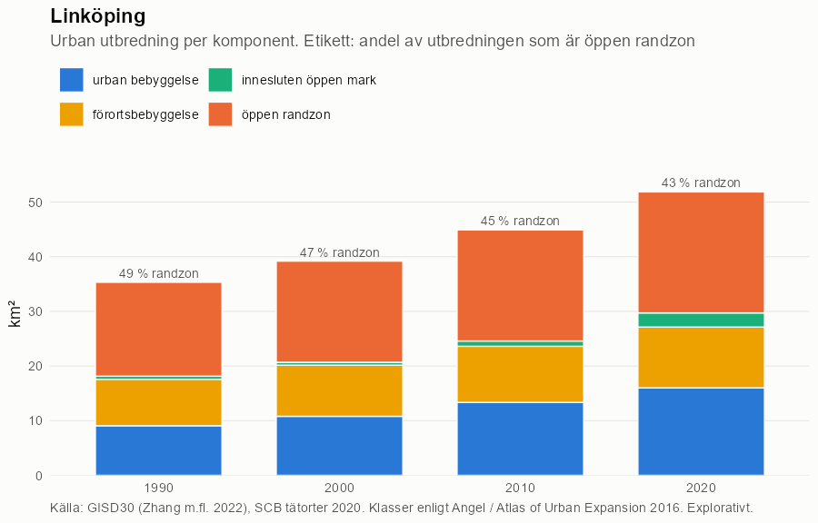

|  | urban bebyggelse | förortsbebyggelse | innesluten öppen mark | öppen randzon | utbredning | % randzon | bebyggd mark | mättnad | öppenhet | fotavtryck 2007 |
|---|---|---|---|---|---|---|---|---|---|---|
| 1990 | 9,1 | 8,5 | 0,6 | 17,2 | 35,3 | 48,6 | 17,7 | 0,50 | 0,47 | 51,2 |
| 2000 | 10,8 | 9,4 | 0,5 | 18,5 | 39,2 | 47,2 | 20,3 | 0,52 | 0,46 | 56,2 |
| 2010 | 13,3 | 10,3 | 1,0 | 20,3 | 44,9 | 45,3 | 23,7 | 0,53 | 0,44 | 59,8 |
| 2020 | 16,0 | 11,1 | 2,6 | 22,1 | 51,9 | 42,7 | 27,4 | 0,53 | 0,43 | 64,1 |

km². Landsbygdsbebyggelse och öppen landsbygd ligger utanför den urbana utbredningen; de syns på kartorna.

#### Tillväxt per decennium

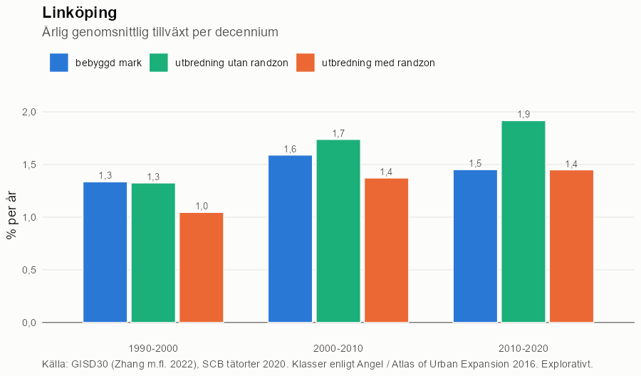

| Decennium | bebyggd mark | utbredning utan randzon | utbredning med randzon |
|---|---|---|---|
| 1990-2000 | 1,34 | 1,32 | 1,05 |
| 2000-2010 | 1,59 | 1,74 | 1,37 |
| 2010-2020 | 1,45 | 1,92 | 1,45 |

% per år.

#### Kartor

<table>
<tr><td><a href="img/maps/linkoping_1990.png">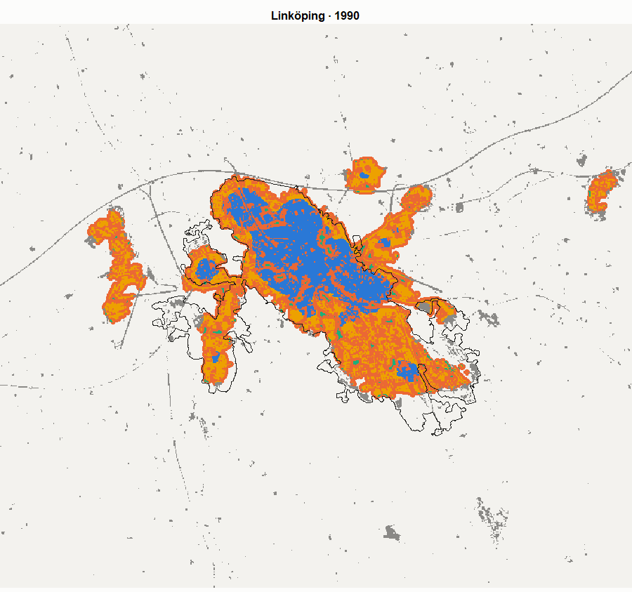</a></td><td><a href="img/maps/linkoping_2000.png">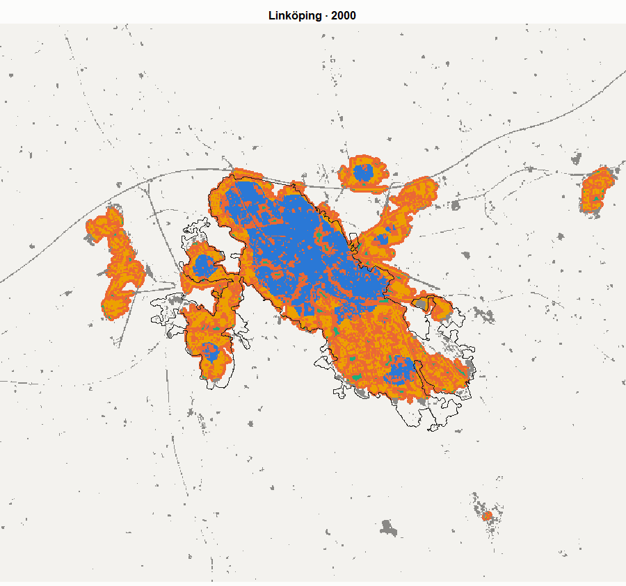</a></td></tr>
<tr><td><a href="img/maps/linkoping_2010.png">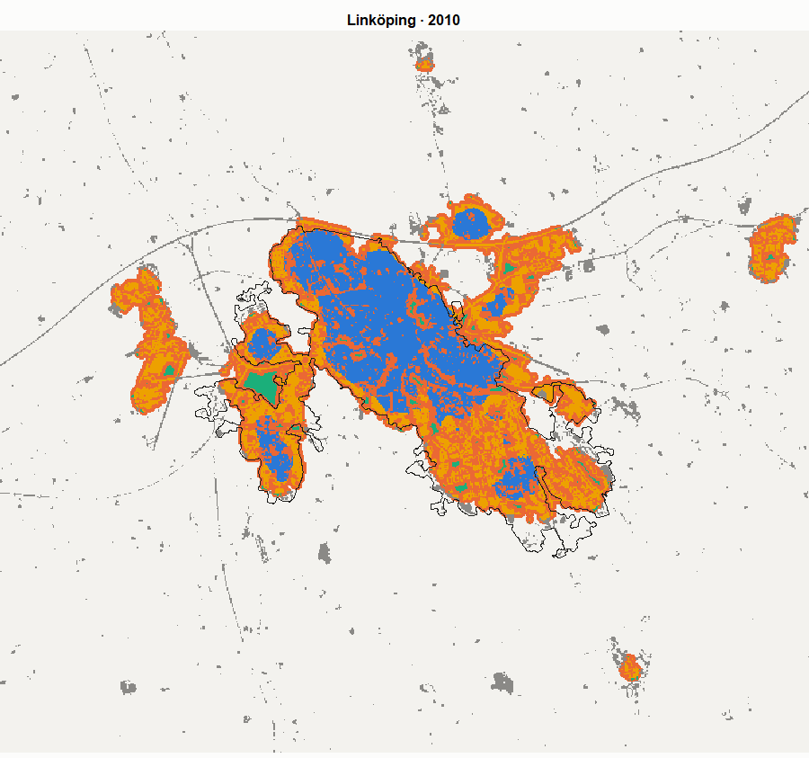</a></td><td><a href="img/maps/linkoping_2020.png">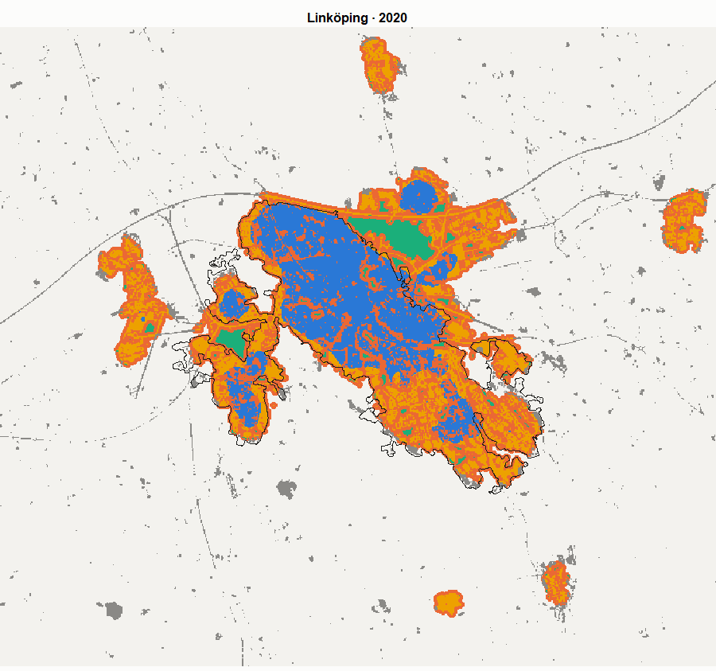</a></td></tr>
</table>

Kartorna visar tätorten plus 5 km; måtten använder den större rutan i `cajas.md` (slug `linkoping`).

[Tillbaka till innehållet](#innehåll)

### Helsingborg

Län: Skåne. Tätortens befolkning 2020 (SCB): 113 828.

Den bebyggda marken i stadens urbana utbredning växte från **25,3 km²** år 1990 till **35,0 km²** år 2020, **1,08 % per år** (takt: **långsam**). Den urbana utbredningen gick från 41,9 till 55,0 km². Mättnaden gick från 0,60 till 0,64 (form: **förtätas**).

Den öppna randzonen var 38,5 % av den urbana utbredningen 1990 och 34,9 % 2020; år 2020 lägger den till 54 % till resten av utbredningen. Att räkna med den ändrar tillväxttakten 1990-2020 från 1,10 % till 0,91 % per år (-0,19 procentenheter).

#### Tillväxt per klass

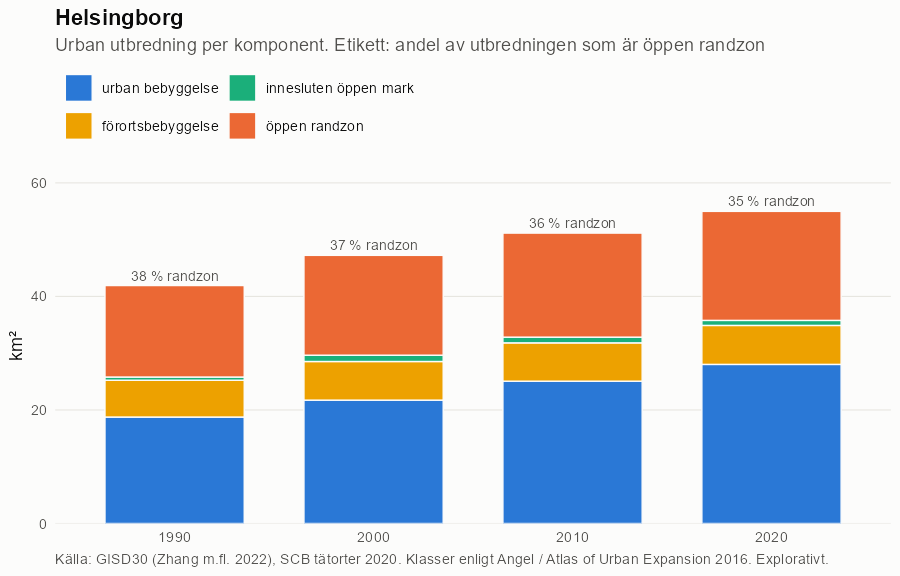

|  | urban bebyggelse | förortsbebyggelse | innesluten öppen mark | öppen randzon | utbredning | % randzon | bebyggd mark | mättnad | öppenhet | fotavtryck 2007 |
|---|---|---|---|---|---|---|---|---|---|---|
| 1990 | 18,8 | 6,5 | 0,6 | 16,1 | 41,9 | 38,5 | 25,3 | 0,60 | 0,38 | 52,8 |
| 2000 | 21,7 | 6,8 | 1,1 | 17,6 | 47,2 | 37,2 | 28,6 | 0,61 | 0,37 | 67,6 |
| 2010 | 25,1 | 6,8 | 1,0 | 18,3 | 51,2 | 35,8 | 31,9 | 0,62 | 0,36 | 73,1 |
| 2020 | 28,0 | 6,9 | 0,9 | 19,2 | 55,0 | 34,9 | 35,0 | 0,64 | 0,34 | 79,4 |

km². Landsbygdsbebyggelse och öppen landsbygd ligger utanför den urbana utbredningen; de syns på kartorna.

#### Tillväxt per decennium

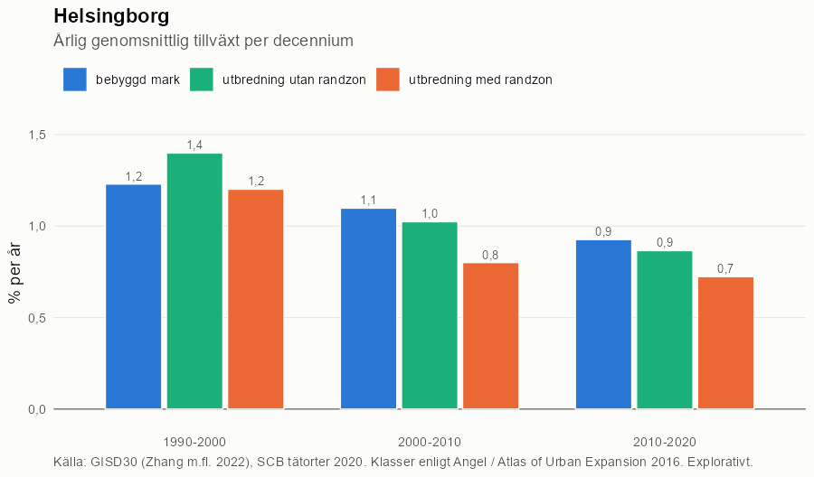

| Decennium | bebyggd mark | utbredning utan randzon | utbredning med randzon |
|---|---|---|---|
| 1990-2000 | 1,23 | 1,40 | 1,20 |
| 2000-2010 | 1,10 | 1,02 | 0,80 |
| 2010-2020 | 0,93 | 0,87 | 0,72 |

% per år.

#### Kartor

<table>
<tr><td><a href="img/maps/helsingborg_1990.png">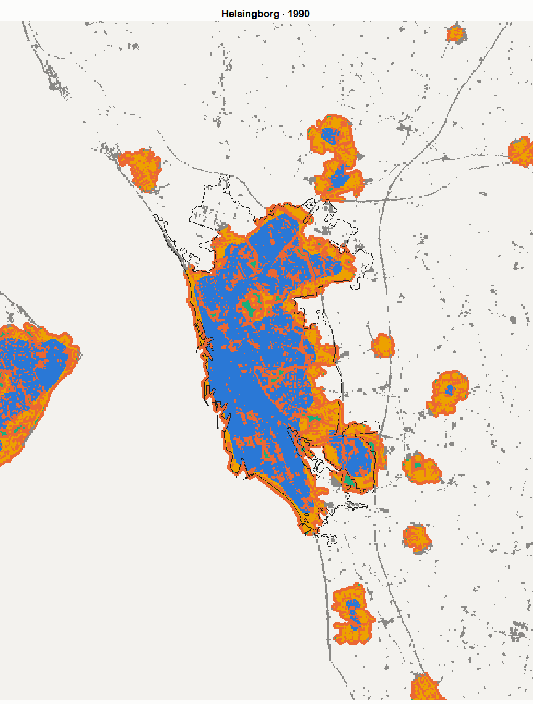</a></td><td></td></tr>
<tr><td></td><td></td></tr>
</table>

Kartorna visar tätorten plus 5 km; måtten använder den större rutan i `cajas.md` (slug `helsingborg`).

[Tillbaka till innehållet](#innehåll)

### Jönköping

Län: Jönköping. Tätortens befolkning 2020 (SCB): 100 579.

Den bebyggda marken i stadens urbana utbredning växte från **12,6 km²** år 1990 till **19,6 km²** år 2020, **1,48 % per år** (takt: **långsam**). Den urbana utbredningen gick från 26,2 till 37,3 km². Mättnaden gick från 0,48 till 0,52 (form: **förtätas**).

Den öppna randzonen var 46,7 % av den urbana utbredningen 1990 och 43,9 % 2020; år 2020 lägger den till 78 % till resten av utbredningen. Att räkna med den ändrar tillväxttakten 1990-2020 från 1,36 % till 1,18 % per år (-0,18 procentenheter).

#### Tillväxt per klass

|  | urban bebyggelse | förortsbebyggelse | innesluten öppen mark | öppen randzon | utbredning | % randzon | bebyggd mark | mättnad | öppenhet | fotavtryck 2007 |
|---|---|---|---|---|---|---|---|---|---|---|
| 1990 | 6,0 | 6,5 | 1,5 | 12,3 | 26,2 | 46,7 | 12,6 | 0,48 | 0,50 | 37,1 |
| 2000 | 6,9 | 7,7 | 1,5 | 13,9 | 30,1 | 46,2 | 14,8 | 0,49 | 0,49 | 41,4 |
| 2010 | 9,4 | 8,4 | 1,5 | 15,6 | 34,9 | 44,6 | 17,9 | 0,51 | 0,47 | 46,8 |
| 2020 | 10,8 | 8,6 | 1,5 | 16,4 | 37,3 | 43,9 | 19,6 | 0,52 | 0,46 | 50,4 |

km². Landsbygdsbebyggelse och öppen landsbygd ligger utanför den urbana utbredningen; de syns på kartorna.

#### Tillväxt per decennium

| Decennium | bebyggd mark | utbredning utan randzon | utbredning med randzon |
|---|---|---|---|
| 1990-2000 | 1,61 | 1,49 | 1,38 |
| 2000-2010 | 1,95 | 1,79 | 1,49 |
| 2010-2020 | 0,88 | 0,80 | 0,67 |

% per år.

#### Kartor

<table>
<tr><td></td><td></td></tr>
<tr><td></td><td></td></tr>
</table>

Kartorna visar tätorten plus 5 km; måtten använder den större rutan i `cajas.md` (slug `jonkoping`).

[Tillbaka till innehållet](#innehåll)

### Norrköping

Län: Östergötland. Tätortens befolkning 2020 (SCB): 98 088.

Den bebyggda marken i stadens urbana utbredning växte från **16,9 km²** år 1990 till **26,5 km²** år 2020, **1,51 % per år** (takt: **måttlig**). Den urbana utbredningen gick från 30,9 till 46,7 km². Mättnaden gick från 0,55 till 0,57 (form: **stabil**).

Den öppna randzonen var 44,2 % av den urbana utbredningen 1990 och 39,0 % 2020; år 2020 lägger den till 64 % till resten av utbredningen. Att räkna med den ändrar tillväxttakten 1990-2020 från 1,68 % till 1,38 % per år (-0,30 procentenheter).

#### Tillväxt per klass

|  | urban bebyggelse | förortsbebyggelse | innesluten öppen mark | öppen randzon | utbredning | % randzon | bebyggd mark | mättnad | öppenhet | fotavtryck 2007 |
|---|---|---|---|---|---|---|---|---|---|---|
| 1990 | 10,2 | 6,6 | 0,4 | 13,7 | 30,9 | 44,2 | 16,9 | 0,55 | 0,44 | 41,8 |
| 2000 | 11,5 | 7,8 | 0,5 | 16,5 | 36,3 | 45,3 | 19,5 | 0,54 | 0,44 | 53,4 |
| 2010 | 14,7 | 8,6 | 0,7 | 17,8 | 41,7 | 42,7 | 23,3 | 0,56 | 0,42 | 57,9 |
| 2020 | 18,2 | 8,2 | 2,1 | 18,2 | 46,7 | 39,0 | 26,5 | 0,57 | 0,40 | 67,4 |

km². Landsbygdsbebyggelse och öppen landsbygd ligger utanför den urbana utbredningen; de syns på kartorna.

#### Tillväxt per decennium

| Decennium | bebyggd mark | utbredning utan randzon | utbredning med randzon |
|---|---|---|---|
| 1990-2000 | 1,40 | 1,42 | 1,63 |
| 2000-2010 | 1,82 | 1,88 | 1,40 |
| 2010-2020 | 1,31 | 1,75 | 1,12 |

% per år.

#### Kartor

<table>
<tr><td></td><td></td></tr>
<tr><td></td><td></td></tr>
</table>

Kartorna visar tätorten plus 5 km; måtten använder den större rutan i `cajas.md` (slug `norrkoping`).

[Tillbaka till innehållet](#innehåll)

### Lund

Län: Skåne. Tätortens befolkning 2020 (SCB): 94 393.

Den bebyggda marken i stadens urbana utbredning växte från **13,8 km²** år 1990 till **19,7 km²** år 2020, **1,20 % per år** (takt: **långsam**). Den urbana utbredningen gick från 24,4 till 32,6 km². Mättnaden gick från 0,57 till 0,61 (form: **förtätas**).

Den öppna randzonen var 43,0 % av den urbana utbredningen 1990 och 38,3 % 2020; år 2020 lägger den till 62 % till resten av utbredningen. Att räkna med den ändrar tillväxttakten 1990-2020 från 1,24 % till 0,97 % per år (-0,27 procentenheter).

#### Tillväxt per klass

|  | urban bebyggelse | förortsbebyggelse | innesluten öppen mark | öppen randzon | utbredning | % randzon | bebyggd mark | mättnad | öppenhet | fotavtryck 2007 |
|---|---|---|---|---|---|---|---|---|---|---|
| 1990 | 9,5 | 4,3 | 0,1 | 10,5 | 24,4 | 43,0 | 13,8 | 0,57 | 0,43 | 30,5 |
| 2000 | 11,6 | 4,1 | 0,3 | 11,1 | 27,1 | 40,9 | 15,7 | 0,58 | 0,41 | 35,4 |
| 2010 | 14,2 | 3,4 | 0,3 | 11,4 | 29,3 | 38,8 | 17,6 | 0,60 | 0,38 | 40,6 |
| 2020 | 15,5 | 4,2 | 0,4 | 12,5 | 32,6 | 38,3 | 19,7 | 0,61 | 0,38 | 44,8 |

km². Landsbygdsbebyggelse och öppen landsbygd ligger utanför den urbana utbredningen; de syns på kartorna.

#### Tillväxt per decennium

| Decennium | bebyggd mark | utbredning utan randzon | utbredning med randzon |
|---|---|---|---|
| 1990-2000 | 1,31 | 1,44 | 1,07 |
| 2000-2010 | 1,14 | 1,13 | 0,77 |
| 2010-2020 | 1,14 | 1,14 | 1,06 |

% per år.

#### Kartor

<table>
<tr><td></td><td></td></tr>
<tr><td></td><td></td></tr>
</table>

Kartorna visar tätorten plus 5 km; måtten använder den större rutan i `cajas.md` (slug `lund`).

[Tillbaka till innehållet](#innehåll)

### Umeå

Län: Västerbotten. Tätortens befolkning 2020 (SCB): 91 916.

Den bebyggda marken i stadens urbana utbredning växte från **17,0 km²** år 1990 till **26,7 km²** år 2020, **1,52 % per år** (takt: **måttlig**). Den urbana utbredningen gick från 31,5 till 46,8 km². Mättnaden gick från 0,54 till 0,57 (form: **stabil**).

Den öppna randzonen var 40,2 % av den urbana utbredningen 1990 och 36,0 % 2020; år 2020 lägger den till 56 % till resten av utbredningen. Att räkna med den ändrar tillväxttakten 1990-2020 från 1,57 % till 1,33 % per år (-0,23 procentenheter).

#### Tillväxt per klass

|  | urban bebyggelse | förortsbebyggelse | innesluten öppen mark | öppen randzon | utbredning | % randzon | bebyggd mark | mättnad | öppenhet | fotavtryck 2007 |
|---|---|---|---|---|---|---|---|---|---|---|
| 1990 | 10,2 | 6,7 | 1,9 | 12,7 | 31,5 | 40,2 | 17,0 | 0,54 | 0,44 | 38,3 |
| 2000 | 11,5 | 7,6 | 1,9 | 14,1 | 35,2 | 40,2 | 19,2 | 0,55 | 0,44 | 43,0 |
| 2010 | 14,5 | 8,2 | 3,5 | 15,8 | 42,0 | 37,5 | 23,0 | 0,55 | 0,42 | 48,6 |
| 2020 | 18,6 | 8,0 | 3,4 | 16,9 | 46,8 | 36,0 | 26,7 | 0,57 | 0,40 | 53,6 |

km². Landsbygdsbebyggelse och öppen landsbygd ligger utanför den urbana utbredningen; de syns på kartorna.

#### Tillväxt per decennium

| Decennium | bebyggd mark | utbredning utan randzon | utbredning med randzon |
|---|---|---|---|
| 1990-2000 | 1,24 | 1,12 | 1,11 |
| 2000-2010 | 1,80 | 2,25 | 1,81 |
| 2010-2020 | 1,52 | 1,33 | 1,09 |

% per år.

#### Kartor

<table>
<tr><td></td><td></td></tr>
<tr><td></td><td></td></tr>
</table>

Kartorna visar tätorten plus 5 km; måtten använder den större rutan i `cajas.md` (slug `umea`).

[Tillbaka till innehållet](#innehåll)

### Gävle

Län: Gävleborg. Tätortens befolkning 2020 (SCB): 79 004.

Den bebyggda marken i stadens urbana utbredning växte från **25,3 km²** år 1990 till **34,0 km²** år 2020, **0,99 % per år** (takt: **långsam**). Den urbana utbredningen gick från 44,5 till 61,2 km². Mättnaden gick från 0,57 till 0,56 (form: **stabil**).

Den öppna randzonen var 39,4 % av den urbana utbredningen 1990 och 41,7 % 2020; år 2020 lägger den till 72 % till resten av utbredningen. Att räkna med den ändrar tillväxttakten 1990-2020 från 0,93 % till 1,07 % per år (+0,13 procentenheter).

#### Tillväxt per klass

|  | urban bebyggelse | förortsbebyggelse | innesluten öppen mark | öppen randzon | utbredning | % randzon | bebyggd mark | mättnad | öppenhet | fotavtryck 2007 |
|---|---|---|---|---|---|---|---|---|---|---|
| 1990 | 16,1 | 8,9 | 1,9 | 17,5 | 44,5 | 39,4 | 25,3 | 0,57 | 0,39 | 64,5 |
| 2000 | 17,1 | 9,2 | 1,8 | 18,3 | 46,4 | 39,4 | 26,5 | 0,57 | 0,38 | 68,1 |
| 2010 | 20,0 | 11,2 | 1,7 | 23,2 | 56,2 | 41,3 | 31,4 | 0,56 | 0,40 | 72,8 |
| 2020 | 22,0 | 11,9 | 1,8 | 25,5 | 61,2 | 41,7 | 34,0 | 0,56 | 0,40 | 78,8 |

km². Landsbygdsbebyggelse och öppen landsbygd ligger utanför den urbana utbredningen; de syns på kartorna.

#### Tillväxt per decennium

| Decennium | bebyggd mark | utbredning utan randzon | utbredning med randzon |
|---|---|---|---|
| 1990-2000 | 0,46 | 0,40 | 0,41 |
| 2000-2010 | 1,73 | 1,62 | 1,94 |
| 2010-2020 | 0,79 | 0,78 | 0,86 |

% per år.

#### Kartor

<table>
<tr><td></td><td></td></tr>
<tr><td></td><td></td></tr>
</table>

Kartorna visar tätorten plus 5 km; måtten använder den större rutan i `cajas.md` (slug `gavle`).

[Tillbaka till innehållet](#innehåll)

### Södertälje

Län: Stockholm. Tätortens befolkning 2020 (SCB): 76 320.

Den bebyggda marken i stadens urbana utbredning växte från **11,4 km²** år 1990 till **18,6 km²** år 2020, **1,67 % per år** (takt: **måttlig**). Den urbana utbredningen gick från 24,1 till 33,9 km². Mättnaden gick från 0,47 till 0,55 (form: **förtätas**).

Den öppna randzonen var 50,7 % av den urbana utbredningen 1990 och 43,5 % 2020; år 2020 lägger den till 77 % till resten av utbredningen. Att räkna med den ändrar tillväxttakten 1990-2020 från 1,60 % till 1,14 % per år (-0,46 procentenheter).

#### Tillväxt per klass

|  | urban bebyggelse | förortsbebyggelse | innesluten öppen mark | öppen randzon | utbredning | % randzon | bebyggd mark | mättnad | öppenhet | fotavtryck 2007 |
|---|---|---|---|---|---|---|---|---|---|---|
| 1990 | 4,5 | 6,8 | 0,6 | 12,2 | 24,1 | 50,7 | 11,4 | 0,47 | 0,52 | 28,9 |
| 2000 | 6,2 | 7,2 | 0,6 | 13,3 | 27,3 | 48,8 | 13,4 | 0,49 | 0,50 | 31,7 |
| 2010 | 8,5 | 7,4 | 0,6 | 14,3 | 30,7 | 46,5 | 15,9 | 0,52 | 0,47 | 34,4 |
| 2020 | 11,7 | 6,9 | 0,6 | 14,8 | 33,9 | 43,5 | 18,6 | 0,55 | 0,44 | 38,1 |

km². Landsbygdsbebyggelse och öppen landsbygd ligger utanför den urbana utbredningen; de syns på kartorna.

#### Tillväxt per decennium

| Decennium | bebyggd mark | utbredning utan randzon | utbredning med randzon |
|---|---|---|---|
| 1990-2000 | 1,69 | 1,61 | 1,24 |
| 2000-2010 | 1,69 | 1,63 | 1,18 |
| 2010-2020 | 1,62 | 1,55 | 1,00 |

% per år.

#### Kartor

<table>
<tr><td></td><td></td></tr>
<tr><td></td><td></td></tr>
</table>

Kartorna visar tätorten plus 5 km; måtten använder den större rutan i `cajas.md` (slug `sodertalje`).

[Tillbaka till innehållet](#innehåll)

### Borås

Län: Västra Götaland. Tätortens befolkning 2020 (SCB): 74 042.

Den bebyggda marken i stadens urbana utbredning växte från **9,6 km²** år 1990 till **16,0 km²** år 2020, **1,72 % per år** (takt: **måttlig**). Den urbana utbredningen gick från 19,6 till 30,8 km². Mättnaden gick från 0,49 till 0,52 (form: **stabil**).

Den öppna randzonen var 49,1 % av den urbana utbredningen 1990 och 46,5 % 2020; år 2020 lägger den till 87 % till resten av utbredningen. Att räkna med den ändrar tillväxttakten 1990-2020 från 1,69 % till 1,52 % per år (-0,17 procentenheter).

#### Tillväxt per klass

|  | urban bebyggelse | förortsbebyggelse | innesluten öppen mark | öppen randzon | utbredning | % randzon | bebyggd mark | mättnad | öppenhet | fotavtryck 2007 |
|---|---|---|---|---|---|---|---|---|---|---|
| 1990 | 4,3 | 5,1 | 0,5 | 9,6 | 19,6 | 49,1 | 9,6 | 0,49 | 0,49 | 27,0 |
| 2000 | 4,7 | 5,7 | 0,5 | 10,7 | 21,7 | 49,3 | 10,6 | 0,49 | 0,49 | 30,7 |
| 2010 | 5,4 | 7,3 | 0,5 | 12,6 | 25,8 | 48,7 | 12,8 | 0,50 | 0,49 | 37,8 |
| 2020 | 7,4 | 8,5 | 0,6 | 14,3 | 30,8 | 46,5 | 16,0 | 0,52 | 0,47 | 43,3 |

km². Landsbygdsbebyggelse och öppen landsbygd ligger utanför den urbana utbredningen; de syns på kartorna.

#### Tillväxt per decennium

| Decennium | bebyggd mark | utbredning utan randzon | utbredning med randzon |
|---|---|---|---|
| 1990-2000 | 1,00 | 1,03 | 1,06 |
| 2000-2010 | 1,92 | 1,84 | 1,74 |
| 2010-2020 | 2,25 | 2,21 | 1,78 |

% per år.

#### Kartor

<table>
<tr><td></td><td></td></tr>
<tr><td></td><td></td></tr>
</table>

Kartorna visar tätorten plus 5 km; måtten använder den större rutan i `cajas.md` (slug `boras`).

[Tillbaka till innehållet](#innehåll)

### Halmstad

Län: Halland. Tätortens befolkning 2020 (SCB): 71 422.

Den bebyggda marken i stadens urbana utbredning växte från **17,7 km²** år 1990 till **24,4 km²** år 2020, **1,08 % per år** (takt: **långsam**). Den urbana utbredningen gick från 32,0 till 42,3 km². Mättnaden gick från 0,55 till 0,58 (form: **stabil**).

Den öppna randzonen var 43,5 % av den urbana utbredningen 1990 och 40,5 % 2020; år 2020 lägger den till 68 % till resten av utbredningen. Att räkna med den ändrar tillväxttakten 1990-2020 från 1,11 % till 0,93 % per år (-0,18 procentenheter).

#### Tillväxt per klass

|  | urban bebyggelse | förortsbebyggelse | innesluten öppen mark | öppen randzon | utbredning | % randzon | bebyggd mark | mättnad | öppenhet | fotavtryck 2007 |
|---|---|---|---|---|---|---|---|---|---|---|
| 1990 | 10,6 | 7,0 | 0,5 | 13,9 | 32,0 | 43,5 | 17,7 | 0,55 | 0,41 | 44,0 |
| 2000 | 11,6 | 7,8 | 0,7 | 15,5 | 35,6 | 43,5 | 19,5 | 0,55 | 0,41 | 46,7 |
| 2010 | 14,1 | 8,2 | 0,8 | 16,6 | 39,9 | 41,8 | 22,5 | 0,56 | 0,40 | 49,6 |
| 2020 | 16,0 | 8,4 | 0,9 | 17,1 | 42,3 | 40,5 | 24,4 | 0,58 | 0,39 | 51,6 |

km². Landsbygdsbebyggelse och öppen landsbygd ligger utanför den urbana utbredningen; de syns på kartorna.

#### Tillväxt per decennium

| Decennium | bebyggd mark | utbredning utan randzon | utbredning med randzon |
|---|---|---|---|
| 1990-2000 | 0,97 | 1,07 | 1,08 |
| 2000-2010 | 1,43 | 1,44 | 1,13 |
| 2010-2020 | 0,83 | 0,82 | 0,60 |

% per år.

#### Kartor

<table>
<tr><td></td><td></td></tr>
<tr><td></td><td></td></tr>
</table>

Kartorna visar tätorten plus 5 km; måtten använder den större rutan i `cajas.md` (slug `halmstad`).

[Tillbaka till innehållet](#innehåll)

### Växjö

Län: Kronoberg. Tätortens befolkning 2020 (SCB): 71 282.

Den bebyggda marken i stadens urbana utbredning växte från **10,9 km²** år 1990 till **20,1 km²** år 2020, **2,07 % per år** (takt: **måttlig**). Den urbana utbredningen gick från 21,1 till 35,2 km². Mättnaden gick från 0,52 till 0,57 (form: **förtätas**).

Den öppna randzonen var 47,6 % av den urbana utbredningen 1990 och 41,4 % 2020; år 2020 lägger den till 71 % till resten av utbredningen. Att räkna med den ändrar tillväxttakten 1990-2020 från 2,11 % till 1,72 % per år (-0,38 procentenheter).

#### Tillväxt per klass

|  | urban bebyggelse | förortsbebyggelse | innesluten öppen mark | öppen randzon | utbredning | % randzon | bebyggd mark | mättnad | öppenhet | fotavtryck 2007 |
|---|---|---|---|---|---|---|---|---|---|---|
| 1990 | 5,9 | 4,9 | 0,3 | 10,0 | 21,1 | 47,6 | 10,9 | 0,52 | 0,48 | 29,9 |
| 2000 | 7,1 | 5,4 | 0,2 | 11,2 | 24,0 | 46,6 | 12,7 | 0,53 | 0,47 | 32,5 |
| 2010 | 10,3 | 6,8 | 0,6 | 13,3 | 31,1 | 42,8 | 17,2 | 0,55 | 0,44 | 37,0 |
| 2020 | 12,2 | 7,8 | 0,6 | 14,6 | 35,2 | 41,4 | 20,1 | 0,57 | 0,42 | 42,1 |

km². Landsbygdsbebyggelse och öppen landsbygd ligger utanför den urbana utbredningen; de syns på kartorna.

#### Tillväxt per decennium

| Decennium | bebyggd mark | utbredning utan randzon | utbredning med randzon |
|---|---|---|---|
| 1990-2000 | 1,53 | 1,49 | 1,28 |
| 2000-2010 | 3,12 | 3,34 | 2,64 |
| 2010-2020 | 1,58 | 1,51 | 1,26 |

% per år.

#### Kartor

<table>
<tr><td></td><td></td></tr>
<tr><td></td><td></td></tr>
</table>

Kartorna visar tätorten plus 5 km; måtten använder den större rutan i `cajas.md` (slug `vaxjo`).

[Tillbaka till innehållet](#innehåll)

### Eskilstuna

Län: Södermanland. Tätortens befolkning 2020 (SCB): 69 948.

Den bebyggda marken i stadens urbana utbredning växte från **11,1 km²** år 1990 till **14,6 km²** år 2020, **0,92 % per år** (takt: **långsam**). Den urbana utbredningen gick från 20,1 till 25,9 km². Mättnaden gick från 0,55 till 0,56 (form: **stabil**).

Den öppna randzonen var 44,1 % av den urbana utbredningen 1990 och 42,8 % 2020; år 2020 lägger den till 75 % till resten av utbredningen. Att räkna med den ändrar tillväxttakten 1990-2020 från 0,94 % till 0,86 % per år (-0,08 procentenheter).

#### Tillväxt per klass

|  | urban bebyggelse | förortsbebyggelse | innesluten öppen mark | öppen randzon | utbredning | % randzon | bebyggd mark | mättnad | öppenhet | fotavtryck 2007 |
|---|---|---|---|---|---|---|---|---|---|---|
| 1990 | 7,0 | 4,0 | 0,2 | 8,9 | 20,1 | 44,1 | 11,1 | 0,55 | 0,41 | 35,7 |
| 2000 | 7,8 | 4,2 | 0,3 | 9,4 | 21,6 | 43,4 | 12,0 | 0,56 | 0,41 | 43,2 |
| 2010 | 8,9 | 4,3 | 0,2 | 10,3 | 23,7 | 43,2 | 13,3 | 0,56 | 0,40 | 46,8 |
| 2020 | 9,9 | 4,6 | 0,3 | 11,1 | 25,9 | 42,8 | 14,6 | 0,56 | 0,40 | 52,9 |

km². Landsbygdsbebyggelse och öppen landsbygd ligger utanför den urbana utbredningen; de syns på kartorna.

#### Tillväxt per decennium

| Decennium | bebyggd mark | utbredning utan randzon | utbredning med randzon |
|---|---|---|---|
| 1990-2000 | 0,82 | 0,88 | 0,76 |
| 2000-2010 | 1,01 | 0,96 | 0,92 |
| 2010-2020 | 0,93 | 0,97 | 0,89 |

% per år.

#### Kartor

<table>
<tr><td></td><td></td></tr>
<tr><td></td><td></td></tr>
</table>

Kartorna visar tätorten plus 5 km; måtten använder den större rutan i `cajas.md` (slug `eskilstuna`).

[Tillbaka till innehållet](#innehåll)

### Karlstad

Län: Värmland. Tätortens befolkning 2020 (SCB): 67 122.

Den bebyggda marken i stadens urbana utbredning växte från **12,8 km²** år 1990 till **18,8 km²** år 2020, **1,29 % per år** (takt: **långsam**). Den urbana utbredningen gick från 25,5 till 36,1 km². Mättnaden gick från 0,50 till 0,52 (form: **stabil**).

Den öppna randzonen var 48,1 % av den urbana utbredningen 1990 och 41,3 % 2020; år 2020 lägger den till 70 % till resten av utbredningen. Att räkna med den ändrar tillväxttakten 1990-2020 från 1,58 % till 1,16 % per år (-0,42 procentenheter).

#### Tillväxt per klass

|  | urban bebyggelse | förortsbebyggelse | innesluten öppen mark | öppen randzon | utbredning | % randzon | bebyggd mark | mättnad | öppenhet | fotavtryck 2007 |
|---|---|---|---|---|---|---|---|---|---|---|
| 1990 | 6,6 | 6,1 | 0,5 | 12,3 | 25,5 | 48,1 | 12,8 | 0,50 | 0,49 | 32,6 |
| 2000 | 7,3 | 6,6 | 0,5 | 13,2 | 27,5 | 47,8 | 13,9 | 0,51 | 0,49 | 35,6 |
| 2010 | 9,4 | 7,2 | 0,5 | 13,8 | 30,9 | 44,7 | 16,7 | 0,54 | 0,46 | 38,4 |
| 2020 | 10,6 | 8,0 | 2,6 | 14,9 | 36,1 | 41,3 | 18,8 | 0,52 | 0,45 | 46,0 |

km². Landsbygdsbebyggelse och öppen landsbygd ligger utanför den urbana utbredningen; de syns på kartorna.

#### Tillväxt per decennium

| Decennium | bebyggd mark | utbredning utan randzon | utbredning med randzon |
|---|---|---|---|
| 1990-2000 | 0,81 | 0,81 | 0,75 |
| 2000-2010 | 1,86 | 1,77 | 1,18 |
| 2010-2020 | 1,20 | 2,17 | 1,56 |

% per år.

#### Kartor

<table>
<tr><td></td><td></td></tr>
<tr><td></td><td></td></tr>
</table>

Kartorna visar tätorten plus 5 km; måtten använder den större rutan i `cajas.md` (slug `karlstad`).

[Tillbaka till innehållet](#innehåll)

### Sundsvall

Län: Västernorrland. Tätortens befolkning 2020 (SCB): 58 813.

Den bebyggda marken i stadens urbana utbredning växte från **25,6 km²** år 1990 till **34,1 km²** år 2020, **0,96 % per år** (takt: **långsam**). Den urbana utbredningen gick från 46,9 till 60,9 km². Mättnaden gick från 0,55 till 0,56 (form: **stabil**).

Den öppna randzonen var 42,1 % av den urbana utbredningen 1990 och 41,7 % 2020; år 2020 lägger den till 72 % till resten av utbredningen. Att räkna med den ändrar tillväxttakten 1990-2020 från 0,89 % till 0,87 % per år (-0,02 procentenheter).

#### Tillväxt per klass

|  | urban bebyggelse | förortsbebyggelse | innesluten öppen mark | öppen randzon | utbredning | % randzon | bebyggd mark | mättnad | öppenhet | fotavtryck 2007 |
|---|---|---|---|---|---|---|---|---|---|---|
| 1990 | 14,1 | 11,4 | 1,7 | 19,7 | 46,9 | 42,1 | 25,6 | 0,55 | 0,45 | 77,0 |
| 2000 | 14,7 | 11,7 | 1,7 | 20,3 | 48,3 | 41,9 | 26,5 | 0,55 | 0,45 | 79,2 |
| 2010 | 16,6 | 12,9 | 1,6 | 22,0 | 53,0 | 41,5 | 29,6 | 0,56 | 0,44 | 85,0 |
| 2020 | 18,8 | 15,1 | 1,6 | 25,4 | 60,9 | 41,7 | 34,1 | 0,56 | 0,45 | 97,8 |

km². Landsbygdsbebyggelse och öppen landsbygd ligger utanför den urbana utbredningen; de syns på kartorna.

#### Tillväxt per decennium

| Decennium | bebyggd mark | utbredning utan randzon | utbredning med randzon |
|---|---|---|---|
| 1990-2000 | 0,35 | 0,31 | 0,29 |
| 2000-2010 | 1,11 | 1,01 | 0,94 |
| 2010-2020 | 1,41 | 1,36 | 1,39 |

% per år.

#### Kartor

<table>
<tr><td></td><td></td></tr>
<tr><td></td><td></td></tr>
</table>

Kartorna visar tätorten plus 5 km; måtten använder den större rutan i `cajas.md` (slug `sundsvall`).

[Tillbaka till innehållet](#innehåll)

### Östersund

Län: Jämtland. Tätortens befolkning 2020 (SCB): 52 980.

Den bebyggda marken i stadens urbana utbredning växte från **2,6 km²** år 1990 till **3,4 km²** år 2020, **0,97 % per år** (takt: **långsam**). Den urbana utbredningen gick från 5,9 till 8,0 km². Mättnaden gick från 0,43 till 0,43 (form: **stabil**).

Den öppna randzonen var 56,3 % av den urbana utbredningen 1990 och 57,1 % 2020; år 2020 lägger den till 133 % till resten av utbredningen. Att räkna med den ändrar tillväxttakten 1990-2020 från 0,98 % till 1,04 % per år (+0,06 procentenheter).

#### Tillväxt per klass

|  | urban bebyggelse | förortsbebyggelse | innesluten öppen mark | öppen randzon | utbredning | % randzon | bebyggd mark | mättnad | öppenhet | fotavtryck 2007 |
|---|---|---|---|---|---|---|---|---|---|---|
| 1990 | 0,4 | 2,1 | 0,1 | 3,3 | 5,9 | 56,3 | 2,6 | 0,43 | 0,60 | 9,3 |
| 2000 | 0,5 | 2,2 | 0,0 | 3,7 | 6,5 | 56,9 | 2,8 | 0,43 | 0,59 | 11,0 |
| 2010 | 0,7 | 2,5 | 0,1 | 4,4 | 7,7 | 57,2 | 3,3 | 0,42 | 0,59 | 13,5 |
| 2020 | 0,7 | 2,6 | 0,1 | 4,6 | 8,0 | 57,1 | 3,4 | 0,43 | 0,58 | 14,7 |

km². Landsbygdsbebyggelse och öppen landsbygd ligger utanför den urbana utbredningen; de syns på kartorna.

#### Tillväxt per decennium

| Decennium | bebyggd mark | utbredning utan randzon | utbredning med randzon |
|---|---|---|---|
| 1990-2000 | 0,87 | 0,87 | 1,00 |
| 2000-2010 | 1,58 | 1,65 | 1,72 |
| 2010-2020 | 0,47 | 0,43 | 0,40 |

% per år.

#### Kartor

<table>
<tr><td></td><td></td></tr>
<tr><td></td><td></td></tr>
</table>

Kartorna visar tätorten plus 5 km; måtten använder den större rutan i `cajas.md` (slug `ostersund`).

[Tillbaka till innehållet](#innehåll)

### Trollhättan

Län: Västra Götaland. Tätortens befolkning 2020 (SCB): 50 502.

Den bebyggda marken i stadens urbana utbredning växte från **10,2 km²** år 1990 till **14,0 km²** år 2020, **1,07 % per år** (takt: **långsam**). Den urbana utbredningen gick från 20,7 till 26,5 km². Mättnaden gick från 0,49 till 0,53 (form: **förtätas**).

Den öppna randzonen var 48,6 % av den urbana utbredningen 1990 och 45,5 % 2020; år 2020 lägger den till 84 % till resten av utbredningen. Att räkna med den ändrar tillväxttakten 1990-2020 från 1,02 % till 0,82 % per år (-0,20 procentenheter).

#### Tillväxt per klass

|  | urban bebyggelse | förortsbebyggelse | innesluten öppen mark | öppen randzon | utbredning | % randzon | bebyggd mark | mättnad | öppenhet | fotavtryck 2007 |
|---|---|---|---|---|---|---|---|---|---|---|
| 1990 | 4,7 | 5,4 | 0,5 | 10,1 | 20,7 | 48,6 | 10,2 | 0,49 | 0,50 | 25,6 |
| 2000 | 5,8 | 5,5 | 0,5 | 10,7 | 22,5 | 47,6 | 11,4 | 0,51 | 0,48 | 28,5 |
| 2010 | 6,9 | 5,9 | 0,5 | 11,5 | 24,8 | 46,5 | 12,8 | 0,52 | 0,47 | 30,1 |
| 2020 | 7,9 | 6,0 | 0,5 | 12,1 | 26,5 | 45,5 | 14,0 | 0,53 | 0,45 | 31,9 |

km². Landsbygdsbebyggelse och öppen landsbygd ligger utanför den urbana utbredningen; de syns på kartorna.

#### Tillväxt per decennium

| Decennium | bebyggd mark | utbredning utan randzon | utbredning med randzon |
|---|---|---|---|
| 1990-2000 | 1,11 | 1,00 | 0,81 |
| 2000-2010 | 1,22 | 1,21 | 1,00 |
| 2010-2020 | 0,89 | 0,84 | 0,66 |

% per år.

#### Kartor

<table>
<tr><td></td><td></td></tr>
<tr><td></td><td></td></tr>
</table>

Kartorna visar tätorten plus 5 km; måtten använder den större rutan i `cajas.md` (slug `trollhattan`).

[Tillbaka till innehållet](#innehåll)

### Luleå

Län: Norrbotten. Tätortens befolkning 2020 (SCB): 49 123.

Den bebyggda marken i stadens urbana utbredning växte från **4,3 km²** år 1990 till **12,5 km²** år 2020, **3,66 % per år** (takt: **snabb**). Den urbana utbredningen gick från 10,6 till 26,3 km². Mättnaden gick från 0,40 till 0,47 (form: **förtätas**).

Den öppna randzonen var 59,4 % av den urbana utbredningen 1990 och 50,6 % 2020; år 2020 lägger den till 102 % till resten av utbredningen. Att räkna med den ändrar tillväxttakten 1990-2020 från 3,76 % till 3,08 % per år (-0,68 procentenheter).

#### Tillväxt per klass

|  | urban bebyggelse | förortsbebyggelse | innesluten öppen mark | öppen randzon | utbredning | % randzon | bebyggd mark | mättnad | öppenhet | fotavtryck 2007 |
|---|---|---|---|---|---|---|---|---|---|---|
| 1990 | 0,0 | 4,2 | 0,1 | 6,3 | 10,6 | 59,4 | 4,3 | 0,40 | 0,65 | 19,3 |
| 2000 | 0,1 | 4,8 | 0,3 | 6,9 | 12,1 | 57,5 | 5,0 | 0,41 | 0,63 | 22,4 |
| 2010 | 1,3 | 6,5 | 0,3 | 9,5 | 17,6 | 54,1 | 7,9 | 0,45 | 0,60 | 37,3 |
| 2020 | 4,4 | 7,9 | 0,6 | 13,3 | 26,3 | 50,6 | 12,5 | 0,47 | 0,55 | 42,4 |

km². Landsbygdsbebyggelse och öppen landsbygd ligger utanför den urbana utbredningen; de syns på kartorna.

#### Tillväxt per decennium

| Decennium | bebyggd mark | utbredning utan randzon | utbredning med randzon |
|---|---|---|---|
| 1990-2000 | 1,57 | 1,78 | 1,32 |
| 2000-2010 | 4,75 | 4,65 | 3,83 |
| 2010-2020 | 4,68 | 4,88 | 4,11 |

% per år.

#### Kartor

<table>
<tr><td></td><td></td></tr>
<tr><td></td><td></td></tr>
</table>

Kartorna visar tätorten plus 5 km; måtten använder den större rutan i `cajas.md` (slug `lulea`).

[Tillbaka till innehållet](#innehåll)

### Borlänge

Län: Dalarna. Tätortens befolkning 2020 (SCB): 44 898.

Den bebyggda marken i stadens urbana utbredning växte från **18,1 km²** år 1990 till **20,9 km²** år 2020, **0,48 % per år** (takt: **långsam**). Den urbana utbredningen gick från 33,0 till 38,3 km². Mättnaden gick från 0,55 till 0,55 (form: **stabil**).

Den öppna randzonen var 43,6 % av den urbana utbredningen 1990 och 43,8 % 2020; år 2020 lägger den till 78 % till resten av utbredningen. Att räkna med den ändrar tillväxttakten 1990-2020 från 0,48 % till 0,49 % per år (+0,01 procentenheter).

#### Tillväxt per klass

|  | urban bebyggelse | förortsbebyggelse | innesluten öppen mark | öppen randzon | utbredning | % randzon | bebyggd mark | mättnad | öppenhet | fotavtryck 2007 |
|---|---|---|---|---|---|---|---|---|---|---|
| 1990 | 11,4 | 6,6 | 0,6 | 14,4 | 33,0 | 43,6 | 18,1 | 0,55 | 0,41 | 47,4 |
| 2000 | 11,8 | 6,8 | 0,6 | 14,8 | 34,0 | 43,5 | 18,7 | 0,55 | 0,41 | 48,2 |
| 2010 | 12,6 | 7,1 | 0,6 | 16,0 | 36,3 | 44,0 | 19,9 | 0,55 | 0,41 | 55,3 |
| 2020 | 13,3 | 7,5 | 0,7 | 16,8 | 38,3 | 43,8 | 20,9 | 0,55 | 0,41 | 58,2 |

km². Landsbygdsbebyggelse och öppen landsbygd ligger utanför den urbana utbredningen; de syns på kartorna.

#### Tillväxt per decennium

| Decennium | bebyggd mark | utbredning utan randzon | utbredning med randzon |
|---|---|---|---|
| 1990-2000 | 0,31 | 0,32 | 0,30 |
| 2000-2010 | 0,59 | 0,56 | 0,65 |
| 2010-2020 | 0,52 | 0,56 | 0,52 |

% per år.

#### Kartor

<table>
<tr><td></td><td></td></tr>
<tr><td></td><td></td></tr>
</table>

Kartorna visar tätorten plus 5 km; måtten använder den större rutan i `cajas.md` (slug `borlange`).

[Tillbaka till innehållet](#innehåll)

### Kalmar

Län: Kalmar. Tätortens befolkning 2020 (SCB): 41 852.

Den bebyggda marken i stadens urbana utbredning växte från **9,2 km²** år 1990 till **15,0 km²** år 2020, **1,64 % per år** (takt: **måttlig**). Den urbana utbredningen gick från 17,3 till 27,3 km². Mättnaden gick från 0,53 till 0,55 (form: **stabil**).

Den öppna randzonen var 45,2 % av den urbana utbredningen 1990 och 42,8 % 2020; år 2020 lägger den till 75 % till resten av utbredningen. Att räkna med den ändrar tillväxttakten 1990-2020 från 1,68 % till 1,53 % per år (-0,15 procentenheter).

#### Tillväxt per klass

|  | urban bebyggelse | förortsbebyggelse | innesluten öppen mark | öppen randzon | utbredning | % randzon | bebyggd mark | mättnad | öppenhet | fotavtryck 2007 |
|---|---|---|---|---|---|---|---|---|---|---|
| 1990 | 4,9 | 4,3 | 0,3 | 7,8 | 17,3 | 45,2 | 9,2 | 0,53 | 0,44 | 23,2 |
| 2000 | 5,4 | 4,2 | 0,4 | 8,0 | 18,1 | 44,4 | 9,7 | 0,54 | 0,43 | 24,3 |
| 2010 | 7,6 | 3,8 | 0,4 | 8,0 | 19,8 | 40,5 | 11,4 | 0,58 | 0,40 | 30,8 |
| 2020 | 9,6 | 5,4 | 0,7 | 11,7 | 27,3 | 42,8 | 15,0 | 0,55 | 0,41 | 37,6 |

km². Landsbygdsbebyggelse och öppen landsbygd ligger utanför den urbana utbredningen; de syns på kartorna.

#### Tillväxt per decennium

| Decennium | bebyggd mark | utbredning utan randzon | utbredning med randzon |
|---|---|---|---|
| 1990-2000 | 0,53 | 0,62 | 0,46 |
| 2000-2010 | 1,64 | 1,57 | 0,89 |
| 2010-2020 | 2,77 | 2,87 | 3,27 |

% per år.

#### Kartor

<table>
<tr><td></td><td></td></tr>
<tr><td></td><td></td></tr>
</table>

Kartorna visar tätorten plus 5 km; måtten använder den större rutan i `cajas.md` (slug `kalmar`).

[Tillbaka till innehållet](#innehåll)

### Kristianstad

Län: Skåne. Tätortens befolkning 2020 (SCB): 41 299.

Den bebyggda marken i stadens urbana utbredning växte från **9,6 km²** år 1990 till **13,8 km²** år 2020, **1,21 % per år** (takt: **långsam**). Den urbana utbredningen gick från 19,1 till 24,8 km². Mättnaden gick från 0,50 till 0,55 (form: **förtätas**).

Den öppna randzonen var 49,1 % av den urbana utbredningen 1990 och 43,8 % 2020; år 2020 lägger den till 78 % till resten av utbredningen. Att räkna med den ändrar tillväxttakten 1990-2020 från 1,21 % till 0,88 % per år (-0,33 procentenheter).

#### Tillväxt per klass

|  | urban bebyggelse | förortsbebyggelse | innesluten öppen mark | öppen randzon | utbredning | % randzon | bebyggd mark | mättnad | öppenhet | fotavtryck 2007 |
|---|---|---|---|---|---|---|---|---|---|---|
| 1990 | 5,0 | 4,5 | 0,2 | 9,4 | 19,1 | 49,1 | 9,6 | 0,50 | 0,49 | 28,0 |
| 2000 | 5,8 | 4,8 | 0,2 | 9,7 | 20,5 | 47,2 | 10,7 | 0,52 | 0,47 | 29,5 |
| 2010 | 7,0 | 5,2 | 0,2 | 10,2 | 22,6 | 45,1 | 12,3 | 0,54 | 0,45 | 31,4 |
| 2020 | 8,0 | 5,6 | 0,3 | 10,9 | 24,8 | 43,8 | 13,8 | 0,55 | 0,44 | 33,2 |

km². Landsbygdsbebyggelse och öppen landsbygd ligger utanför den urbana utbredningen; de syns på kartorna.

#### Tillväxt per decennium

| Decennium | bebyggd mark | utbredning utan randzon | utbredning med randzon |
|---|---|---|---|
| 1990-2000 | 1,07 | 1,10 | 0,74 |
| 2000-2010 | 1,39 | 1,34 | 0,95 |
| 2010-2020 | 1,18 | 1,19 | 0,95 |

% per år.

#### Kartor

<table>
<tr><td></td><td></td></tr>
<tr><td></td><td></td></tr>
</table>

Kartorna visar tätorten plus 5 km; måtten använder den större rutan i `cajas.md` (slug `kristianstad`).

[Tillbaka till innehållet](#innehåll)

### Skövde

Län: Västra Götaland. Tätortens befolkning 2020 (SCB): 39 580.

Den bebyggda marken i stadens urbana utbredning växte från **6,9 km²** år 1990 till **11,5 km²** år 2020, **1,72 % per år** (takt: **måttlig**). Den urbana utbredningen gick från 13,7 till 22,4 km². Mättnaden gick från 0,50 till 0,51 (form: **stabil**).

Den öppna randzonen var 48,7 % av den urbana utbredningen 1990 och 47,0 % 2020; år 2020 lägger den till 89 % till resten av utbredningen. Att räkna med den ändrar tillväxttakten 1990-2020 från 1,77 % till 1,66 % per år (-0,11 procentenheter).

#### Tillväxt per klass

|  | urban bebyggelse | förortsbebyggelse | innesluten öppen mark | öppen randzon | utbredning | % randzon | bebyggd mark | mättnad | öppenhet | fotavtryck 2007 |
|---|---|---|---|---|---|---|---|---|---|---|
| 1990 | 3,6 | 3,3 | 0,1 | 6,7 | 13,7 | 48,7 | 6,9 | 0,50 | 0,49 | 20,7 |
| 2000 | 4,0 | 3,7 | 0,2 | 7,3 | 15,3 | 48,1 | 7,8 | 0,51 | 0,48 | 21,9 |
| 2010 | 4,9 | 4,7 | 0,4 | 9,1 | 19,1 | 47,7 | 9,7 | 0,50 | 0,47 | 24,5 |
| 2020 | 6,2 | 5,3 | 0,4 | 10,5 | 22,4 | 47,0 | 11,5 | 0,51 | 0,47 | 28,3 |

km². Landsbygdsbebyggelse och öppen landsbygd ligger utanför den urbana utbredningen; de syns på kartorna.

#### Tillväxt per decennium

| Decennium | bebyggd mark | utbredning utan randzon | utbredning med randzon |
|---|---|---|---|
| 1990-2000 | 1,22 | 1,22 | 1,10 |
| 2000-2010 | 2,17 | 2,36 | 2,30 |
| 2010-2020 | 1,76 | 1,72 | 1,59 |

% per år.

#### Kartor

<table>
<tr><td></td><td></td></tr>
<tr><td></td><td></td></tr>
</table>

Kartorna visar tätorten plus 5 km; måtten använder den större rutan i `cajas.md` (slug `skovde`).

[Tillbaka till innehållet](#innehåll)

### Falun

Län: Dalarna. Tätortens befolkning 2020 (SCB): 39 492.

Den bebyggda marken i stadens urbana utbredning växte från **13,4 km²** år 1990 till **17,2 km²** år 2020, **0,83 % per år** (takt: **långsam**). Den urbana utbredningen gick från 24,1 till 30,5 km². Mättnaden gick från 0,56 till 0,56 (form: **stabil**).

Den öppna randzonen var 42,7 % av den urbana utbredningen 1990 och 41,6 % 2020; år 2020 lägger den till 71 % till resten av utbredningen. Att räkna med den ändrar tillväxttakten 1990-2020 från 0,85 % till 0,79 % per år (-0,06 procentenheter).

#### Tillväxt per klass

|  | urban bebyggelse | förortsbebyggelse | innesluten öppen mark | öppen randzon | utbredning | % randzon | bebyggd mark | mättnad | öppenhet | fotavtryck 2007 |
|---|---|---|---|---|---|---|---|---|---|---|
| 1990 | 8,2 | 5,1 | 0,5 | 10,3 | 24,1 | 42,7 | 13,4 | 0,56 | 0,43 | 29,0 |
| 2000 | 8,7 | 5,5 | 0,5 | 11,0 | 25,7 | 42,8 | 14,3 | 0,56 | 0,43 | 30,4 |
| 2010 | 9,2 | 6,1 | 0,8 | 11,8 | 27,9 | 42,3 | 15,4 | 0,55 | 0,44 | 32,2 |
| 2020 | 10,6 | 6,5 | 0,7 | 12,7 | 30,5 | 41,6 | 17,2 | 0,56 | 0,43 | 34,3 |

km². Landsbygdsbebyggelse och öppen landsbygd ligger utanför den urbana utbredningen; de syns på kartorna.

#### Tillväxt per decennium

| Decennium | bebyggd mark | utbredning utan randzon | utbredning med randzon |
|---|---|---|---|
| 1990-2000 | 0,63 | 0,62 | 0,65 |
| 2000-2010 | 0,75 | 0,91 | 0,82 |
| 2010-2020 | 1,11 | 1,01 | 0,90 |

% per år.

#### Kartor

<table>
<tr><td></td><td></td></tr>
<tr><td></td><td></td></tr>
</table>

Kartorna visar tätorten plus 5 km; måtten använder den större rutan i `cajas.md` (slug `falun`).

[Tillbaka till innehållet](#innehåll)

### Nyköping

Län: Södermanland. Tätortens befolkning 2020 (SCB): 38 780.

Den bebyggda marken i stadens urbana utbredning växte från **6,1 km²** år 1990 till **10,1 km²** år 2020, **1,70 % per år** (takt: **måttlig**). Den urbana utbredningen gick från 12,1 till 19,0 km². Mättnaden gick från 0,50 till 0,53 (form: **stabil**).

Den öppna randzonen var 49,1 % av den urbana utbredningen 1990 och 46,8 % 2020; år 2020 lägger den till 88 % till resten av utbredningen. Att räkna med den ändrar tillväxttakten 1990-2020 från 1,68 % till 1,53 % per år (-0,15 procentenheter).

#### Tillväxt per klass

|  | urban bebyggelse | förortsbebyggelse | innesluten öppen mark | öppen randzon | utbredning | % randzon | bebyggd mark | mättnad | öppenhet | fotavtryck 2007 |
|---|---|---|---|---|---|---|---|---|---|---|
| 1990 | 2,8 | 3,2 | 0,1 | 5,9 | 12,1 | 49,1 | 6,1 | 0,50 | 0,48 | 18,1 |
| 2000 | 3,1 | 3,6 | 0,1 | 6,8 | 13,6 | 49,6 | 6,8 | 0,50 | 0,48 | 19,1 |
| 2010 | 3,7 | 4,4 | 0,2 | 7,7 | 16,1 | 48,2 | 8,2 | 0,51 | 0,49 | 20,8 |
| 2020 | 5,0 | 4,9 | 0,1 | 8,9 | 19,0 | 46,8 | 10,1 | 0,53 | 0,47 | 25,1 |

km². Landsbygdsbebyggelse och öppen landsbygd ligger utanför den urbana utbredningen; de syns på kartorna.

#### Tillväxt per decennium

| Decennium | bebyggd mark | utbredning utan randzon | utbredning med randzon |
|---|---|---|---|
| 1990-2000 | 1,15 | 1,11 | 1,22 |
| 2000-2010 | 1,94 | 1,96 | 1,67 |
| 2010-2020 | 2,00 | 1,97 | 1,70 |

% per år.

#### Kartor

<table>
<tr><td></td><td></td></tr>
<tr><td></td><td></td></tr>
</table>

Kartorna visar tätorten plus 5 km; måtten använder den större rutan i `cajas.md` (slug `nykoping`).

[Tillbaka till innehållet](#innehåll)

### Karlskrona

Län: Blekinge. Tätortens befolkning 2020 (SCB): 36 904.

Den bebyggda marken i stadens urbana utbredning växte från **7,0 km²** år 1990 till **11,0 km²** år 2020, **1,51 % per år** (takt: **måttlig**). Den urbana utbredningen gick från 14,5 till 21,0 km². Mättnaden gick från 0,48 till 0,52 (form: **förtätas**).

Den öppna randzonen var 50,3 % av den urbana utbredningen 1990 och 46,6 % 2020; år 2020 lägger den till 87 % till resten av utbredningen. Att räkna med den ändrar tillväxttakten 1990-2020 från 1,50 % till 1,26 % per år (-0,25 procentenheter).

#### Tillväxt per klass

|  | urban bebyggelse | förortsbebyggelse | innesluten öppen mark | öppen randzon | utbredning | % randzon | bebyggd mark | mättnad | öppenhet | fotavtryck 2007 |
|---|---|---|---|---|---|---|---|---|---|---|
| 1990 | 2,9 | 4,1 | 0,3 | 7,3 | 14,5 | 50,3 | 7,0 | 0,48 | 0,52 | 21,4 |
| 2000 | 3,3 | 4,2 | 0,2 | 7,6 | 15,4 | 49,6 | 7,6 | 0,49 | 0,51 | 22,5 |
| 2010 | 4,6 | 4,9 | 0,4 | 9,2 | 19,0 | 48,6 | 9,5 | 0,50 | 0,50 | 24,9 |
| 2020 | 5,8 | 5,1 | 0,4 | 9,8 | 21,0 | 46,6 | 11,0 | 0,52 | 0,48 | 27,8 |

km². Landsbygdsbebyggelse och öppen landsbygd ligger utanför den urbana utbredningen; de syns på kartorna.

#### Tillväxt per decennium

| Decennium | bebyggd mark | utbredning utan randzon | utbredning med randzon |
|---|---|---|---|
| 1990-2000 | 0,80 | 0,78 | 0,63 |
| 2000-2010 | 2,31 | 2,34 | 2,13 |
| 2010-2020 | 1,44 | 1,39 | 1,01 |

% per år.

#### Kartor

<table>
<tr><td></td><td></td></tr>
<tr><td></td><td></td></tr>
</table>

Kartorna visar tätorten plus 5 km; måtten använder den större rutan i `cajas.md` (slug `karlskrona`).

[Tillbaka till innehållet](#innehåll)

### Skellefteå

Län: Västerbotten. Tätortens befolkning 2020 (SCB): 36 388.

Den bebyggda marken i stadens urbana utbredning växte från **7,4 km²** år 1990 till **10,9 km²** år 2020, **1,30 % per år** (takt: **långsam**). Den urbana utbredningen gick från 15,9 till 21,9 km². Mättnaden gick från 0,47 till 0,50 (form: **förtätas**).

Den öppna randzonen var 52,9 % av den urbana utbredningen 1990 och 49,8 % 2020; år 2020 lägger den till 99 % till resten av utbredningen. Att räkna med den ändrar tillväxttakten 1990-2020 från 1,29 % till 1,07 % per år (-0,22 procentenheter).

#### Tillväxt per klass

|  | urban bebyggelse | förortsbebyggelse | innesluten öppen mark | öppen randzon | utbredning | % randzon | bebyggd mark | mättnad | öppenhet | fotavtryck 2007 |
|---|---|---|---|---|---|---|---|---|---|---|
| 1990 | 2,5 | 4,8 | 0,2 | 8,4 | 15,9 | 52,9 | 7,4 | 0,47 | 0,53 | 21,9 |
| 2000 | 2,8 | 5,2 | 0,2 | 9,0 | 17,2 | 52,1 | 8,1 | 0,47 | 0,52 | 24,2 |
| 2010 | 3,5 | 6,0 | 0,2 | 10,1 | 19,7 | 51,1 | 9,5 | 0,48 | 0,52 | 25,9 |
| 2020 | 4,3 | 6,5 | 0,2 | 10,9 | 21,9 | 49,8 | 10,9 | 0,50 | 0,50 | 28,5 |

km². Landsbygdsbebyggelse och öppen landsbygd ligger utanför den urbana utbredningen; de syns på kartorna.

#### Tillväxt per decennium

| Decennium | bebyggd mark | utbredning utan randzon | utbredning med randzon |
|---|---|---|---|
| 1990-2000 | 0,94 | 0,99 | 0,81 |
| 2000-2010 | 1,60 | 1,55 | 1,33 |
| 2010-2020 | 1,34 | 1,33 | 1,07 |

% per år.

#### Kartor

<table>
<tr><td></td><td></td></tr>
<tr><td></td><td></td></tr>
</table>

Kartorna visar tätorten plus 5 km; måtten använder den större rutan i `cajas.md` (slug `skelleftea`).

[Tillbaka till innehållet](#innehåll)

### Varberg

Län: Halland. Tätortens befolkning 2020 (SCB): 36 327.

Den bebyggda marken i stadens urbana utbredning växte från **8,1 km²** år 1990 till **13,3 km²** år 2020, **1,66 % per år** (takt: **måttlig**). Den urbana utbredningen gick från 14,9 till 23,3 km². Mättnaden gick från 0,54 till 0,57 (form: **stabil**).

Den öppna randzonen var 43,1 % av den urbana utbredningen 1990 och 40,9 % 2020; år 2020 lägger den till 69 % till resten av utbredningen. Att räkna med den ändrar tillväxttakten 1990-2020 från 1,64 % till 1,51 % per år (-0,13 procentenheter).

#### Tillväxt per klass

|  | urban bebyggelse | förortsbebyggelse | innesluten öppen mark | öppen randzon | utbredning | % randzon | bebyggd mark | mättnad | öppenhet | fotavtryck 2007 |
|---|---|---|---|---|---|---|---|---|---|---|
| 1990 | 5,3 | 2,8 | 0,4 | 6,4 | 14,9 | 43,1 | 8,1 | 0,54 | 0,43 | 21,1 |
| 2000 | 5,9 | 3,1 | 0,4 | 7,1 | 16,6 | 42,8 | 9,1 | 0,55 | 0,43 | 24,8 |
| 2010 | 7,1 | 4,4 | 0,5 | 8,7 | 20,7 | 42,2 | 11,6 | 0,56 | 0,42 | 29,0 |
| 2020 | 8,4 | 4,9 | 0,5 | 9,6 | 23,3 | 40,9 | 13,3 | 0,57 | 0,41 | 31,6 |

km². Landsbygdsbebyggelse och öppen landsbygd ligger utanför den urbana utbredningen; de syns på kartorna.

#### Tillväxt per decennium

| Decennium | bebyggd mark | utbredning utan randzon | utbredning med randzon |
|---|---|---|---|
| 1990-2000 | 1,22 | 1,11 | 1,06 |
| 2000-2010 | 2,38 | 2,38 | 2,27 |
| 2010-2020 | 1,40 | 1,42 | 1,20 |

% per år.

#### Kartor

<table>
<tr><td></td><td></td></tr>
<tr><td></td><td></td></tr>
</table>

Kartorna visar tätorten plus 5 km; måtten använder den större rutan i `cajas.md` (slug `varberg`).

[Tillbaka till innehållet](#innehåll)

### Uddevalla

Län: Västra Götaland. Tätortens befolkning 2020 (SCB): 35 916.

Den bebyggda marken i stadens urbana utbredning växte från **7,9 km²** år 1990 till **11,1 km²** år 2020, **1,13 % per år** (takt: **långsam**). Den urbana utbredningen gick från 16,3 till 21,7 km². Mättnaden gick från 0,48 till 0,51 (form: **stabil**).

Den öppna randzonen var 48,9 % av den urbana utbredningen 1990 och 47,0 % 2020; år 2020 lägger den till 89 % till resten av utbredningen. Att räkna med den ändrar tillväxttakten 1990-2020 från 1,07 % till 0,95 % per år (-0,12 procentenheter).

#### Tillväxt per klass

|  | urban bebyggelse | förortsbebyggelse | innesluten öppen mark | öppen randzon | utbredning | % randzon | bebyggd mark | mättnad | öppenhet | fotavtryck 2007 |
|---|---|---|---|---|---|---|---|---|---|---|
| 1990 | 3,1 | 4,8 | 0,5 | 8,0 | 16,3 | 48,9 | 7,9 | 0,48 | 0,53 | 21,3 |
| 2000 | 3,3 | 5,6 | 0,5 | 9,0 | 18,4 | 48,9 | 8,9 | 0,49 | 0,53 | 24,2 |
| 2010 | 3,8 | 6,1 | 0,5 | 9,5 | 19,8 | 47,8 | 9,9 | 0,50 | 0,52 | 27,1 |
| 2020 | 4,8 | 6,2 | 0,5 | 10,2 | 21,7 | 47,0 | 11,1 | 0,51 | 0,50 | 30,0 |

km². Landsbygdsbebyggelse och öppen landsbygd ligger utanför den urbana utbredningen; de syns på kartorna.

#### Tillväxt per decennium

| Decennium | bebyggd mark | utbredning utan randzon | utbredning med randzon |
|---|---|---|---|
| 1990-2000 | 1,24 | 1,17 | 1,18 |
| 2000-2010 | 1,03 | 0,98 | 0,75 |
| 2010-2020 | 1,11 | 1,06 | 0,92 |

% per år.

#### Kartor

<table>
<tr><td></td><td></td></tr>
<tr><td></td><td></td></tr>
</table>

Kartorna visar tätorten plus 5 km; måtten använder den större rutan i `cajas.md` (slug `uddevalla`).

[Tillbaka till innehållet](#innehåll)

### Åkersberga

Län: Stockholm. Tätortens befolkning 2020 (SCB): 35 747.

Den bebyggda marken i stadens urbana utbredning växte från **1,8 km²** år 1990 till **5,8 km²** år 2020, **4,00 % per år** (takt: **mycket snabb**). Den urbana utbredningen gick från 4,0 till 12,4 km². Mättnaden gick från 0,44 till 0,47 (form: **stabil**).

Den öppna randzonen var 54,7 % av den urbana utbredningen 1990 och 52,9 % 2020; år 2020 lägger den till 112 % till resten av utbredningen. Att räkna med den ändrar tillväxttakten 1990-2020 från 3,96 % till 3,82 % per år (-0,14 procentenheter).

- **Kontrollera:** den bebyggda marken växer 4,00 % per år, vid eller över gränsen 4 %; jämför med GHSL eller bilder innan siffrorna används.

#### Tillväxt per klass

|  | urban bebyggelse | förortsbebyggelse | innesluten öppen mark | öppen randzon | utbredning | % randzon | bebyggd mark | mättnad | öppenhet | fotavtryck 2007 |
|---|---|---|---|---|---|---|---|---|---|---|
| 1990 | 0,5 | 1,2 | 0,1 | 2,2 | 4,0 | 54,7 | 1,8 | 0,44 | 0,58 | 10,3 |
| 2000 | 0,8 | 1,9 | 0,1 | 3,4 | 6,2 | 54,6 | 2,7 | 0,45 | 0,57 | 12,5 |
| 2010 | 1,6 | 2,3 | 0,1 | 4,4 | 8,4 | 52,3 | 3,9 | 0,46 | 0,52 | 17,4 |
| 2020 | 2,5 | 3,2 | 0,1 | 6,6 | 12,4 | 52,9 | 5,8 | 0,47 | 0,51 | 21,3 |

km². Landsbygdsbebyggelse och öppen landsbygd ligger utanför den urbana utbredningen; de syns på kartorna.

#### Tillväxt per decennium

| Decennium | bebyggd mark | utbredning utan randzon | utbredning med randzon |
|---|---|---|---|
| 1990-2000 | 4,40 | 4,36 | 4,33 |
| 2000-2010 | 3,62 | 3,70 | 3,19 |
| 2010-2020 | 3,99 | 3,83 | 3,95 |

% per år.

#### Kartor

<table>
<tr><td></td><td></td></tr>
<tr><td></td><td></td></tr>
</table>

Kartorna visar tätorten plus 5 km; måtten använder den större rutan i `cajas.md` (slug `akersberga`).

[Tillbaka till innehållet](#innehåll)

### Landskrona

Län: Skåne. Tätortens befolkning 2020 (SCB): 33 466.

Den bebyggda marken i stadens urbana utbredning växte från **8,9 km²** år 1990 till **11,7 km²** år 2020, **0,92 % per år** (takt: **långsam**). Den urbana utbredningen gick från 14,9 till 18,0 km². Mättnaden gick från 0,60 till 0,65 (form: **förtätas**).

Den öppna randzonen var 38,7 % av den urbana utbredningen 1990 och 33,4 % 2020; år 2020 lägger den till 50 % till resten av utbredningen. Att räkna med den ändrar tillväxttakten 1990-2020 från 0,92 % till 0,64 % per år (-0,28 procentenheter).

#### Tillväxt per klass

|  | urban bebyggelse | förortsbebyggelse | innesluten öppen mark | öppen randzon | utbredning | % randzon | bebyggd mark | mättnad | öppenhet | fotavtryck 2007 |
|---|---|---|---|---|---|---|---|---|---|---|
| 1990 | 6,3 | 2,5 | 0,3 | 5,8 | 14,9 | 38,7 | 8,9 | 0,60 | 0,39 | 19,6 |
| 2000 | 7,5 | 2,7 | 0,3 | 5,9 | 16,4 | 36,2 | 10,2 | 0,62 | 0,36 | 21,5 |
| 2010 | 8,2 | 2,5 | 0,2 | 5,8 | 16,7 | 34,7 | 10,7 | 0,64 | 0,34 | 22,6 |
| 2020 | 9,2 | 2,5 | 0,3 | 6,0 | 18,0 | 33,4 | 11,7 | 0,65 | 0,33 | 25,7 |

km². Landsbygdsbebyggelse och öppen landsbygd ligger utanför den urbana utbredningen; de syns på kartorna.

#### Tillväxt per decennium

| Decennium | bebyggd mark | utbredning utan randzon | utbredning med randzon |
|---|---|---|---|
| 1990-2000 | 1,39 | 1,37 | 0,97 |
| 2000-2010 | 0,51 | 0,42 | 0,19 |
| 2010-2020 | 0,87 | 0,97 | 0,76 |

% per år.

#### Kartor

<table>
<tr><td></td><td></td></tr>
<tr><td></td><td></td></tr>
</table>

Kartorna visar tätorten plus 5 km; måtten använder den större rutan i `cajas.md` (slug `landskrona`).

[Tillbaka till innehållet](#innehåll)

